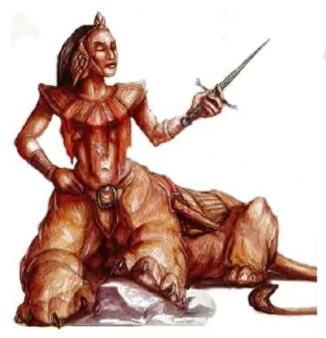

# Lâmia

Cidades desérticas arruinadas e tumbas de monarcas esquecidos são covis perfeitos para as pavorosas lâmias. Esses monstros decadentes apossam-se de locais que foram esquecidos e fazem desses a sede do seu governo hedonista, rodeando-se de sicofantas. As lâmias dependem dos homens-chacal para realizar diversas tarefas, enviando-os através dos desertos para capturar escravos ou roubar tesouros de caravanas, acampamentos ou vilas, ocultos pela magia da lâmia enquanto atacam.

A lâmia possui um belo corpo humanoide superior que se funde com uma poderosa forma leonina quadrupede. Suas garras negras devastadoras fala por sua natureza predatória, assim como por sua sede por tortura e carne humanoide.

***Tiranas do Prazer***. As lâmias adornam seus paraísos decrépitos com ornamentos roubados de caravanas passantes, depois usam magia para acentuar ainda mais seus covis, mascarando decadência com ilusão. Os deslumbrantes jardins do covil, apartamentos finamente decorados e inúmeros escravos parecem estar em desacordo com seu afastamento e estado de ruína.

Usando seu toque intoxicante, uma lâmia enfraquece a mente dos inimigos, tornando-os mais suscetíveis às suas magias de encantamento e tornando-os escravos. Aqueles seduzidos com a magia *missão* são colocados uns contra os outros em competições elaboradas para o divertimento da lâmia.

***Predadoras Vaidosas***. Sempre ansiosas por adquirir mais riqueza e escravos, uma lâmia usa uma poça de água ou um espelho em conjunto com a magia *vidência* para observar seus domínios. Uma lâmia usa esse poder para vigiar as rotas de comércio e os assentamentos próximos, ou para buscar objetos e criaturas de suas fantasias.

As lâmias são particularmente apaixonadas por buscar aventureiros de coração puro para seduzi-los e corrompe-los ao mal, saboreando a destruição da virtude deles. Elas usam suas magias para atrair vítimas em potencial para seus covis, contando com ilusão e com seus escravos para capturar oponentes desafortunados. As lâmias prezam pela beleza e força acima de tudo, no entanto. Qualquer prisioneiro que fique aquém de sua expectativa torna-se o prato principal de um banquete horrendo, ou é liberto para morrer enquanto vaga pelos desertos.

Enquanto tiverem escravos para enfrentar seus inimigos, as lâmias lutarão de longe, seduzindo os inimigos com magia, quando puderem. Uma lâmia obrigada a entrar em corpo-a-corpo não permanece por muito tempo, dilacerando a carne com suas garras e adaga antes de saltar para um local seguro.

***Lacaias de Graz’zt***. O lorde demônio Graz’zt criou as lâmias a partir dos seus servos mortais, garantindo a elas imortalidade em troca de poderes monstruosos e de um juramento de fidelidade. Graz’zt às vezes solicita que as lâmias guardem locais importantes para ele, mas as lâmias sob seu serviço permanecem livres para espalhar sua maldade como acharem adequado.

## Bloco de estatísticas: Lâmia

*Monstruosidade Grande, caótico e mau*

**Classe de Armadura** 13 (armadura natural)  
**Pontos de Vida** 97 (13d10 + 26)  
**Deslocamento** 9 m

| FOR | DES | CON | INT | SAB | CAR |
| :---: | :---: | :---: | :---: | :---: | :---: |
| 16 (+3) | 13 (+1) | 15 (+2) | 14 (+2) | 15 (+2) | 16 (+3) |

**Perícias** Enganação +7, Furtividade +3, Intuição +4  
**Sentidos** visão no escuro 18 m, Percepção passiva 12  
**Idiomas** Abissal, Comum  
**Nível de Desafio** 4 (1.100 XP)

***Conjuração Inata***. A habilidade de conjuração de uma lâmia é Carisma (CD de resistência de magia 13). Ela pode conjurar, inatamente, as seguintes magias, sem necessidade de componentes materiais:

À vontade: *disfarçar-se* (qualquer forma humanoide), *imagem* *maior* 3/dia cada: *enfeitiçar pessoa, imagem maior, sugestão, vidência* 1/dia: *missão*

### Ações

***Ataques Múltiplos***. A lâmia realiza dois ataques: um com suas garras e um com sua adaga ou toque intoxicante.

***Garras***. *Ataque Corpo-a-Corpo com Arma*: +5 para atingir, alcance 1,5 m, um alvo. *Acerto*: 14 (2d10 + 3) de dano cortante.

***Adaga***. *Ataque Corpo-a-Corpo com Arma*: +5 para atingir, alcance 1,5 m, um alvo. *Acerto*: 5 (1d4 + 3) de dano perfurante.

***Toque Intoxicante***. *Ataque Corpo-a-Corpo com Magia*: +5 para atingir, alcance 1,5 m, uma criatura. *Acerto*: O alvo é magicamente amaldiçoado por 1 hora. Até a maldição acabar, o alvo tem desvantagem em testes de resistência de Sabedoria e em todos os testes de habilidade.
