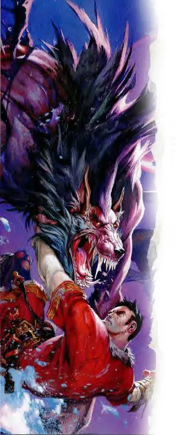
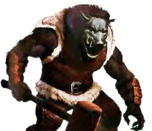
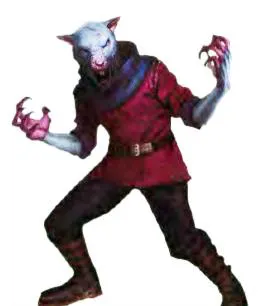
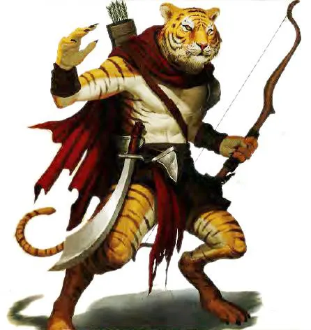
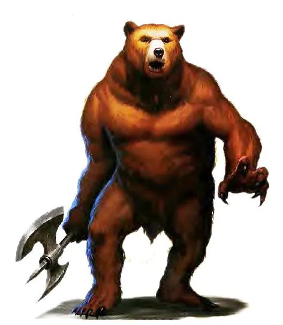
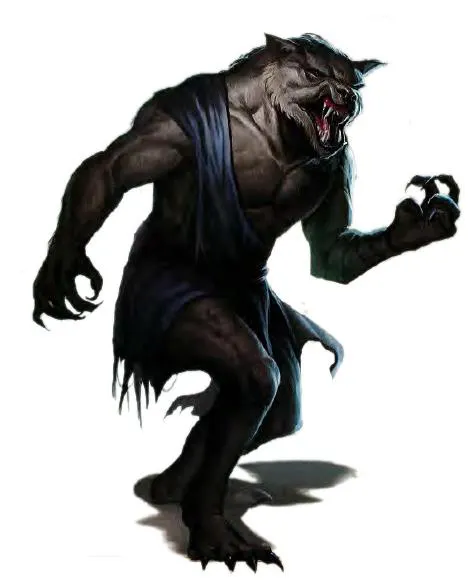

# Licantropos

Uma das mais antigas e temidas de todas as maldições, a licantropia pode transformar o humanoide mais civilizado em uma besta voraz. Em sua forma humanoide natural, uma criatura amaldiçoada com a licantropia parece ser seu eu normal. Com o tempo, no entanto, muitos licantropos adquirem traços sugestivos de sua forma animal. Na forma animal, um licantropos lembra uma poderosa versão de um animal normal. Ao ser examinado mais de perto, seus olhos mostram uma fagulha tênue de inteligência antinatural e pode brilhar vermelho no escuro.

Licantropos malignos escondem-se entre o povo comum, surgindo na forma animal durante a noite para espalhar terror e derramamento de sangue, especialmente durante a lua cheia. Licantropos benignos são reclusos e ficam desconfortáveis em volta de outras criaturas civilizadas, geralmente vivendo sozinhos em áreas selvagens bem longe de vilas e cidades.

***Maldição da Licantropia***. Uma criatura humanoides pode ser afetada com a maldição da licantropia após ser ferida por um licantropos, ou se um ou ambos os seus pais forem licantropos. A magia *remover* *maldição* pode livrar um licantropos afetado pela maldição, mas um licantropos de nascimento pode ser liberto da maldição apenas através da magia *desejo*.

Um licantropos pode tanto resistir a maldição quanto abraça-la. Ao resistir a maldição, um licantropos mantem sua tendência normal e personalidade enquanto estiver em sua forma humanoide. Ele vive sua vida como sempre viveu, enterrando fundo os impulsos bestiais que enfurecem dentro dele. Porém, quando a lua cheia aparece, a maldição torna-se forte demais para se resistir, transformando o indivíduo em sua forma de besta – ou numa forma híbrida horrenda que combina traços animais e humanoides. Quando a lua desce, a besta interior pode ser controlada mais uma vez. Especialmente se a criatura amaldiçoada não estiver ciente de sua condição, ela pode não se lembrar dos eventos de sua transformação, apesar dessas memórias, muitas vezes, assombrarem um licantropos como sonhos sangrentos.

Alguns indivíduos veem pouco motivo para lutar contra a maldição e aceitam o que são. Com o tempo e experiência, eles aprendem a dominar suas habilidades de metamorfose e podem assumir as formas de besta e formas híbridas à vontade. A maioria dos licantropos que abraçam suas naturezas bestiais sucumbem a sede de sangue, tornando-se criaturas malignas oportunistas que caçam os mais fracos.

### Homem-Javali

Os homens-javali são mal-humorados, brutos e vulgares. Como humanoides, eles atarracados e musculosos, com cabelos curtos e espetados. Em suas formas humanoides ou híbridas, eles usam armas pesadas, enquanto que em sua forma híbrida ou animal, eles ganham um ataque devastador com suas presas por onde sua maldição é transmitida. Um homem-javali infecta outras criaturas indiscriminadamente, apreciando o fato de que, quanto mais suas vítimas resistirem a maldição, mais selvagens e bestiais elas se tornarão. Os homens-javali vivem em pequenos grupos familiares em áreas florestais remotas, construindo cabanas mal acabadas ou vivendo em cavernas. Eles desconfiam de estranhos, mas as vezes se aliam com orcs.

> **Variação: Licantropos Não-Humanos**
>
> As estatísticas presentes nessa seção assumem um humano como criatura base. Porém, você também pode usar as estatísticas para representar licantropos não-humanos, adicionando verossimilhança ao permitir que licantropos não-humanos mantenham um ou mais de seus traços raciais humanoides. Por exemplo, um elfo lobisomem deveria ter o traço Ancestralidade Feérica.

### Homem-Rato

Os homens-rato são licantropos astutos com personalidades manhosas e avarentas. Eles são magros e cheios de tiques na forma humanoide, com cabelos finos e olhos penetrantes. Em suas formas humanoides e híbridas, os homens-rato preferem armas leves e usam táticas de emboscada ao invés de combaterem em bando. Apesar de um homem-rato poder desferir uma mordida desagradável em sua forma de rato, eles preferem essa forma para se infiltrarem furtivamente e escaparem ao invés de para o combate.

Um clã de homens-rato opera similarmente a uma guilda de ladrões, com homens-rato transmitindo suas maldições apenas para criaturas que eles queiram introduzir no clã. Os homens-rato que são amaldiçoados por acidente ou que saem do controle do clã, são rapidamente caçados e mortos.

Os clãs de homens-rato são encontrados em civilizações urbanas, geralmente residindo em porões e catacumbas. Essas criaturas são comuns em esgotos abaixo de cidades maiores, vendo essas áreas subterrâneas como territórios de caça. Ratos e ratos gigantes são encontrados com frequência vivendo entre os homens-ratos.

### Homem-Tigre

Os homens-tigre são caçadores e guerreiros ferozes com uma natureza arrogante e exigente. Esbeltos, elegantes e musculosos na forma humanoides, eles são mais altos que a média e são bem cuidados. Os homens-tigre alcançam tamanhos enormes em sua forma animal e híbrida, mas eles lutam em suas formas humanoides mais refinadas quando podem. Eles não gostam de transmitir suas maldições, já que cada novo homem-tigre significa competição por território e presas.

Os homens-tigre vivem em selvas nos limites da civilização humanoide, viajando para assentamentos isolados para comercializar ou se divertir. Eles vivem e caçam sozinhos ou em pequenos grupos familiares.

### Homem-Urso

Homens-urso são poderosos licantropos com a habilidade de acalmar suas naturezas monstruosas e rejeitar seus impulsos violentos. Na forma humanoide, eles são grandes, musculosos e cobertos por pelos que combinam com a pelagem de suas formas ursinas. Um homem-urso é solitário por natureza, temendo o que pode vir a acontecer com as criaturas inocentes a sua volta quando sua natureza bestial tomar conta.

Quando um homem-urso se transforma, ele cresce a um tamanho enorme, atacando com armas ou garras. Ele luta com a ferocidade de um urso, apesar de que mesmo em suas formas bestiais, eles evitam morder para não transmitir suas maldições. Tipicamente, um homem-urso passa a licantropia apenas para companheiros ou aprendizes escolhidos, passando o tempo que segue ajudando o novo licantropos a aceitar a maldição para que possa controla-la.

Criaturas solitárias, os homens-urso agem como andarilhos em seus territórios, protegendo a flora e a fauna tanto contra intrusos humanoides quanto monstruosos. Apesar da maioria dos homens-ursos terem tendência boa, alguns são tão malignos quanto outros licantropos.

### Lobisomem

Um lobisomem é um predador selvagem. Em sua forma humanoide, um lobisomem possui sentidos aguçados, temperamento explosivo e uma tendência a comer carne mal passada. Sua forma de lobo é um predador assustador, mas sua forma híbrida é ainda mais aterrorizante – um corpo humanoide peludo e musculoso com uma cabeça de lobo raivoso. Um lobisomem pode empunhar armas em sua forma híbrida, apesar dele preferir partir seus inimigos ao meio com suas poderosas garras e mordida.

A maioria dos lobisomens fogem das terras civilizadas não muito depois de serem afetados. Aqueles que rejeitam a maldição temem pelo que pode acontecer se permanecerem entre seus amigos e familiares. Aqueles que abraçam a maldição temem descobrir e as consequências dos seus atos assassinos. Na natureza selvagem, os lobisomens formam matilhas que também incluem lobos e lobos atrozes.

> **Personagens de Jogadores Como Licantropos**
>
> Um personagem que se torne um licantropos mantem suas estatísticas, exceto como especificado no tipo licantropos. O personagem ganha os deslocamentos do licantropos em formas não-humanoides, imunidades a dano, traços e ações que não envolvam equipamentos. O personagem é proficiente com os ataques naturais do licantropos, como com sua mordida e garras, que causam dano como mostrado nas estatísticas do licantropos. O personagem não pode falar enquanto estiver na forma animal. Um humanoide atingido por um ataque que carregue a maldição da licantropia deve ser bem sucedido num teste de resistência de Constituição (CD 8 + o bônus de proficiência do licantropos + o modificador de Constituição do licantropos) ou será amaldiçoado. Se o personagem abraçar a maldição, a tendência dele torna-se a definida para o licantropos. O Mestre é livre para decidir se uma mudança de tendência pode colocar o personagem sob controle do Mestre até que a maldição da licantropia seja removida. As seguintes informações aplicam-se aos licantropos específicos.
>
> ***Homem-Javali***. O personagem adquire Força 17 se seu valor já não for maior, e +1 de bônus na CA enquanto estiver na forma de javali ou híbrida (de armadura natural). As jogadas de ataque e dano das presas são baseadas em Força. Para o traço Investida, a CD é 8 + o bônus de proficiência do personagem + seu modificador de Força.
>
> ***Homem-Rato***. O personagem adquire Destreza 15 se o seu valor já não for maior. Jogadas de ataque e dano da mordida são baseadas no que for maior para o personagem entre Força e Destreza.
>
> ***Homem-Tigre***. O personagem adquire Força 17 se seu valor já não for maior. Jogadas de ataque e dano para as armas naturais são baseadas em Força. Para o traço Bote, a CD é 8 + o bônus de proficiência do personagem + seu modificador de Força.
>
> ***Homem-Urso***. O personagem adquire Força 19 se seu valor já não for maior, e +1 de bônus na CA enquanto estiver na forma de urso ou híbrida (de armadura natural). Jogadas de ataque e dano para as armas naturais são baseadas em Força.
>
> ***Lobisomem***. O personagem adquire Força 15 se seu valor já não for maior, e +1 de bônus na CA enquanto estiver na forma de lobo ou híbrida (de armadura natural). Jogadas de ataque e dano para as armas naturais são baseadas em Força.

## Bloco de estatísticas: Homem-Javali

*Humanoide Médio (humano, metamorfo), neutro e mau*

**Classe de Armadura** 10 em forma humanoide, 11 (armadura natural) em forma de javali ou híbrida  
**Pontos de Vida** 78 (12d8 + 24)  
**Deslocamento** 9 m (12 m em forma de javali)

| FOR | DES | CON | INT | SAB | CAR |
| :---: | :---: | :---: | :---: | :---: | :---: |
| 17 (+3) | 10 (+0) | 15 (+2) | 10 (+0) | 11 (+0) | 8 (–1) |

**Perícias** Percepção +2  
**Imunidade a Dano** concussão, cortante e perfurante de ataques não-mágicos que não sejam de prata  
**Sentidos** Percepção passiva 12  
**Idiomas** Comum (não consegue falar em forma de javali)  
**Nível de Desafio** 4 (1.100 XP)

***Implacável (Recarrega após um Descanso Curto ou Longo)***. Se o homem-javali sofrer 14 de dano ou menos, que poderia reduzi-lo a 0 pontos de vida, ele é reduzido a 1 ponto de vida, ao invés.

***Investida (Formas de Javali ou Híbrida Apenas)***. Se o homem-javali se mover, pelo menos, 4,5 metros em linha reta até um alvo e então atingi-lo com suas presas no mesmo turno, o alvo sofre 7 (2d6) de dano cortante extra. Se o alvo for uma criatura, ele deve ser bem sucedido num teste de resistência de Força CD 13 ou será derrubado no chão.

***Metamorfo***. O homem-javali pode usar sua ação para se metamorfosear em um híbrido humanoide-javali ou em um javali, ou de volta a sua forma verdadeira, que é humanoide. Suas estatísticas, diferentes da sua CA, são as mesmas em cada forma. Qualquer equipamento que esteja vestindo ou carregando não é transformado. Ele reverte a sua forma verdadeira se morrer.

### Ações

***Ataques Múltiplos (Formas Humanoide ou Híbrida Apenas)***. O homem-javali realiza dois ataques, apenas um deles pode ser com suas presas.

***Malho (Formas Humanoide ou Híbrida Apenas)***. *Ataque Corpo-a-* *Corpo com Arma*: +5 para atingir, alcance 1,5 m, um alvo. *Acerto*: 10 (2d6 + 3) de dano de concussão.

***Presas (Formas de Javali ou Híbrida Apenas)***. *Ataque Corpo-a-* *Corpo com Arma*: +5 para atingir, alcance 1,5 m, um alvo. *Acerto*: 10 (2d6 + 3) de dano cortante. Se o alvo for um humanoide, ele deve ser bem sucedido num teste de resistência de Constituição CD 12 ou será amaldiçoado com a licantropia do homem-javali.

## Bloco de estatísticas: Homem-Rato

*Humanoide Médio (humano, metamorfo), leal e mau*

**Classe de Armadura** 12  
**Pontos de Vida** 33 (6d8 + 6)  
**Deslocamento** 9 m

| FOR | DES | CON | INT | SAB | CAR |
| :---: | :---: | :---: | :---: | :---: | :---: |
| 10 (+0) | 15 (+2) | 12 (+1) | 11 (+0) | 10 (+0) | 8 (–1) |

**Perícias** Furtividade +4, Percepção +2  
**Imunidade a Dano** concussão, cortante e perfurante de ataques não-mágicos que não sejam de prata  
**Sentidos** visão no escuro 18 m (forma de rato apenas), Percepção passiva 12  
**Idiomas** Comum (não consegue falar em forma de rato)  
**Nível de Desafio** 2 (450 XP)

***Faro Aguçado***. O homem-rato tem vantagem em testes de Sabedoria (Percepção) relacionados ao olfato.

***Metamorfo***. O homem-rato pode usar sua ação para se metamorfosear em um híbrido humanoide-rato ou em um rato gigante, ou de volta a sua forma verdadeira, que é humanoide. Suas estatísticas, diferentes do seu tamanho, são as mesmas em cada forma. Qualquer equipamento que esteja vestindo ou carregando não é transformado. Ele reverte a sua forma verdadeira se morrer.

### Ações

***Ataques Múltiplos (Formas Humanoide ou Híbrida Apenas)***. O homem-rato realiza dois ataques, apenas um deles pode ser com sua mordida.

***Mordida (Formas de Rato ou Híbrida Apenas)***. *Ataque Corpo-a-* *Corpo com Arma*: +4 para atingir, alcance 1,5 m, um alvo. *Acerto*: 4 (1d4 + 2) de dano perfurante. Se o alvo for um humanoide, ele deve ser bem sucedido num teste de resistência de Constituição CD 11 ou será amaldiçoado com a licantropia do homem-rato.

***Espada Curta (Formas Humanoide ou Híbrida Apenas)***. *Ataque* *Corpo-a-Corpo com Arma*: +4 para atingir, alcance 1,5 m, um alvo. *Acerto*: 5 (1d6 + 2) de dano perfurante.

***Besta de Mão (Formas Humanoide ou Híbrida Apenas)***. *Ataque à* *Distância com Arma*: +4 para atingir, distância 9/36 m, um alvo. *Acerto*: 5 (1d6 + 2) de dano perfurante.

## Bloco de estatísticas: Homem-Tigre

*Humanoide Médio (humano, metamorfo), neutro*

**Classe de Armadura** 12  
**Pontos de Vida** 120 (16d8 + 48)  
**Deslocamento** 9 m (12 m em forma de tigre)

| FOR | DES | CON | INT | SAB | CAR |
| :---: | :---: | :---: | :---: | :---: | :---: |
| 17 (+3) | 15 (+2) | 16 (+3) | 10 (+0) | 13 (+1) | 11 (+0) |

**Perícias** Furtividade +4, Percepção +5  
**Imunidade a Dano** concussão, cortante e perfurante de ataques não-mágicos que não sejam de prata  
**Sentidos** visão no escuro 18 m (forma de tigre apenas), Percepção passiva 15  
**Idiomas** Comum (não consegue falar em forma de tigre)  
**Nível de Desafio** 4 (1.100 XP)

***Bote (Forma de Tigre ou Híbrida Apenas).*** Se o homem-tigre se mover, pelo menos, 4,5 metros em linha reta em direção de um alvo logo antes de atingi-lo com seu ataque de garra, o alvo deve ser bem sucedido num teste de resistência de Força CD 14 para não cair no chão. Se o alvo cair no chão, o homem-tigre poderá realizar uma um ataque de mordida contra ele usando uma ação bônus.

***Faro e Audição Aguçados***. O homem-tigre tem vantagem em testes de Sabedoria (Percepção) relacionados ao olfato e à audição.

***Metamorfo***. O homem-tigre pode usar sua ação para se metamorfosear em um híbrido humanoide-tigre ou em um tigre, ou de volta a sua forma verdadeira, que é humanoide. Suas estatísticas, diferentes do seu tamanho, são as mesmas em cada forma. Qualquer equipamento que esteja vestindo ou carregando não é transformado. Ele reverte a sua forma verdadeira se morrer.

### Ações

***Ataques Múltiplos (Formas Humanoide ou Híbrida Apenas)***. Na forma humanoide, o homem-tigre realiza dois ataques com cimitarra ou dois ataques com arco longo. Na forma híbrida, ele pode atacar como um humanoide ou realizar dois ataques de garra.

***Mordida (Formas de Tigre ou Híbrida Apenas)***. *Ataque Corpo-a-* *Corpo com Arma*: +5 para atingir, alcance 1,5 m, um alvo. *Acerto*: 8 (1d10 + 3) de dano perfurante. Se o alvo for um humanoide, ele deve ser bem sucedido num teste de resistência de Constituição CD 13 ou será amaldiçoado com a licantropia do homem-tigre.

***Garra (Formas de Tigre ou Híbrida Apenas)***. *Ataque Corpo-a-* *Corpo com Arma*: +5 para atingir, alcance 1,5 m, um alvo. *Acerto*: 7 (1d8 + 3) de dano cortante.

***Cimitarra (Formas Humanoide ou Híbrida Apenas)***. *Ataque* *Corpo-a-Corpo com Arma*: +5 para atingir, alcance 1,5 m, um alvo. *Acerto*: 6 (1d6 + 3) de dano cortante.

***Arco Longo (Formas Humanoide ou Híbrida Apenas)***. *Ataque à* *Distância com Arma*: +4 para atingir, distância 45/180 m, um alvo. *Acerto*: 6 (1d8 + 2) de dano perfurante.

## Bloco de estatísticas: Homem-Urso

*Humanoide Médio (humano, metamorfo), neutro e bom*

**Classe de Armadura** 10 em forma humanoide, 11 (armadura natural) em forma de urso ou híbrida  
**Pontos de Vida** 135 (18d8 + 54)  
**Deslocamento** 9 m (12 m, escalada 9 m, em forma de urso ou híbrida)

| FOR | DES | CON | INT | SAB | CAR |
| :---: | :---: | :---: | :---: | :---: | :---: |
| 19 (+4) | 10 (+0) | 17 (+3) | 11 (+0) | 12 (+1) | 12 (+1) |

**Perícias** Percepção +7  
**Imunidade a Dano** concussão, cortante e perfurante de ataques não-mágicos que não sejam de prata  
**Sentidos** Percepção passiva 17  
**Idiomas** Comum (não consegue falar em forma de urso)  
**Nível de Desafio** 5 (1.800 XP)

***Faro Aguçado***. O homem-urso tem vantagem em testes de Sabedoria (Percepção) relacionados ao olfato.

***Metamorfo***. O homem-urso pode usar sua ação para se metamorfosear em um híbrido humanoide-urso Grande ou em um urso Grande, ou de volta a sua forma verdadeira, que é humanoide.

Suas estatísticas, diferentes do seu tamanho e CA, são as mesmas em cada forma. Qualquer equipamento que esteja vestindo ou carregando não é transformado. Ele reverte a sua forma verdadeira se morrer.

### Ações

***Ataques Múltiplos***. Na forma de urso, o homem-urso realiza dois ataques de garra. Na forma humanoide, ele realiza dois ataques com machado grande. Na forma híbrida, ele pode atacar como um urso ou como um humanoide.

***Mordida (Formas de Urso ou Híbrida Apenas)***. *Ataque Corpo-a-* *Corpo com Arma*: +7 para atingir, alcance 1,5 m, um alvo. *Acerto*: 15 (2d10 + 4) de dano perfurante. Se o alvo for um humanoide, ele deve ser bem sucedido num teste de resistência de Constituição CD 14 ou será amaldiçoado com a licantropia do homem-urso.

***Garra (Formas de Urso ou Híbrida Apenas)***. *Ataque Corpo-a-* *Corpo com Arma*: +7 para atingir, alcance 1,5 m, um alvo. *Acerto*: 13 (2d8 + 4) de dano cortante.

***Machado Grande (Formas Humanoide ou Híbrida Apenas)***. *Ataque Corpo-a-Corpo com Arma*: +7 para atingir, alcance 1,5 m, um alvo. *Acerto*: 10 (1d12 + 4) de dano cortante.

## Bloco de estatísticas: Lobisomem

*Humanoide Médio (humano, metamorfo), caótico e mau*

**Classe de Armadura** 11 em forma humanoide, 12 (armadura natural) em forma de lobo ou híbrida  
**Pontos de Vida** 58 (9d8 + 18)  
**Deslocamento** 9 m (12 m, em forma de lobo)

| FOR | DES | CON | INT | SAB | CAR |
| :---: | :---: | :---: | :---: | :---: | :---: |
| 15 (+2) | 13 (+1) | 14 (+2) | 10 (+0) | 11 (+0) | 10 (+0) |

**Perícias** Furtividade +3, Percepção +4  
**Imunidade a Dano** concussão, cortante e perfurante de ataques não-mágicos que não sejam de prata  
**Sentidos** Percepção passiva 14  
**Idiomas** Comum (não consegue falar em forma de lobo)  
**Nível de Desafio** 3 (700 XP)

***Faro e Audição Aguçados***. O lobisomem tem vantagem em testes de Sabedoria (Percepção) relacionados ao olfato e à audição.

***Metamorfo***. O lobisomem pode usar sua ação para se metamorfosear em um híbrido humanoide-lobo ou em um lobo, ou de volta a sua forma verdadeira, que é humanoide. Suas estatísticas, diferentes da sua CA, são as mesmas em cada forma. Qualquer equipamento que esteja vestindo ou carregando não é transformado. Ele reverte a sua forma verdadeira se morrer.

### Ações

***Ataques Múltiplos (Formas Humanoide ou Híbrida Apenas)***. O lobisomem realiza dois ataques: um com sua mordida e um com suas garras ou lança.

***Mordida (Formas de Lobo ou Híbrida Apenas)***. *Ataque Corpo-a-* *Corpo com Arma*: +4 para atingir, alcance 1,5 m, um alvo. *Acerto*: 6 (1d8 + 2) de dano perfurante. Se o alvo for um humanoide, ele deve ser bem sucedido num teste de resistência de Constituição CD 12 ou será amaldiçoado com a licantropia do lobisomem.

***Garra (Forma Híbrida Apenas)***. *Ataque Corpo-a-Corpo com* *Arma*: +4 para atingir, alcance 1,5 m, um alvo. *Acerto*: 7 (2d4 + 2) de dano cortante.

***Lança (Forma Humanoide Apenas)***. *Ataque Corpo-a-Corpo ou à* *Distância com Arma*: +4 para atingir, alcance 1,5 m ou distância 6/18 m, uma criatura. *Acerto*: 5 (1d6 + 2) de dano perfurante, ou 6 (1d8 + 2) de dano perfurante se usada com as duas mãos para realizar ataques corpo-a-corpo.
