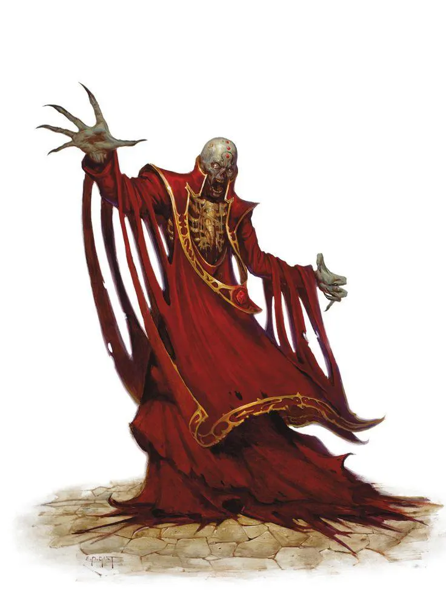

# Lich

## Bloco de estatísticas: Lich

*Morto-vivo Médio, qualquer tendência maligna*

**Classe de Armadura** 17 (armadura natural)  
**Pontos de Vida** 135 (18d8 + 54)  
**Deslocamento** 9 m

| FOR | DES | CON | INT | SAB | CAR |
| :---: | :---: | :---: | :---: | :---: | :---: |
| 11 (+0) | 16 (+3) | 16 (+3) | 20 (+5) | 14 (+2) | 16 (+3) |

**Testes de Resistência** Con +10, Int +12, Sab +9  
**Perícias** Arcanismo +18, História +12, Intuição +9, Percepção +9  
**Resistência a Dano** frio, elétrico, necrótico  
**Imunidade a Dano** veneno; concussão, cortante e perfurante de ataques não-mágicos  
**Imunidade a Condição** amedrontado, enfeitiçado, envenenado, exausto, paralisado  
**Sentidos** visão verdadeira 36 m, Percepção passiva 19  
**Idiomas** Comum e até mais cinco outros idiomas  
**Nível de Desafio** 21 (33.000 XP)

***Conjuração***. O lich é um conjurador de 18° nível. Sua habilidade de conjuração é Inteligência (CD de resistência de magia 20, +12 para atingir com ataques com magia). Ele possui as seguintes magias de mago preparadas:

Truques (à vontade): *mãos mágicas, prestidigitação, raio de gelo* 1° nível (4 espaços): *detectar magia, escudo arcano, mísseis* *mágicos, onda trovejante* 2° nível (3 espaços): *detectar pensamentos, flecha ácida de Melf,* *invisibilidade, reflexos* 3° nível (3 espaços): *animar mortos, bola de fogo, contramágica,* *dissipar magia* 4° nível (3 espaços): *malogro, porta dimensional* 5° nível (3 espaços): *névoa mortal, vidência* 6° nível (1 espaços): *desintegrar, globo de invulnerabilidade* 7° nível (1 espaços): *dedo da morte, viagem planar* 8° nível (1 espaços): *dominar monstro, palavra de poder atordoar* 9° nível (1 espaços): *palavra de poder matar*

***Rejuvenescimento.*** Se tiver uma filactéria, um lich destruído adquire um novo corpo em 1d10 dias, recuperando todos os seus pontos de vida e se tornando ativo novamente. O novo corpo aparece a 1,5 metro da filactéria.

***Resistência à Expulsão***. O lich tem vantagem em testes de resistência contra qualquer efeito de expulsar mortos-vivos.

***Resistência Lendária (3/Dia)***. Se o lich falhar em um teste de resistência, ele pode escolher obter sucesso, no lugar.

### Ações

***Toque Paralisante***. *Ataque Corpo-a-Corpo com Magia*: +12 para atingir, alcance 1,5 m, uma criatura. *Acerto*: 10 (3d6) de dano de frio. O alvo deve ser bem sucedido num teste de resistência de Constituição CD 18 ou ficará paralisado por 1 minuto. O alvo pode repetir o teste de resistência no final de cada um dos turnos dele, terminando o efeito sobre si com um sucesso.

### Ações Lendárias

O lich pode realizar 3 ações lendárias, escolhidas dentre as opções abaixo. Apenas uma ação lendária pode ser usada por vez e apenas no final do turno de outra criatura. O lich recupera as ações lendárias gastas no começo do turno dele.

**Truque**. O lich conjura um truque.  
**Toque Paralisante (Custa 2 Ações).** O lich usa seu Toque Paralisante.  
**Olhar Aterrorizante (Custa 2 Ações).** O lich fita seu olhar em uma criatura que ele possa ver, a até 3 metros dele. O alvo deve ser bem sucedido num teste de resistência de Sabedoria CD 18 contra essa magia ou ficará amedrontado por 1 minuto. A criatura amedrontada pode repetir o teste de resistência no final de cada um dos turnos dela, terminando o efeito sobre si com um sucesso. Se o teste de resistência de um alvo for bem sucedido ou se o efeito terminar nele, esse alvo fica imune ao olhar do lich pelas próximas 24 horas.  
**Romper Vida (Custa 3 Ações).** Cada criatura viva a até 6 metros do lich, deve realizar um teste de resistência de Constituição CD 18 contra essa magia, sofrendo 21 (6d6) de dano necrótico se fracassarem, ou metade desse dano caso obtenham sucesso.

## Lich

Os liches são os restos de grandes magos que abraçaram a morte-vida como meio de se preservarem. Eles aprofundam seu próprio poder a qualquer custo, não tendo nenhum interesse nos assuntos dos vivos, exceto onde esses assuntos interferem nos seus próprios. Conspiradores e insanos, eles anseiam por conhecimento há muito esquecido e pelos mais terríveis segredos. Já que a sombra da morte não paira sobre eles, os liches podem conceber planos que levam anos, décadas ou séculos para darem frutos.

Um lich é um humanoide magro e esquelético com carne murcha esticada sobre seus ossos. Seus olhos sucumbiram à deterioração há muito tempo, mas pontos de luz queimam em suas órbitas vazias. Ele geralmente se veste com restos de roupas finas bem ajustadas e joias usadas e embotadas pelo passar do tempo.

***Segredos da Morte-Vida***. Nenhum mago toma o caminho do lich por capricho, e o processo de se tornar um lich é um segredo bem guardado. Os magos que buscam se tornar liches devem fazer barganhas com corruptores, deuses malignos ou outras entidades torpes. Muitos buscam Orcus, o Príncipe Demônio dos Mortos-Vivos, cujo poder já criou incontáveis liches. Porém, aqueles que controlam o poder de se tornar um lich sempre exigem lealdade e servidão por seus conhecimentos.

Um lich é criado através de um ritual arcano que aprisiona a alma do mago dentro de uma filactéria. Fazer isso vincula a alma ao mundo mortal, impedindo-a de viajar para os Planos Exteriores após a morte. Uma filactéria é tradicionalmente um amuleto no formado de uma pequena caixa, mas ela pode ter a forma de qualquer item que possua um espaço interior no qual símbolos arcanos de nomeação, vinculação, imortalidade e magia negra são inscritos com prata.

Com sua filactéria preparada, o futuro lich bebe uma poção de transformação – uma infusão vil de veneno misturado com sangue de uma criatura racional cuja alma é sacrificada para a filactéria. O mago cai morto, depois se ergue como um lich enquanto sua alma entra na filactéria, onde ela permanece para sempre.

***Sacrifícios de Almas***. Um lich deve, periodicamente, alimentar sua filactéria com almas para sustentar a magia que preserva seu corpo e consciência. Ele o faz usando a magia *aprisionamento*. Ao invés de escolher uma das opções normais da magia, o lich usa a magia para prender magicamente o corpo e a alma do alvo dentro da sua filactéria. A filactéria deve estar no mesmo plano que o lich para que a magia funcione. A filactéria do lich pode conter apenas uma criatura por vez, e uma magia dissipar magia conjurada como uma magia de 9° nível sobre a filactéria liberta qualquer criatura aprisionada dentro dela. Uma criatura aprisionada na filactéria por 24 horas é consumida e destruída completamente, depois disso, nada inferior a uma intervenção divina pode trazê-la de volta à vida.

Um lich que fracasse ou esqueça de manter seu corpo com sacrifícios de almas, começa a se debilitar fisicamente e pode, eventualmente, se tornar um demilich.

***Morte e Restauração***. Quando o corpo de um lich é destruído por acidente ou por luta, a vontade e mente do lich são drenadas dele, deixando apenas um corpo sem vida para trás. Dentro de dias, um novo corpo se reforma próximo da filactéria do lich, coalescendo através de fumaça brilhante emitida do aparato. Já que a destruição de sua filactéria significa a possibilidade da morte eterna, um lich geralmente mantem sua filactéria em um local escondido e bem guardado.

Destruir a filactéria de um lich não é uma tarefa fácil e geralmente requer um ritual, item ou arma especial. Cada filactéria é única, e descobrir a chave para a destruição dela pode ser uma busca por si só.

***Existência Solitária***. De tempos em tempos, um lich pode ficar cansado de sua busca obstinada por poder, para se interessar com o mundo a sua volta, na maioria das vezes, quando algum evento grande o lembra da vida que ele teve uma vez. Do contrário, ele vive em isolamento, lidando apenas com as criaturas cujos serviços ajudam a proteger seu covil.

Alguns poucos liches chamam-se por seus nomes antigos, ao invés de adotarem alcunhas como o Mão Negra ou o Rei Esquecido.

***Coletores de Mágica***. Os liches coletam magias e itens mágicos. Além de seu repertório de magias, um lich possui acesso a poções, pergaminhos, bibliotecas de grimórios, uma ou mais varinhas e talvez um ou dois cajados. Ele não tem receio em usar esses tesouros sempre que seu covil estiver sob ataque.

***Natureza Morta-Viva***. Um lich não precisa respirar, comer, beber ou dormir.

### O Covil do Lich

Um lich geralmente assombra a residência que ele mais gostava em vida, como uma torre solitária, uma ruína assombrada ou uma academia de magia negra. Alternativamente, alguns liches constroem tumbas secretas cheias de guardiões poderosos e armadilhas.

Tudo no covil de um lich reflete sua mente tenaz e sua astúcia pavorosa, incluindo as armadilhas mágicas e mundanas que o protege. Mortos-vivos, constructos e demônios aprisionados espreitam em recessos sombrios, emergindo para destruir aqueles que ousarem perturbar o trabalho do lich.

Um lich enfrentado em seu covil tem um nível de desafio 22 (41.000 XP).

### Ações de Covil

No valor de iniciativa 20 (quebrando toda a sequência de iniciativa), o lich rola um d20. Em um resultado 11 ou superior, o lich realiza uma ação de covil fazendo um dos efeitos a seguir. Ele não pode usar o mesmo efeito em duas rodadas consecutivas:

- O lich rola um d8 e recupera um espaço de magia desse nível ou inferior. Se ele não possuir um espaço de magia desse nível ou inferior, nada acontece.
- O lich afeta uma criatura que ele possa ver, a até 9 metros dele. Um cordão crepitante de energia negativa acorrenta o lich ao alvo. Sempre que o lich sofrer dano, o alvo deve realizar um teste de resistência de Constituição CD 18. Se fracassar na resistência, o lich sofre metade do dano (arredondado para baixo), e o alvo sofre o dano restante. Essa corrente dura até a contagem de iniciativa 20 na próxima rodada ou até o lich ou o alvo não estar mais no covil do lich.
- O lich convoca os espíritos das criaturas que morreram no seu covil. Essas aparições se materializam e atacam uma criatura que o lich possa ver, a até 18 metros dele. O alvo deve ser bem sucedido num teste de resistência de Constituição CD 18, sofrendo 52 (15d6) de dano necrótico se falhar na resistência, ou metade desse dano caso obtenha sucesso. As aparições, então, desaparecem.
