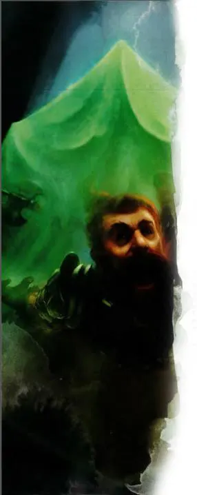
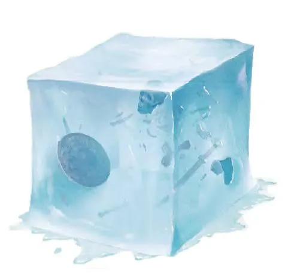
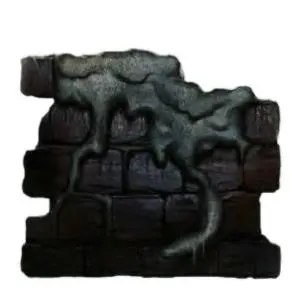
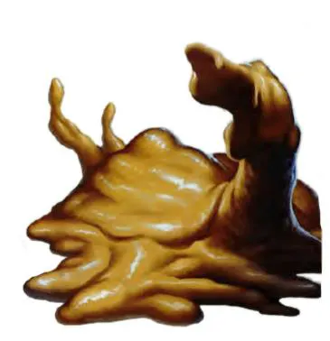
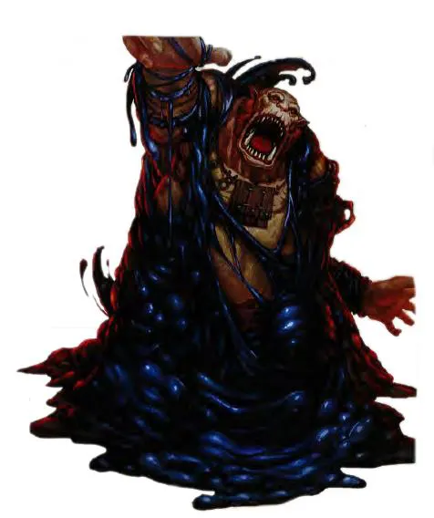

# Limos

Os limos se desenvolvem no escuro, evitando áreas de luz plena e temperaturas extremas. Eles fluem através do subterrâneo úmido, alimentando-se de qualquer criatura ou objeto que possam dissolver, esgueirando-se pelo chão, escorrendo de paredes e tetos, espalhando-se pelas bordas de poças subterrâneas e espremendo-se através de rachaduras. O primeiro indício que um aventureiro recebe da presença de um limo, geralmente é a dor excruciante do seu toque ácido.

Os limos são atraídos por movimento e calor. Matéria orgânica nutre-os, e quando as presas são escassas, eles se alimentam de sujeiras, fungos e vísceras. Exploradores veteranos sabem que uma passagem imaculadamente limpa é um provável sinal que um limo habita as redondezas.

***Morte Lenta***. Um limo mata suas presas devagar. Algumas variedades, como os pudins negros e cubos gelatinosos, engolfam as criaturas para impedi-las de escapar. O único ponto positivo dessa morte torturante é que os companheiros da vítima podem vir para resgata-la antes que seja tarde.

Já que nem todo limo digere todo tipo de substância, alguns terão moedas, equipamentos de metal, ossos e outros entulhos suspensos dentro de seus corpos trêmulos. Um limo derrotado pode ser uma fonte rica de tesouros para seus algozes.

***Servos Involuntários***. Apesar de um limo não possuir inteligência para se aliar com outras criaturas, aqueles que compreenderem a necessidade de alimento de um limo podem atrai-los para um local onde ele possa ser usado por eles. Monstros espertos mantem limos por perto para defender passagens ou consumir restos. Da mesma forma, um limo pode ser atraído para uma armadilha de fosso, onde seus captores o alimentam regularmente para prevenir que ele venha atrás deles. Criaturas engenhosas colocam tochas e braseiros flamejantes em áreas estratégicas para dissuadir um limo a sair de um túnel ou recinto em particular.

***Crias de Juiblex***. De acordo com o *Demonomicon de* *Iggwilv* e outras fontes, os limos são fragmentos dispersos ou descendentes do lorde demônio Juiblex. Se isso é verdade ou não, o Lorde Sem Face é um dos poucos seres que pode controlar os limos e imbuir neles um pouco de inteligência. A maior parte do tempo, os limos não tem qualquer senso tático ou de autopreservação. Eles são diretos e previsíveis, atacando e comendo sem astúcia. Sob o controle de Juiblex, eles exibem vislumbres de raciocínio e de intenções malignas.

***Natureza de Limo***. Um limo não precisa dormir.

> **Variação: Limo Cinzento Psíquico**
>
> Um limo cinzento que viva por muito tempo, pode evoluir para se tornar mais inteligente e desenvolver uma habilidade psiônica limitada. Tais ocorrências são mais comuns nos limos cinzentos que vivem próximos de criaturas psiônicas, como os devoradores de mentes, sugerindo que o limo possa sentir e imitar habilidades psiônicas. Um limo cinzento psiônico possui valor de Inteligência 6 (–2), assim como a seguinte ação adicional.
>
> ***Esmagamento Psíquico (Recarrega 5–6)***. O limo afeta uma criatura que ele possa sentir a até 18 metros dele. O alvo deve realizar um teste de resistência de Inteligência CD 10, sofrendo 10 (3d6) de dano psíquico se fracassar na resistência, ou metade desse dano caso obtenha sucesso.

### Cubo Gelatinoso

Os cubos gelatinosos vasculham as passagens das masmorras em silêncio, com padrões previsíveis, deixando caminhos perfeitamente limpos em seu rastro. Eles consomem tecido vivo enquanto deixam os ossos e outros materiais não dissolvidos.

Um cubo gelatinoso é praticamente transparente, deixando-o difícil de se observar até que ele ataque. Um cubo que esteja bem alimentado pode ser facilmente observado, já que os ossos, moedas e outros objetos de suas vítimas podem ser vistos suspensos dentro da criatura.

### Gosma Ocre

As gosmas ocre são bolas amareladas que podem deslizar por debaixo de portas e através de rachaduras estreitas para perseguir criaturas e devora-las. Eles tem esperteza bestial suficiente para evitar grupos grandes de inimigos.

Uma gosma ocre segue a uma distância segura enquanto persegue seu jantar. Ela digere enzimas e dissolve carne rapidamente, mas não produz efeito em substâncias como ossos, madeira e metal.

### Limo Cinzento

Um limo cinzento é a rocha que se tornou líquida pelo caos. Quando se move, ele desliza como uma serpente líquida, erguendo-se para atacar.

### Pudim Negro

Um pudim negro lembra uma massa pesada de lodo negro pegajoso. Em passagens mal iluminadas, o pudim parece ser nada além de uma mancha de sombra.

Carne, madeira, metal e ossos se dissolvem quando o pudim reflui sobre eles. A pedra permanece para trás, intacta.

## Bloco de estatísticas: Cubo Gelatinoso

*Limo Grande, imparcial*

**Classe de Armadura** 6  
**Pontos de Vida** 84 (8d10 + 40)  
**Deslocamento** 4,5 m

| FOR | DES | CON | INT | SAB | CAR |
| :---: | :---: | :---: | :---: | :---: | :---: |
| 14 (+2) | 3 (–4) | 20 (+5) | 1 (–5) | 6 (–2) | 1 (–5) |

**Imunidade a Condição** amedrontado, caído, cego, enfeitiçado, exausto, surdo  
**Sentidos** percepção às cegas 18 m (cego além desse raio), Percepção passiva 8  
**Idiomas** –  
**Nível de Desafio** 2 (450 XP)

***Cubo de Gosma***. O cubo ocupa seu espaço total. Outras criaturas podem entrar no espaço, mas uma criatura que o fizer, é alvo do Engolfar do cubo e tem desvantagem no teste de resistência. As criaturas dentro do cubo podem ver mas tem cobertura total. Uma criatura a 1,5 metro do cubo pode realizar uma ação para puxar uma criatura ou objeto para fora do cubo. Fazer isso requer um teste de Força CD 12, bem sucedido, e a criatura que realizar a tentativa sofre 10 (3d6) de dano de ácido. O cubo pode conter apenas uma criatura Grande ou até quatro criaturas Médias ou menores dentro de si, por vez.

***Transparente***. Mesmo quando o cubo está totalmente à vista, é necessário um teste de Sabedoria (Percepção) CD 15, bem sucedido, para ver um cubo que não esteja nem se movendo nem atacando. Uma criatura que tentar entrar no espaço do cubo sem estar ciente dele, é surpresa pelo cubo.

### Ações

***Pseudópode.*** *Ataque Corpo-a-Corpo com Arma*: +4 para atingir, alcance 1,5 m, uma criatura. *Acerto*: 10 (3d6) de dano de ácido.

***Engolfar***. O cubo se move até seu deslocamento. Enquanto faz isso, ele pode entrar no espaço de uma criatura Grande ou menor. Quando o cubo entrar no espaço de uma criatura, a criatura de realizar um teste de resistência de Destreza CD 12. Se for bem sucedida na resistência, a criatura pode escolher ser empurrada 1,5 metro para trás ou para o lado do cubo. Uma criatura que escolha não ser empurrada sofre as consequências de um fracasso no teste de resistência. Num fracasso na resistência, o cubo entra no espaço da criatura, e a criatura sofre 10 (3d6) de dano de ácido e é engolfada. A criatura engolfada não pode respirar, fica impedida e sofre 21 (6d6) de dano de ácido no início de cada um dos turnos do cubo. Quando o cubo se mover, a criatura engolfada se moverá com ele. Uma criatura engolfada pode tentar escapar usando uma ação para realizar um teste de Força CD 12. Com um sucesso, a criatura escapa e entra num espaço de sua escolha, a até 1,5 metro do cubo.

## Bloco de estatísticas: Gosma Ocre

*Limo Grande, imparcial*

**Classe de Armadura** 8  
**Pontos de Vida** 45 (6d10 + 12)  
**Deslocamento** 3 m, escalada 3 m

| FOR | DES | CON | INT | SAB | CAR |
| :---: | :---: | :---: | :---: | :---: | :---: |
| 15 (+2) | 6 (–2) | 14 (+2) | 2 (–4) | 6 (–2) | 1 (–5) |

**Resistência a Dano** ácido  
**Imunidade a Dano** elétrico, cortante  
**Imunidade a Condição** amedrontado, caído, cego, enfeitiçado, exausto, surdo  
**Sentidos** percepção às cegas 18 m (cego além desse raio), Percepção passiva 8  
**Idiomas** –  
**Nível de Desafio** 2 (450 XP)

***Amorfo***. A gosma pode se mover através de um espaço de até 2,5 centímetros de espessura sem se espremer.

***Escalada Aracnídea***. A gosma pode escalar superfícies difíceis, incluindo andar de cabeça para baixo em tetos, sem precisar realizar um teste de habilidade.

### Ações

***Pseudópode.*** *Ataque Corpo-a-Corpo com Arma*: +4 para atingir, alcance 1,5 m, um alvo. *Acerto*: 9 (2d6 + 2) de dano de concussão mais 3 (1d6) de dano de ácido.

### Reações

***Divisão***. Quando a gosma que seja Média ou maior for alvo de dano elétrico ou cortante, ela se divide em duas novas gosmas se tiver pelo menos 10 pontos de vida. Cada nova gosma tem pontos de vida igual a metade da gosma original, arredondado para baixo. Novas gosmas são uma categoria de tamanho inferior ao da gosma original.

## Bloco de estatísticas: Limo Cinzento

*Limo Médio, imparcial*

**Classe de Armadura** 8  
**Pontos de Vida** 22 (3d8 + 9)  
**Deslocamento** 3 m, escalada 3 m

| FOR | DES | CON | INT | SAB | CAR |
| :---: | :---: | :---: | :---: | :---: | :---: |
| 12 (+1) | 6 (–2) | 16 (+3) | 1 (–5) | 6 (–2) | 2 (–4) |

**Perícias** Furtividade +2  
**Resistência a Dano** ácido, fogo, frio  
**Imunidade a Condição** amedrontado, caído, cego, enfeitiçado, exausto, surdo  
**Sentidos** percepção às cegas 18 m (cego além desse raio), Percepção passiva 8  
**Idiomas** –  
**Nível de Desafio** 1/2 (100 XP)

***Amorfo***. O limo pode se mover através de um espaço de até 2,5 centímetros de espessura sem se espremer.

***Aparência Falsa***. Enquanto o limo permanecer imóvel, ele é indistinguível de uma poça oleosa ou rocha molhada.

***Corroer Metal***. Qualquer arma não-mágica feita de metal que atingir o limo é corroída. Após causar dano, a arma sofre uma penalidade permanente e cumulativa de –1 nas jogadas de dano. Se a penalidade chegar a –5, a arma é destruída. Munições não-mágicas feitas de metal que atingirem o limo são destruídas depois de causarem dano. O limo pode devorar até 5 centímetros de espessura de metal não mágico em 1 rodada.

### Ações

***Pseudópode.*** *Ataque Corpo-a-Corpo com Arma*: +3 para atingir, alcance 1,5 m, um alvo. *Acerto*: 4 (1d6 + 1) de dano de concussão mais 7 (2d6) de dano de ácido, e se o alvo estiver vestindo uma armadura de metal não-mágica, a armadura é parcialmente corroída e sofre uma penalidade cumulativa permanente de –1 na CA que ela oferece. A armadura é destruída se a penalidade reduzir a CA dela a 10.

## Bloco de estatísticas: Pudim Negro

*Limo Grande, imparcial*

**Classe de Armadura** 7  
**Pontos de Vida** 85 (10d10 + 30)  
**Deslocamento** 6 m, escalada 6 m

| FOR | DES | CON | INT | SAB | CAR |
| :---: | :---: | :---: | :---: | :---: | :---: |
| 16 (+3) | 5 (–3) | 16 (+3) | 1 (–5) | 6 (–2) | 1 (–5) |

**Imunidade a Dano** ácido, elétrico, frio, cortante  
**Imunidade a Condição** amedrontado, caído, cego, enfeitiçado, exausto, surdo  
**Sentidos** percepção às cegas 18 m (cego além desse raio), Percepção passiva 8  
**Idiomas** –  
**Nível de Desafio** 4 (1.100 XP)

***Amorfo***. O pudim pode se mover através de um espaço de até 2,5 centímetros de espessura sem se espremer.

***Forma Corrosiva***. Uma criatura que toque o pudim ou atinja-o com um ataque corpo-a-corpo a 1,5 metro dele sofre 4 (1d8) de dano de ácido. Qualquer arma não-mágica feita de metal ou madeira que atinja o pudim é corroída. Após causar dano, a arma sofre uma penalidade permanente e cumulativa de –1 nas jogadas de dano. Se a penalidade chegar a –5, a arma é destruída. Munições não-mágicas feitas de metal ou madeira que atingirem o pudim são destruídas depois de causarem dano. O pudim pode devorar até 5 centímetros de espessura de metal não mágico em 1 rodada.

***Escalada Aracnídea***. O pudim pode escalar superfícies difíceis, incluindo andar de cabeça para baixo em tetos, sem precisar realizar um teste de habilidade.

### Ações

***Pseudópode.*** *Ataque Corpo-a-Corpo com Arma*: +5 para atingir, alcance 1,5 m, um alvo. *Acerto*: 6 (1d6 + 3) de dano de concussão mais 18 (4d8) de dano de ácido. Além disso, uma armadura não-mágica, vestida pelo alvo é parcialmente dissolvida e sofre uma penalidade cumulativa permanente de –1 na CA que ela oferece. A armadura é destruída se a penalidade reduzir a CA dela a 10.

### Reações

***Divisão***. Quando a gosma que seja Média ou maior for alvo de dano elétrico ou cortante, ela se divide em duas novas gosmas se tiver pelo menos 10 pontos de vida. Cada nova gosma tem pontos de vida igual a metade da gosma original, arredondado para baixo. Novas gosmas são uma categoria de tamanho inferior ao da gosma original.
