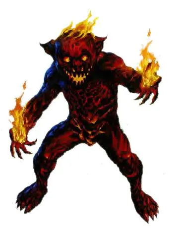

# Magmin

O sorridente e travesso magmin se assemelha a um humanoide atarracado esculpido em uma casca negra de magma. Mesmo quando ele não está inflamado e irradiando calor como uma fogueira, pequenos jatos de chamas emergem de sua pele porosa.

***Piromaníacos Invocados***. Os magmins são espíritos elementais do fogo presos a formas físicas através de magia, e eles aparecem no Plano Material apenas quando são invocados. Eles veem objetos inflamáveis como gravetos para uma grande conflagração e apenas o controle mágico exercido por seus invocadores os impede de incendiar tudo que eles toquem. Sua propensão por fogo e estragos faz deles ideais para espalhar o caos e destruição. Uma multidão de magmins invocados dentro de um castelo pode reduzi-lo a uma casca em chamas em minutos.

***Destruição Flamejante***. Apesar de suas chamas serem potentes, a casca dura do magmin previne que ele incendeie instantaneamente tudo que entre em contato com ele. Porém, como o fogo dentro deles, os magmins são caprichosos e imprevisíveis. Além disso, como criações elementais simples, eles são indiferentes aos ferimentos que suas naturezas elementais causem às criaturas do Plano Material.

Se ele tiver a oportunidade enquanto estiver sob serviço do seu mestre, um magmin buscará áreas de grande calor, como incêndios florestais ou o magma borbulhante de um vulcão ativo. Em outros momentos, um magmin liberará chamas, compulsivamente, das pontas de seus dedos, deliciando-se ao atear chamas a objetos.

## Bloco de estatísticas: Magmin

*Elemental Pequeno, caótico e neutro*

**Classe de Armadura** 14 (armadura natural)  
**Pontos de Vida** 9 (2d6 + 2)  
**Deslocamento** 9 m

| FOR | DES | CON | INT | SAB | CAR |
| :---: | :---: | :---: | :---: | :---: | :---: |
| 7 (–2) | 15 (+2) | 12 (+1) | 8 (–1) | 11 (+0) | 10 (+0) |

**Resistência a Dano** concussão, cortante e perfurante de ataques não-mágicos  
**Imunidade a Dano** fogo  
**Sentidos** visão no escuro 18 m, Percepção passiva 10  
**Idiomas** Ignan  
**Nível de Desafio** 1/2 (100 XP)

***Explosão da Morte***. Quando o magmin morre, ele explode numa erupção de fogo e magma. Cada criatura a até 3 metros dele deve realizar um teste de resistência de Destreza CD 11, sofrendo 7 (2d6) de dano de fogo numa falha na resistência, ou metade desse dano num sucesso. Objetos inflamáveis que não estejam sendo vestidos ou carregados na área são incendiados.

***Iluminação Inflamável***. Com uma ação bônus, o magmin pode se incendiar ou extinguir suas chamas. Enquanto estiver em chamas, o magmin emite luz plena num raio de 3 metros e penumbra por mais 3 metros adicionais.

### Ações

***Toque***. *Ataque Corpo-a-Corpo com Arma*: +4 para atingir, alcance 1,5 m, um alvo. *Acerto*: 7 (2d6) de dano de fogo. Se o alvo for uma criatura ou um objeto inflamável, ele se incendeia. Até uma criatura usar uma ação para extinguir o fogo, o alvo sofre 3 (1d6) de dano de fogo no final de cada um dos turnos dele.
