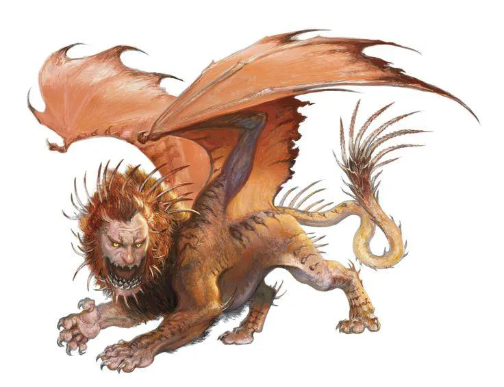

# Manticora

## Bloco de estatísticas: Manticora

*Monstruosidade Grande, leal e mau*

**Classe de Armadura** 14 (armadura natural)  
**Pontos de Vida** 68 (8d10 + 24)  
**Deslocamento** 9 m, voo 15 m

| FOR | DES | CON | INT | SAB | CAR |
| :---: | :---: | :---: | :---: | :---: | :---: |
| 17 (+3) | 16 (+3) | 17 (+3) | 7 (–2) | 12 (+1) | 8 (–1) |

**Sentidos** visão no escuro 18 m, Percepção passiva 11  
**Idiomas** Comum  
**Nível de Desafio** 3 (700 XP)

***Recrescimento de Espinhos de Cauda***. A manticora possui vinte e quatro espinhos de cauda. Espinhos usados crescem novamente quando a manticora termina um descanso longo.

### Ações

***Ataques Múltiplos***. A manticora realiza três ataques: um com sua mordida e dois com suas garras ou três com seus espinhos de cauda.

***Mordida***. *Ataque Corpo-a-Corpo com Arma*: +5 para atingir, alcance 1,5 m, um alvo. *Acerto*: 7 (1d8 + 3) de dano perfurante.

***Garra***. *Ataque Corpo-a-Corpo com Arma*: +5 para atingir, alcance 1,5 m, um alvo. *Acerto*: 6 (1d6 + 3) de dano cortante.

***Espinho de Cauda***. *Ataque à Distância com Arma*: +5 para atingir, distância 30/60 m, um alvo. *Acerto*: 7 (1d8 + 3) de dano perfurante.

Um monstro em todos os sentidos da palavra, uma manticora possui uma cabeça vagamente humanoide, o corpo de um leão e as asas de um dragão. Uma juba eriçada se estende até as costas da criatura e sua longa cauda termina em um emaranhado de espinhos mortais que podem empalar presas a uma distância impressionante.

***Predadores Malignos***. As manticoras são assassinas ferozes que caçam à distância em vastas áreas. Elas trabalham em equipe para derrubar criaturas particularmente grandes ou perigosas, partilhando a comida quando uma morte é feita. Uma manticora começa seu ataque com uma saraivada de espinhos de sua cauda, então aterrissa e usa suas garras e mordida. Quando está ao ar livre e em menor número, ela usa suas asas para se manter distante, atacando à distância até seus espinhos se esgotarem.

Uma manticora não é particularmente brilhante, mas ela possui uma natureza malévola e a capacidade de conversar. Ao decorrer do ataque, ela denigre seus adversários e oferece uma morte rápida se eles implorarem por suas vidas. Se a manticora encontrar uma vantagem a ser adquirida ao poupar a vida de uma criatura, ela o fará, pedindo um tributo ou sacrifício igual a sua comida perdida.

***Relacionamentos Monstruosos***. As manticoras servem mestres perversos que as tratem bem e concedam presas regulares. Uma manticora pode dar suporte aéreo para uma horda de orcs ou um exército de hobgoblins. Outra poderia servir como um companheiro de caça para um gigante da colina líder, ou guardar a entrada do covil de uma lâmia.

Os principais rivais territoriais da manticora incluem quimeras, grifos, perytons e wyverns. As manticoras que cacem como um bando, geralmente terá a vantagem de um maior número. Além dessas criaturas, as manticoras temem os dragões e os evitam.
