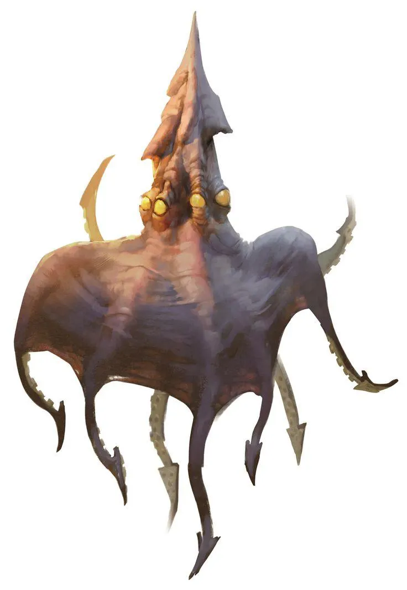

# Manto Negro

## Bloco de estatísticas: Manto Negro

*Monstruosidade Pequena, imparcial*

**Classe de Armadura** 11  
**Pontos de Vida** 22 (5d6 + 5)  
**Deslocamento** 3 m, voo 9 m

| FOR | DES | CON | INT | SAB | CAR |
| :---: | :---: | :---: | :---: | :---: | :---: |
| 16 (+3) | 12 (+1) | 13 (+1) | 2 (–4) | 10 (+0) | 5 (–3) |

**Perícias** Furtividade +3  
**Sentidos** percepção às cegas 18 m, Percepção passiva 10  
**Idiomas** –  
**Nível de Desafio** 1/2 (100 XP)

***Aparência Falsa***. Enquanto o manto permanecer imóvel, ele é indistinguível de uma formação de caverna, como uma estalactite ou uma estalagmite.

***Eco Localização***. O manto não pode usar sua percepção às cegas enquanto estiver surdo.

### Ações

***Esmagar***. *Ataque Corpo-a-Corpo com Arma*: +5 para atingir, alcance 1,5 m, uma criatura. *Acerto*: 6 (1d6 + 3) de dano de

Um manto negro se prende ao teto de cavernas, permanecendo perfeitamente imóvel enquanto aguarda que criaturas passem embaixo dele. À distância, ele pode se passar por uma estalactite ou uma protuberância rochosa. Então ele cai do teto e se desenrola, cercando-se com escuridão mágica enquanto engolfa e esmaga sua presa.

Os mantos negros são encontrados por todo Subterrâneo, mas eles são igualmente comuns na Umbra. Prosperando no reino escuro, eles preenchem um nicho ecológico similar ao dos morcegos no Plano Material. Criaturas inteligentes da Umbra, às vezes, treinam mantos negros como guardiões ou companheiros.

concussão e o manto se prende ao alvo. Se o alvo for uma criatura Média ou menor e o manto tiver vantagem na jogada de ataque, ele se prende engolfando a cabeça do alvo, e o alvo também fica cego e incapaz de respirar enquanto o manto permanecer preso dessa forma. Enquanto estiver preso ao alvo, o manto não pode atacar outra criatura além do alvo, mas tem vantagem em suas jogadas de ataque. O deslocamento do manto torna-se 0, ele não recebe qualquer benefício de bônus de deslocamento e se move com o alvo. Uma criatura pode desprender o manto ao realizar um teste de Força CD 13 bem sucedido, com uma ação. No seu turno, o manto pode se desprender do alvo usando 1,5 metro de deslocamento.

***Aura de Escuridão (1/Dia)***. Um raio de 4,5 metros de escuridão mágica se estende do manto, movendo-se com ele e espalhando-se, dobrando esquinas. A escuridão dura enquanto o manto mantiver a concentração, até 10 minutos (como se ele estivesse se concentrando em uma magia). A visão no escuro não consegue penetrar essa escuridão, e nenhuma luz natural pode ilumina-la. Se qualquer parte da escuridão se sobrepor com a área de uma luz criada por uma magia de 2° nível ou inferior, a magia criando a luz é dissipada.
