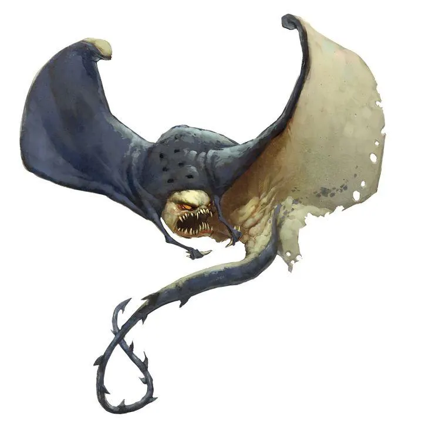

# Mantor

## Bloco de estatísticas: Mantor

*Aberração Grande, caótico e neutro*

**Classe de Armadura** 14 (armadura natural)  
**Pontos de Vida** 78 (12d10 + 12)  
**Deslocamento** 3 m, voo 12 m

| FOR | DES | CON | INT | SAB | CAR |
| :---: | :---: | :---: | :---: | :---: | :---: |
| 17 (+3) | 15 (+2) | 12 (+1) | 13 (+1) | 12 (+1) | 14 (+2) |

**Perícias** Furtividade +5  
**Sentidos** visão no escuro 18 m, Percepção passiva 11  
**Idiomas** Dialeto Subterrâneo, Subcomum  
**Nível de Desafio** 8 (3.900 XP)

***Aparência Falsa***. Enquanto o mantor permanecer imóvel sem seu torso exposto, ele é indistinguível de um manto de couro negro.

***Sensibilidade à Luz***. Enquanto estiver sob luz plena, o mantor tem desvantagem nas jogadas de ataque, assim como em testes de Sabedoria (Percepção) relacionados a visão.

***Transferência de Dano***. Enquanto estiver preso a uma criatura, o mantor sofre apenas metade do dano causado a ele (arredondado para baixo), e a criatura sofre a outra metade.

### Ações

***Ataques Múltiplos***. O mantor realiza dois ataques: um com sua mordida e um com sua cauda.

***Mordida***. *Ataque Corpo-a-Corpo com Arma*: +6 para atingir, alcance 1,5 m, uma criatura. *Acerto*: 10 (2d6 + 3) de dano perfurante, e se o alvo for Grande ou menor, o manto se prende a ele. Se o mantor tiver vantagem contra o alvo, ele se prende a cabeça do alvo e o alvo fica cego e incapaz de respirar enquanto o mantor estiver preso. Enquanto estiver preso ao alvo, o manto não pode atacar outra criatura além do alvo, mas tem vantagem em suas jogadas de ataque. O mantor pode se desprender do alvo usando 1,5 metro de deslocamento. Uma criatura, incluindo o alvo, pode usar uma ação para desprender o mantor sendo bem sucedido num teste de Força CD 16.

***Cauda***. *Ataque Corpo-a-Corpo com Arma*: +6 para atingir, alcance 3 m, uma criatura. *Acerto*: 7 (1d8 + 3) de dano cortante.

***Gemido***. Cada criatura a até 18 metros do mantor, que puderem ouvir seu gemido, e que não forem uma aberração, devem ser bem sucedidos num teste de resistência de Sabedoria CD 13, ou ficarão amedrontadas até o final do próximo turno do mantor. Se o teste de resistência de uma criatura for bem sucedido, ela fica imune ao gemido do mantor pelas próximas 24 horas.

***Fantasmas (Recarrega após um Descanso Curto ou Longo)***. O mantor cria magicamente três duplicadas ilusórias de si mesmo, caso ele não esteja sob luz plena. As duplicadas se movem com ele e imitam suas ações, mudando de posição para tornar impossível determinar qual mantor é o real. Se o mantor estiver numa área de luz plena, as duplicadas desaparecem. Sempre que uma criatura afetar o mantor com um ataque ou magia nociva enquanto uma duplicata existir, a criatura rola aleatoriamente para determinar se afetou o mantor ou uma de suas duplicatas. Uma criatura não é afetada por esse efeito mágico caso ela não possa ver ou possa contar com outros sentidos além da visão. Uma duplicata tem a CA do mantor e usa seus testes de resistência. Se um ataque atingir uma duplicada, ou se a duplicada falhar num teste de resistência contra um efeito que cause dano, ela desaparece.

Mantores adquiriram seus nomes por sua semelhança com mantos de couro negro. Espreitando em masmorras e cavernas remotas, esses predadores furtivos aguardam para matar presas sozinhas ou feridas tropeçando pela escuridão.

***Espreitadores Camuflados***. Como uma arraia, o corpo de um mantor é composto de cartilagem e músculos. Com sua cauda e barbatanas desenroladas, ele voa pela escuridão e espreita entre as sombras das cavernas da mesma forma que uma arraia desliza pela água e se esconde no solo oceânico. Fileiras paralelas de ocelos negros redondos ao longo de suas costas, como botões, e suas garras cor de marfim em seu capuz assemelham-se a fechos ósseos.

Quando um mantor se desenrola e se move para atacar, ele revela seu torso pálido, deixando sua natureza real evidente. Olhos vermelhos brilham sobre fileiras de dentes afiados, e uma longa cauda oscilante balança atrás dele.

***Predadores Oportunistas***. Quando está caçando, os mantores deslizam pelas sombras a uma distância segura atrás de grupos de outras criaturas atravessando o Subterrâneo. Eles seguem grupos de humanoides para abater os feridos após uma batalha, ou perseguem rebanhos de bestas do Subterrâneo, atacando os doentes, fracos ou dispersos.

Os mantores atacam rapidamente e consomem suas refeições o mais rápido possível, envolvendo e devorando suas vítimas. Quando estiver alimentado, um mantor usará seu veloz rabo em forma de chicote para se defender, apesar de ele raramente confrontar adversários perigosos ou grupos de criaturas. Como uma defesa adicional, os mantores podem criar duplicatas ilusórias de si mesmos.

***Gemido Assombroso***. Os pensamentos dos mantores são alienígenas para outras formas de vida, e eles se comunicam entre si através de gemidos subsônicos inaudíveis para a maioria das criaturas. Em intensidades mais altas, o gemido assombroso do mantor torna-se audível, evocando sensações de tristeza e medo nas criaturas que o ouvirem.

***Conclaves de Mantores***. Os mantores preferem o isolamento, mas eles às vezes reúnem-se com outros mantores para se defender ou para trocar informações sobre novos perigos, territórios de caça convenientes, ou revelações que possam afetar seus habitats. Quando essa convergência é completada, os mantores se separam novamente.
