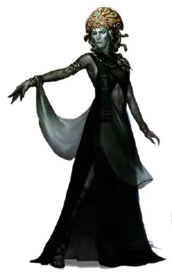

# Medusa

Tão mortais quanto encantadoras, as medusas de cabeça de serpente sofreram uma maldição imortal provocada por sua vaidade. Elas espreitam em exílio silencioso entre as ruínas tombadas de suas vidas anteriores, rodeadas pelos restos petrificados de admiradores passados e aspirantes a heróis.

***Esplendor Imortal***. Homens e mulheres que desejam a juventude, beleza e adoração eternas podem orar para deuses maliciosos, implorar a dragões por magia antiga ou buscar poderosos arquimago para realizar seus desejos. Outros realizam sacrifícios para lordes demônios ou arquidiabos, oferecendo tudo em troca dessa dádiva, alheios à maldição que a acompanha. Esses que fazem tais barganhas adquirem beleza física, juventude restaurada, imortalidade e adoração de todos que os contemplam, concedendo a eles a influência e poder que eles tanto desejam. Porém, após anos vivendo como um semideus entre os mortais, o preço por sua vaidade e arrogância é cobrado, e eles são transformados em medusas para sempre. O cabelo de uma medusa se torna em um ninho de serpentes venenosas, e todos que fitarem a medusa são petrificados, tornando-se monumentos de pedra em homenagem a sua corrupção.

***Covis de Medusas***. As medusas vivem em reclusão para sempre, alienadas ao mundo a sua volta por sua forma monstruosa e capricho. Suas moradas caem gradualmente em desuso, até se tornarem nada além de ruínas sombrias cobertas por espinhos e trepadeiras, cheias de obstruções e esconderijos. Saqueadores e aventureiros imprudentes que entram, geralmente, não estão cientes da presença da medusa até que a criatura enteja entre eles.

Uma medusa é alvo de sua própria maldição. Ao olhar vagamente para o seu reflexo, ela se transforma em pedra da mesma forma que qualquer mortal vivo. Como resultado, uma medusa destrói ou remove quaisquer espelhos ou superfícies reflexivas de seu covil.

## Bloco de estatísticas: Medusa

*Monstruosidade Média, leal e mau*

**Classe de Armadura** 15 (armadura natural)  
**Pontos de Vida** 127 (17d8 + 51)  
**Deslocamento** 9 m

| FOR | DES | CON | INT | SAB | CAR |
| :---: | :---: | :---: | :---: | :---: | :---: |
| 10 (+0) | 15 (+2) | 16 (+3) | 12 (+1) | 13 (+1) | 15 (+2) |

**Perícias** Enganação +5, Furtividade +5, Intuição +4, Percepção +4  
**Sentidos** visão no escuro 18 m, Percepção passiva 14  
**Idiomas** Comum  
**Nível de Desafio** 6 (2.300 XP)

***Olhar Petrificante***. Se uma criatura que possa ver a medusa, começar seu turno a até 9 metros dela, a medusa pode forçar a criatura a realizar um teste de resistência de Constituição CD 14 se ele não estiver incapacitado e puder ver a criatura. Se o teste de resistência fracassar por 5 ou mais, a criatura é transformada em pedra instantaneamente. Caso contrário, uma criatura que falhe na resistência começa a se transformar em pedra e fica impedida. A criatura impedida deve repetir o teste de resistência no final do próximo turno dela, sendo petrificada num fracasso ou terminando o efeito num sucesso. A petrificação dura até a criatura ser liberta pela magia *restauração maior* ou outro efeito mágico. A não ser que esteja surpresa, uma criatura pode desviar seu olhar para evitar o teste de resistência no início do turno dela. Se ela o fizer, ela não poderá ver a medusa até o início do próximo turno dela, quando ela poderá desviar seu olhar novamente. Se a criatura olhar para a medusa nesse meio tempo, ela deve imediatamente realizar a resistência. Se a medusa si ver refletida numa superfície polida a até 9 metros dela numa área de luz plena, ela é, devido a sua maldição, afetada por seu próprio olhar.

### Ações

***Ataques Múltiplos***. A medusa realiza ou três ataques corpo-a-corpo – um com seu cabelo de serpente e dois com sua espada curta – ou dois ataques a distância com seu arco longo.

***Cabelo de Serpente***. *Ataque Corpo-a-Corpo com Arma*: +5 para atingir, alcance 1,5 m, uma criatura. *Acerto*: 4 (1d4 + 2) de dano perfurante mais 14 (4d6) de dano de veneno.

***Espada Curta***. *Ataque Corpo-a-Corpo com Arma*: +5 para atingir, alcance 1,5 m, um alvo. *Acerto*: 5 (1d6 + 2) de dano perfurante.

***Arco Longo***. *Ataque à Distância com Arma*: +5 para atingir, distância 45/180 m, um alvo. *Acerto*: 6 (1d8 + 2) de dano perfurante mais 7 (2d6) de dano de veneno.
