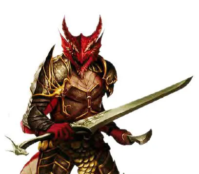

# Meio-Dragão

Quando um dragão metamorfoseado forma um casal com outra criatura, a união, às vezes, produz uma prole meio-dragão. Uma criatura poderosa também pode se transformar em um meio-dragão como resultado de magia de um mago insano ou um ritual ao se banhar em sangue de dragão. Em todos os casos, o resultado é uma criatura que combina a essência de um dragão com a forma de sua raça original. Independentemente de suas origens, todos os meio-dragões possuem traços e aparências similares, adquirindo sentidos especiais, resistência a energia destrutiva e uma arma de sopro.

***Natureza Dracônica***. Os meio-dragões são incapazes de gerarem prole naturalmente. Aqueles que desejam se propagar devem encontrar outras formas de fazê-lo, quase sempre envolvendo magia. Como forma de compensação, os meio-dragões são abençoados com longas vidas. Exceto por um infortúnio imprevisível, a expectativa de vida típica de um meio-dragão é o dobro da sua linhagem não-dracônica, portanto, um humano meio-dragão viveria mais de um século e meio.

Os meio-dragões herdam traços de personalidade comuns a sua herança dracônica, então, um meio-dragão de ouro geralmente é tímido e reservado, enquanto que um meio-dragão de cobre é travesso e brincalhão. Meio-dragões verdes são enganadores, enquanto que meio-dragões brancos são, muitas vezes, brutos e estúpidos. Esses traços são balanceados com a outra linhagem do meio-dragão, mas a ganância, arrogância e paranoia são qualidades que até os meio-dragões bondosos geralmente possuirão.

### Modelo Meio-Dragão

Uma besta, humanoide, gigante ou monstruosidade pode se tornar um meio-dragão. Quando uma criatura se torna um meio-dragão, ela mantem todas as suas estatísticas, exceto como descrito abaixo.

***Sentidos***. O meio-dragão adquire percepção às cegas com um raio de 3 metros e visão no escuro com um raio de 18 metros.

***Resistências***. O meio-dragão adquire resistência a um tipo de dano, baseado em sua cor.

**Cor** **Resistência a Dano** Azul ou Bronze Elétrico Branco ou prata Frio Cobre ou negro Ácido Latão, ouro ou vermelho Fogo Verde Veneno

***Idiomas***. O meio-dragão fala Dracônico além de quaisquer outros idiomas que conheça.

***Nova Ação: Arma de Sopro***. O meio-dragão possui a arma de sopro de sua metade dragão. O tamanho do meio-dragão determina como essa ação funciona.

***Nível de Desafio***. Para evitar ter que recalcular o nível de desafio da criatura, aplique o modelo apenas em uma criatura que atenda ao pré-requisito opcional na tabela Arma de Sopro abaixo. Do contrário, use as diretrizes do Guia do Mestre para recalcular o nível de desafio após aplicar o modelo.

> **Arma de Sopro**

| Tamanho | Arma de Sopro | Pré-Requisito Opcional |
| --- | --- | --- |
| Grande ou | Como de um filhote | Desafio 2 ou maior |

> menor

| Enorme | Como de um dragão jovem | Desafio 7 ou maior |
| --- | --- | --- |
| Imenso | Como de um dragão adulto | Desafio 8 ou maior |

### Meio-Dragão Padrão

Aqui o modelo meio-dragão foi aplicado a um humano veterano para criar um meio-dragão vermelho veterano. A cota de talas foi substituída por uma armadura de placas.

## Bloco de estatísticas: Meio-Dragão Vermelho Veterano

*Humanoide Médio (humano), qualquer tendência*

**Classe de Armadura** 18 (placas)  
**Pontos de Vida** 65 (10d8 + 20)  
**Deslocamento** 9 m

| FOR | DES | CON | INT | SAB | CAR |
| :---: | :---: | :---: | :---: | :---: | :---: |
| 16 (+3) | 13 (+1) | 14 (+2) | 10 (+0) | 11 (+0) | 10 (+0) |

**Perícias** Atletismo +5, Percepção +2  
**Resistência a Dano** fogo  
**Sentidos** percepção às cegas 3 m, visão no escuro 18 m, Percepção passiva 12  
**Idiomas** Comum, Dracônico  
**Nível de Desafio** 5 (1.800 XP)

### Ações

***Ataques Múltiplos***. O veterana realiza dois ataques de espada longa. Se ele tiver sacado uma espada curta, ele também pode realizar um ataque de espada curta.

***Espada Longa***. *Ataque Corpo-a-Corpo com Arma*: +5 para atingir, alcance 1,5 m, um alvo. *Acerto*: 7 (1d8 + 3) de dano cortante, ou 8 (1d10 + 3) de dano cortante, se usada com as duas mãos.

***Espada Curta***. *Ataque Corpo-a-Corpo com Arma*: +5 para atingir, alcance 1,5 m, um alvo. *Acerto*: 6 (1d6 + 3) de dano perfurante.

***Besta Pesada***. *Ataque à Distância com Arma*: +3 para atingir, distância 30/120 m, um alvo. *Acerto*: 6 (1d10 + 1) de dano perfurante.

***Sopro Flamejante (Recarrega 5–6)***. O meio-dragão expele fogo num cone de 4,5 metros. Cada criatura na área deve ser bem sucedida num teste de resistência de Destreza CD 15, sofrendo 24 (7d6) de dano de fogo caso fracassem, ou metade desse dano caso obtenham sucesso.
