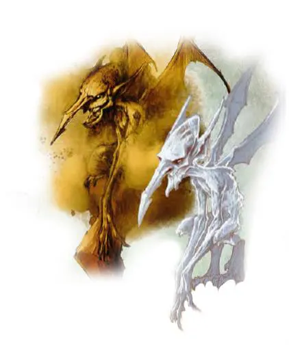
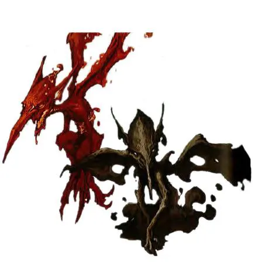
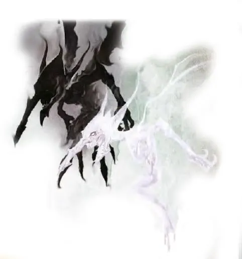

# Mephits

Os mephits são criaturas similares a diabretes caprichosas nativas dos planos elementais. Eles existem em seis variedades, cada um representando a mistura de dois elementos.

Trapaceiros imutáveis, os mephits existem em vasta quantidade nos Planos Elementais e no Plano do Caos. Eles também encontram seus caminhos para o Plano Material, onde eles preferem viver em locais onde seus elementos base são abundantes. Por exemplo, um mephit do magma é composto de terra e fogo, e ele prefere covis vulcânicos, enquanto que um mephit do gelo, que é composto de ar e água, preferiria locais gelados.

***Natureza Elemental***. Um mephit não precisa comer, beber ou dormir.

### Mephit da Poeira

Composto de terra e ar, os mephits da poeira são atraídos por catacumbas e acham a morte morbidamente fascinante.

### Mephit do Gelo

Compostos de ar gelado e água, os mephits do gelo são reservados e frios, superando todos os outros mephits no quesito crueldade impiedosa.

## Bloco de estatísticas: Mephit da Poeira

*Elemental Pequeno, neutro e mau*

**Classe de Armadura** 12  
**Pontos de Vida** 17 (5d6)  
**Deslocamento** 9 m, voo 9 m

| FOR | DES | CON | INT | SAB | CAR |
| :---: | :---: | :---: | :---: | :---: | :---: |
| 5 (–3) | 14 (+2) | 10 (+0) | 9 (–1) | 11 (+0) | 10 (+0) |

**Perícias** Furtividade +4, Percepção +2  
**Vulnerabilidade a Dano** fogo  
**Imunidade a Dano** veneno  
**Imunidade a Condição** envenenado  
**Sentidos** visão no escuro 18 m, Percepção passiva 12  
**Idiomas** Auran, Terran  
**Nível de Desafio** 1/2 (100 XP)

***Conjuração Inata (1/Dia)***. O mephit pode conjurar, inatamente, *sono*, sem necessidade de componentes materiais. Sua habilidade de conjuração é Carisma (CD de resistência de magia 10).

***Explosão da Morte***. Quando o mephit morre, ele explode numa erupção de poeira. Cada criatura a até 1,5 metro dele deve ser bem sucedida num teste de resistência de Constituição CD 10, ou ficará cega por 1 minuto. Uma criatura cega pode repetir o teste de resistência em cada um dos turnos dela, terminando o efeito sobre si com um sucesso.

### Ações

***Garras***. *Ataque Corpo-a-Corpo com Arma*: +4 para atingir, alcance 1,5 m, um alvo. *Acerto*: 4 (1d4 + 2) de dano cortante.

***Sopro Cegante (Recarrega 6)***. O mephit expele um cone de 4,5 metro de poeira cegante. Cada criatura na área deve ser bem sucedida num teste de resistência de Destreza CD 10 ou ficará cega por 1 minuto. Uma criatura pode repetir o teste de resistência no final de cada um dos turnos dela, terminando o efeito sobre si com um sucesso.

## Bloco de estatísticas: Mephit do Gelo

*Elemental Pequeno, neutro e mau*

**Classe de Armadura** 11  
**Pontos de Vida** 21 (6d6)  
**Deslocamento** 9 m, voo 9 m

| FOR | DES | CON | INT | SAB | CAR |
| :---: | :---: | :---: | :---: | :---: | :---: |
| 7 (–2) | 13 (+1) | 10 (+0) | 9 (–1) | 11 (+0) | 12 (+1) |

**Perícias** Furtividade +3, Percepção +2  
**Vulnerabilidade a Dano** concussão, fogo  
**Imunidade a Dano** frio, veneno  
**Imunidade a Condição** envenenado  
**Sentidos** visão no escuro 18 m, Percepção passiva 12  
**Idiomas** Aquan, Auran  
**Nível de Desafio** 1/2 (100 XP)

***Aparência Falsa***. Enquanto o mephit permanecer imóvel, ele é indistinguível de um fragmento de gelo comum.

***Conjuração Inata (1/Dia)***. O mephit pode conjurar, inatamente, *névoa obscurecente*, sem necessidade de componentes materiais. Sua habilidade de conjuração é Carisma (CD de resistência de magia 11).

***Explosão da Morte***. Quando o mephit morre, ele explode numa erupção de farpas de gelo. Cada criatura a até 1,5 metro dele deve realizar um teste de resistência de Destreza CD 10, sofrendo 4 (1d8) de dano cortante num fracasso na resistência, ou metade desse dano caso obtenha sucesso.

### Ações

***Garras***. *Ataque Corpo-a-Corpo com Arma*: +3 para atingir, alcance 1,5 m, um alvo. *Acerto*: 3 (1d4 + 1) de dano cortante mais 2 (1d4) de dano de frio.

***Sopro Congelante (Recarrega 6)***. O mephit expele um cone de 4,5 metro de ar gelado. Cada criatura na área deve ser bem sucedida num teste de resistência de Destreza CD 10, sofrendo 5 (2d4) de dano de frio num fracasso na resistência, ou metade desse dano caso obtenha sucesso.

### Mephit do Magma

Compostos de terra e fogo, os mephits do magma brilham uma cor vermelho escuro quando transpiram grânulos de lava derretida. Eles são lentos para compreender o sentido das palavras e ações dos outros.

### Mephit da Lama

Os mephits da lama são criaturas lentas e untuosas de terra e água. Eles reclamam suas queixas para todos que quiserem ouvir e imploram incessantemente por atenção e tesouros.

## Bloco de estatísticas: Mephit do Magma

*Elemental Pequeno, neutro e mau*

**Classe de Armadura** 11  
**Pontos de Vida** 22 (5d6 + 5)  
**Deslocamento** 9 m, voo 9 m

| FOR | DES | CON | INT | SAB | CAR |
| :---: | :---: | :---: | :---: | :---: | :---: |
| 8 (–1) | 12 (+1) | 12 (+1) | 7 (–2) | 10 (+0) | 10 (+0) |

**Perícias** Furtividade +3  
**Vulnerabilidade a Dano** frio  
**Imunidade a Dano** fogo, veneno  
**Imunidade a Condição** envenenado  
**Sentidos** visão no escuro 18 m, Percepção passiva 10  
**Idiomas** Ignan, Terran  
**Nível de Desafio** 1/2 (100 XP)

***Aparência Falsa***. Enquanto o mephit permanecer imóvel, ele é indistinguível de um monte de magma comum.

***Conjuração Inata (1/Dia)***. O mephit pode conjurar, inatamente, *esquentar metal*, sem necessidade de componentes materiais. Sua habilidade de conjuração é Carisma (CD de resistência de magia 10).

***Explosão da Morte***. Quando o mephit morre, ele explode numa erupção de lava. Cada criatura a até 1,5 metro dele deve realizar um teste de resistência de Destreza CD 11, sofrendo 7 (2d6) de dano de fogo num fracasso na resistência, ou metade desse dano caso obtenha sucesso.

### Ações

***Garras***. *Ataque Corpo-a-Corpo com Arma*: +3 para atingir, alcance 1,5 m, um alvo. *Acerto*: 3 (1d4 + 1) de dano cortante mais 2 (1d4) de dano de fogo.

***Sopro Flamejante (Recarrega 6)***. O mephit expele um cone de 4,5 metro de fogo. Cada criatura na área deve ser bem sucedida num teste de resistência de Destreza CD 11, sofrendo 7 (2d6) de dano de fogo num fracasso na resistência, ou metade desse dano caso obtenha sucesso.

## Bloco de estatísticas: Mephit da Lama

*Elemental Pequeno, neutro e mau*

**Classe de Armadura** 11  
**Pontos de Vida** 27 (6d6 + 6)  
**Deslocamento** 6 m, natação 6 m, voo 6 m

| FOR | DES | CON | INT | SAB | CAR |
| :---: | :---: | :---: | :---: | :---: | :---: |
| 8 (–1) | 12 (+1) | 12 (+1) | 9 (–1) | 11 (+0) | 7 (–2) |

**Perícias** Furtividade +3  
**Imunidade a Dano** veneno  
**Imunidade a Condição** envenenado  
**Sentidos** visão no escuro 18 m, Percepção passiva 10  
**Idiomas** Aquan, Terran  
**Nível de Desafio** 1/4 (50 XP)

***Aparência Falsa***. Enquanto o mephit permanecer imóvel, ele é indistinguível de um monte de lama comum.

***Explosão da Morte***. Quando o mephit morre, ele explode numa erupção de lama pegajosa. Cada criatura Média ou menor a até 1,5 metro dele ser bem sucedida num teste de resistência de Destreza CD 11 ou ficará impedida até o final do próximo turno da criatura.

### Ações

***Punhos***. *Ataque Corpo-a-Corpo com Arma*: +3 para atingir, alcance 1,5 m, um alvo. *Acerto*: 4 (1d6 + 1) de dano de concussão.

***Sopro de Lama (Recarrega 6)***. O mephit vomita lama viscosa em uma criatura a até 1,5 metro dele. Se o alvo for Médio ou menor, ele deve ser bem sucedido num teste de resistência de Destreza CD 11 ou ficará impedido por 1 minuto. A criatura pode repetir o teste de resistência no final de cada um dos turnos dela, terminando o efeito sobre si caso obtenha sucesso.

### Mephit da Fumaça

Os mephits da fumaça são criaturas cruéis e preguiçosas de ar e fogo que liberam fumaça constantemente. Eles raramente falam a verdade e adoram enganar e zombar de outras criaturas.

### Mephit do Vapor

Compostos de fogo e água, os mephits do vapor deixam rastros de água quente por onde quer que passem, e eles assobiam como jatos de vapor. Autoritários e hipersensíveis, eles se auto intitulam os senhores de todos os mephits.

> **Variação: Invocação de Mephit**
>
> Alguns mephits podem ter uma opção de ação que permite a eles invocar outros mephits.
>
> ***Invocar Mephits (1/Dia)***. O mephit tem 25 por cento de chance de invocar 1d4 mephits de seu tipo. Um mephit invocado aparece num espaço desocupado a até 18 metros do invocador, agindo como um aliado do invocador, e não pode invocar outros mephits. Ele permanece por 1 minuto, até o invocador morrer ou até seu invocador dispensa-lo com uma ação.

## Bloco de estatísticas: Mephit da Fumaça

*Elemental Pequeno, neutro e mau*

**Classe de Armadura** 12  
**Pontos de Vida** 22 (5d6 + 5)  
**Deslocamento** 9 m, voo 9 m

| FOR | DES | CON | INT | SAB | CAR |
| :---: | :---: | :---: | :---: | :---: | :---: |
| 6 (–2) | 14 (+2) | 12 (+1) | 10 (+0) | 10 (+0) | 11 (+0) |

**Perícias** Furtividade +4, Percepção +2  
**Imunidade a Dano** frio, veneno  
**Imunidade a Condição** envenenado  
**Sentidos** visão no escuro 18 m, Percepção passiva 12  
**Idiomas** Auran, Ignan  
**Nível de Desafio** 1/4 (50 XP)

***Conjuração Inata (1/Dia)***. O mephit pode conjurar, inatamente, *globos de luz*, sem necessidade de componentes materiais. Sua habilidade de conjuração é Carisma (CD de resistência de magia 10).

***Explosão da Morte***. Quando o mephit morre, ele deixa para trás uma nuvem de fumaça que preenche uma esfera de 1,5 metro de raio, centrada no espaço dele. A esfera produz escuridão densa. Vento dispersa a nuvem, do contrário, ela dura por 1 minuto.

### Ações

***Garras***. *Ataque Corpo-a-Corpo com Arma*: +4 para atingir, alcance 1,5 m, um alvo. *Acerto*: 4 (1d4 + 2) de dano cortante.

***Sopro Incinerante (Recarrega 6)***. O mephit expele um cone de 4,5 metro de cinzas fumegantes. Cada criatura na área deve ser bem sucedida num teste de resistência de Destreza CD 10, ou ficará cega até o final do próximo turno do mephit.

## Bloco de estatísticas: Mephit do Vapor

*Elemental Pequeno, neutro e mau*

**Classe de Armadura** 10  
**Pontos de Vida** 21 (6d6)  
**Deslocamento** 9 m, voo 9 m

| FOR | DES | CON | INT | SAB | CAR |
| :---: | :---: | :---: | :---: | :---: | :---: |
| 5 (–3) | 11 (+0) | 10 (+0) | 10 (+0) | 10 (+0) | 11 (+0) |

**Imunidade a Dano** fogo, veneno  
**Imunidade a Condição** envenenado  
**Sentidos** visão no escuro 18 m, Percepção passiva 10  
**Idiomas** Aquan, Ignan  
**Nível de Desafio** 1/4 (50 XP)

***Conjuração Inata (1/Dia)***. O mephit pode conjurar, inatamente, *nublar*, sem necessidade de componentes materiais. Sua habilidade de conjuração é Carisma (CD de resistência de magia 10).

***Explosão da Morte***. Quando o mephit morre, ele deixa para trás uma nuvem de vapor. Cada criatura a até 1,5 metro dele, deve ser bem sucedida num teste de resistência de Destreza CD 10 ou sofrerá 4 (1d8) de dano de fogo.

### Ações

***Garras***. *Ataque Corpo-a-Corpo com Arma*: +2 para atingir, alcance 1,5 m, um alvo. *Acerto*: 2 (1d4) de dano cortante mais 2 (1d4) de dano de fogo.

***Sopro de Vapor (Recarrega 6)***. O mephit expele um cone de 4,5 metro de vapor escaldante. Cada criatura na área deve ser bem sucedida num teste de resistência de Destreza CD 10, sofrendo 4 (1d8) de dano de fogo num fracasso, ou metade desse dano caso seja bem sucedida.
