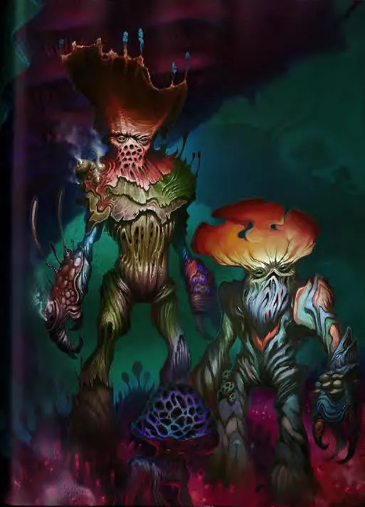

# Miconides

Os miconides são fungos ambulantes inteligentes que vivem no Subterrâneo, buscando esclarecimento, e repudiando violência. Se forem abordados pacificamente, os miconides oferecerão abrigo com prazer ou permitirão passagem segura através de suas colônias.

***Círculos e Fusões***. Os maiores miconides em uma colônia são seus soberanos, os quais presidem um ou mais grupos sociais chamados círculos. Um círculo consiste em doze ou mais miconides que trabalham, vivem e se fundem juntos.

Uma fusão é uma forma de meditação comunitária que permite que os miconides transcendam suas existências subterrâneas tediosas. Os esporos harmoniosos dos miconides vinculam os participantes em uma consciência grupal. Esporos alucinógenos, em seguida, induzem um sonho coletivo que fornece divertimento e interação social. Os miconides consideram a fusão como o propósito de suas existências. Eles o utilizam na busca de elevação da consciência, união coletiva e apoteose espiritual. Os miconides também usam seus esporos harmoniosos para se comunicar telepaticamente com outras criaturas racionais.

***Reprodução Miconide***. Como outros fungos, os miconides se reproduzem propagando seus esporos. Eles controlam cuidadosamente os esporos que liberam para evitar superpopulação.

### Modelo Servo Esporo

Um servo esporo é qualquer criatura Grande ou menor trazida de volta à vida pelos esporos animadores de um miconide soberano. Uma criatura que nunca foi de carne e sangue desde o começo (como um constructo, elemental,

## Bloco de estatísticas: Miconide Broto

*Planta Pequena, leal e neutro*

**Classe de Armadura** 10  
**Pontos de Vida** 7 (2d6)  
**Deslocamento** 3 m

| FOR | DES | CON | INT | SAB | CAR |
| :---: | :---: | :---: | :---: | :---: | :---: |
| 8 (–1) | 10 (+0) | 10 (+0) | 8 (–1) | 11 (+0) | 5 (–3) |

**Sentidos** visão no escuro 36 m, Percepção passiva 10  
**Idiomas** –  
**Nível de Desafio** 0 (10 XP)

***Esporos Angustiantes***. Quando o miconide sofre dano, todos os outros miconides a até 72 metros dele podem sentir sua dor.

***Fraqueza Solar***. Enquanto estiver sob luz solar, o miconide tem desvantagem em testes de habilidade, jogadas de ataque e testes de resistência. O miconide morre se ficar mais de 1 hora sob luz solar direta.

### Ações

***Punho***. *Ataque Corpo-a-Corpo com Arma*: +1 para atingir, alcance 1,5 m, um alvo. *Acerto*: 1 (1d4 – 1) de dano de concussão mais 2 (1d4) de dano de veneno.

***Esporos Harmoniosos (3/Dia)***. Uma nuvem de 3 metros de raio de esporos se espalha do miconide. Esses esporos podem dobrar esquinas e afetam apenas criaturas com Inteligência 2 ou superior que não sejam mortos-vivos, constructos ou elementais. As criaturas afetadas podem se comunicar telepaticamente umas com as outras enquanto estiverem a até 9 metros entre si. O efeito dura por 1 hora.

limo, planta ou morto-vivo) não pode se tornar um servo esporo. As seguintes características mudam ou são adicionadas a criatura que se tornar um servo esporo.

***Características Mantidas***. O servo mantem sua Classe de Armadura, pontos de vida, Dados de Vida, Força, Destreza, Constituição, vulnerabilidades, resistências e imunidades.

***Características Perdidas***. O servo perde seus testes de resistência e bônus de perícia originais, sentidos especiais e traços especiais. Ele perde qualquer ação que não seja de Ataques Múltiplos ou de ataques corpo-a-corpo com arma que cause dano de concussão, perfurante ou cortante. Se ele tiver uma ação ou um ataque corpo-a-corpo com arma que cause algum outro tipo de dano, ele perde a capacidade de causar esse tipo de dano, a não ser que o dano venha de um equipamento, como um item mágico.

***Tipo***. O tipo do servo é planta, e ele perde quaisquer descritores.

***Tendência***. A tendência do servo é imparcial.

***Deslocamento***. Reduz todos os deslocamentos do servo em 3 metros, até o mínimo de 1,5 metro.

***Valores de Habilidade***. Os valores de habilidade do servo mudam como a seguir: Int 2 (–4), Sab 6 (–2) e Car 1 (–5).

***Sentidos***. O servo possui percepção às cegas com raio de 9 metros e fica cego além desse raio.

***Imunidade a Condição***. O servo não pode ser amedrontado, cego, enfeitiçado ou paralisado.

***Idiomas***. O servo perde todos os idiomas conhecidos, mas ele responde as ordens dadas a ele por miconides usando os esporos harmoniosos. O servo dá prioridade maior às ordens recebidas dos miconides mais poderosos.

***Ataques***. Se o servo não tiver outras formas de causar dano, ele pode usar seus punhos ou membros para realizar golpes desarmados. Em um acerto, um golpe desarmado causa dano de concussão igual a 1d4 + o modificador de Força do servo, ou se o servo for Grande, 2d4 + seu modificador de Força.

### Servo Esporo Padrão

As estatísticas do servo esporo presentes aqui usam um quaggoth como criatura base.

## Bloco de estatísticas: Servo Esporo Quaggoth

*Planta Média, imparcial*

**Classe de Armadura** 13 (armadura natural)  
**Pontos de Vida** 45 (6d6 + 18)  
**Deslocamento** 6 m, escalada 6 m

| FOR | DES | CON | INT | SAB | CAR |
| :---: | :---: | :---: | :---: | :---: | :---: |
| 17 (+3) | 12 (+1) | 16 (+3) | 2 (–4) | 6 (–2) | 1 (–5) |

**Imunidade a Dano** veneno  
**Imunidade a Dano** amedrontado, cego, enfeitiçado, envenenado, paralisado  
**Sentidos** percepção às cegas 9 m (cego além desse raio), Percepção passiva 8  
**Idiomas** –  
**Nível de Desafio** 1 (200 XP)

### Ações

***Ataques Múltiplos***. O servo realiza dois ataques de garra.

***Garra***. *Ataque Corpo-a-Corpo com Arma*: +5 para atingir, alcance 1,5 m, um alvo. *Acerto*: 6 (1d6 + 3) de dano cortante.

## Bloco de estatísticas: Miconide Adulto

*Planta Média, leal e neutro*

**Classe de Armadura** 12 (armadura natural)  
**Pontos de Vida** 22 (4d8 + 4)  
**Deslocamento** 6 m

| FOR | DES | CON | INT | SAB | CAR |
| :---: | :---: | :---: | :---: | :---: | :---: |
| 10 (+0) | 10 (+0) | 12 (+1) | 10 (+0) | 13 (+1) | 7 (–2) |

**Sentidos** visão no escuro 36 m, Percepção passiva 11  
**Idiomas** –  
**Nível de Desafio** 1/2 (100 XP)

***Esporos Angustiantes***. Quando o miconide sofre dano, todos os outros miconides a até 72 metros dele podem sentir sua dor.

***Fraqueza Solar***. Enquanto estiver sob luz solar, o miconide tem desvantagem em testes de habilidade, jogadas de ataque e testes de resistência. O miconide morre se ficar mais de 1 hora sob luz solar direta.

### Ações

***Punho***. *Ataque Corpo-a-Corpo com Arma*: +2 para atingir, alcance 1,5 m, um alvo. *Acerto*: 5 (2d4) de dano de concussão mais 5 (2d4) de dano de veneno.

***Esporos Pacificadores (3/Dia)***. O miconide ejeta esporos em uma criatura que ele possa ver, a até 1,5 metro dele. O alvo deve ser bem sucedido num teste de resistência de Constituição CD 11 ou ficará atordoado por 1 minuto. O alvo pode repetir o teste de resistência no final de cada um dos turnos dele, terminando o efeito sobre si com um sucesso.

***Esporos Harmoniosos***. Uma nuvem de 3 metros de raio de esporos se espalha do miconide. Esses esporos podem dobrar esquinas e afetam apenas criaturas com Inteligência 2 ou superior que não sejam mortos-vivos, constructos ou elementais. As criaturas afetadas podem se comunicar telepaticamente umas com as outras enquanto estiverem a até 9 metros entre si. O efeito dura por 1 hora.

## Bloco de estatísticas: Miconide Soberano

*Planta Grande, leal e neutro*

**Classe de Armadura** 13 (armadura natural)  
**Pontos de Vida** 60 (8d10 + 16)  
**Deslocamento** 9 m

| FOR | DES | CON | INT | SAB | CAR |
| :---: | :---: | :---: | :---: | :---: | :---: |
| 12 (+1) | 10 (+0) | 14 (+2) | 13 (+1) | 15 (+2) | 10 (+0) |

**Sentidos** visão no escuro 36 m, Percepção passiva 12  
**Idiomas** –  
**Nível de Desafio** 2 (450 XP)

***Esporos Angustiantes***. Quando o miconide sofre dano, todos os outros miconides a até 72 metros dele podem sentir sua dor.

***Fraqueza Solar***. Enquanto estiver sob luz solar, o miconide tem desvantagem em testes de habilidade, jogadas de ataque e testes de resistência. O miconide morre se ficar mais de 1 hora sob luz solar direta.

### Ações

***Ataques Múltiplos***. O miconide usa ou seus Esporos Alucinógenos ou seus Esporos Pacificadores, então realiza um ataque de punho.

***Punho***. *Ataque Corpo-a-Corpo com Arma*: +3 para atingir, alcance 1,5 m, um alvo. *Acerto*: 8 (3d4 + 1) de dano de concussão mais 7 (3d4) de dano de veneno.

***Esporos Animadores (3/Dia)***. O miconide escolhe um cadáver de um humanoide ou de uma besta Grande ou menor a 1,5 metro dele, e libera esporos no corpo. Em 24 horas, o corpo se ergue como um servo esporo. O corpo permanece animado por 1d4 + 1 semanas ou até ser destruído e ele não pode ser animado novamente por esse meio.

***Esporos Alucinógenos***. O miconide ejeta esporos em uma criatura que ele possa ver, a até 1,5 metro dele. O alvo deve ser bem sucedido num teste de resistência de Constituição CD 12 ou ficará envenenado por 1 minuto. O alvo envenenado fica incapacitado enquanto sofre alucinações. O alvo pode repetir o teste de resistência no final de cada um dos turnos dele, terminando o efeito sobre si caso obtenha sucesso.

***Esporos Pacificadores***. O miconide ejeta esporos em uma criatura que ele possa ver, a até 1,5 metro dele. O alvo deve ser bem sucedido num teste de resistência de Constituição CD 12 ou ficará atordoado por 1 minuto. O alvo pode repetir o teste de resistência no final de cada um dos turnos dele, terminando o efeito sobre si com um sucesso.

***Esporos Harmoniosos (3/Dia)***. Uma nuvem de 3 metros de raio de esporos se espalha do miconide. Esses esporos podem dobrar esquinas e afetam apenas criaturas com Inteligência 2 ou superior que não sejam mortos-vivos, constructos ou elementais. As criaturas afetadas podem se comunicar telepaticamente umas com as outras enquanto estiverem a até 9 metros entre si. O efeito dura por 1 hora.
