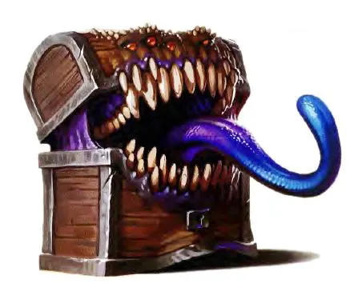

# Mímico

## Bloco de estatísticas: Mímico

*Monstruosidade Média (metamorfo), neutro*

**Classe de Armadura** 12 (armadura natural)  
**Pontos de Vida** 58 (9d8 + 18)  
**Deslocamento** 4,5 m

| FOR | DES | CON | INT | SAB | CAR |
| :---: | :---: | :---: | :---: | :---: | :---: |
| 17 (+3) | 12 (+1) | 15 (+2) | 5 (–3) | 13 (+1) | 8 (–1) |

**Perícias** Furtividade +5  
**Imunidade a Dano** ácido  
**Imunidade a Condição** caído  
**Sentidos** visão no escuro 18 m, Percepção passiva 11  
**Idiomas** –  
**Nível de Desafio** 2 (450 XP)

***Adesivo (Forma de Objeto Apenas)***. O mímico adere a qualquer coisa que ele toque. Uma criatura Enorme ou menor aderida ao mímico também está agarrada por ele (CD 13 para escapar). Testes de habilidade feitos para escapar desse agarrão tem desvantagem.

***Aparência Falsa (Forma de Objeto Apenas)***. Enquanto o mímico permanecer imóvel, ele é indistinguível de um objeto comum.

***Agarrador***. O mímico tem vantagem nas jogadas de ataque contra qualquer criatura agarrada por ele.

***Metamorfo***. O mímico pode usar sua ação para se metamorfosear em um objeto ou voltar para sua forma verdadeira, uma forma amorfa. Suas estatísticas são as mesmas em cada forma. Qualquer equipamento que ele esteja vestindo ou carregando não é transformado. Ele reverte a sua forma verdadeira se morrer.

### Ações

***Pseudópode***. *Ataque Corpo-a-Corpo com Arma*: +5 para atingir, alcance 1,5 m, um alvo. *Acerto*: 7 (1d8 + 3) de dano de concussão. Se o mímico estiver em forma de objeto, o alvo é alvo do traço Adesivo.

***Mordida***. *Ataque Corpo-a-Corpo com Arma*: +5 para atingir, alcance 1,5 m, um alvo. *Acerto*: 7 (1d8 + 3) de dano perfurante mais 4 (1d8) de dano de ácido.

Os mímicos são predadores metamorfos capazes de assumir a forma de objetos inanimados para atrair criaturas para seu fim. Nas masmorras, essas criaturas astutas, na maioria das vezes, assumem a forma de portas ou baús, pois aprenderam que tais formas atraem um fluxo constante de presas.

***Predadores Imitativos***. Os mímicos podem alterar sua textura exterior para se parecerem com madeira, pedra e outros materiais básicos, e eles evoluíram para assumir a aparência de objetos que outras criaturas estão suscetíveis a entrarem em contato. Um mímico em sua forma alterada é praticamente irreconhecível até que uma presa em potencial cometa o erro de se aproximar, quando o monstro libera pseudópodes e ataca.

Quando muda sua forma, um mímico excreta um adesivo que o ajuda a prender presas e armas que o toquem. O adesivo é absorvido quando o mímico assume sua forma amorfa e nos momentos que o mímico resolve se mover.

***Caçadores Astutos***. Os mímicos vivem e caçam sozinhos, apesar de, ocasionalmente, eles partilharem seus territórios de caça com outras criaturas. Apesar de a maioria dos mímicos terem apenas uma inteligência predatória, alguns raros evoluem uma astucia maior e a habilidade de manter uma conversação em Comum ou Subterrâneo. Tais mímicos podem garantir passagem segura através dos seus domínios ou conceder informações úteis em troca de comida.
