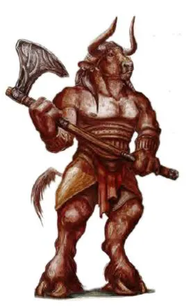

# Minotauro

O urro de um minotauro é um grito de batalha selvagem que as criaturas mais civilizadas temem. Nascido no reino mortal através de ritos demoníacos, os minotauros são conquistadores e carnívoros selvagens que vivem para caçar. Seu pelo marrom ou negro é manchado com o sangue dos seus oponentes mortos, e ele carrega o cheiro da morte.

***A Besta Interior***. A maioria dos minotauros é de carnívoros solitários que vagam por masmorras labirínticas, cavernas tortuosas, florestas primitivas e ruas e passagens em forma de labirinto de ruínas desoladas. Um minotauro pode visualizar cada rota que ele poderia tomar para encurtar a distância até sua presa.

O cheiro de sangue, os pedaços de carne e o quebrar de ossos estimulam o desejo por carnificina de um minotauro, esmagando todos os pensamentos e razão. Em uma fúria de sangue, um minotauro investe em qualquer coisa que ele veja, cabeçando e chifrando como um aríete, então partindo os mortos em dois.

Além de emboscar as criaturas que vagam em seu labirinto, um minotauro não se importa muito com estratégia ou táticas. Os minotauros raramente se organizam, eles não respeitam autoridade ou hierarquia e eles são notoriamente difíceis de se escravizar, muito menos controlar.

***Cultos do Rei Chifrudo***. Os minotauros são descendentes sombrios de humanoides transformados pelos rituais de cultos que rejeitaram a opressão da

## Bloco de estatísticas: Minotauro

*Monstruosidade Grande, caótico e mau*

**Classe de Armadura** 14 (armadura natural)  
**Pontos de Vida** 76 (9d10 + 27)  
**Deslocamento** 12 m

| FOR | DES | CON | INT | SAB | CAR |
| :---: | :---: | :---: | :---: | :---: | :---: |
| 18 (+4) | 11 (+0) | 16 (+3) | 6 (–2) | 16 (+3) | 9 (–1) |

**Perícias** Percepção +7  
**Sentidos** visão no escuro 18 m, Percepção passiva 17  
**Idiomas** Abissal  
**Nível de Desafio** 3 (700 XP)

***Descuidado***. No início do seu turno, o minotauro pode ganhar vantagem em todas as jogadas de ataque corpo-a-corpo que ele fizer durante seu turno, mas as jogadas de ataque contra ele tem vantagem até o início do próximo turno dele.

***Investida***. Se o minotauro se mover, pelo menos, 3 metros em linha reta até um alvo e então atingi-lo com seu ataque de chifrada no mesmo turno, o alvo sofre 9 (2d8) de dano perfurante extra. Se o alvo for uma criatura, ele deve ser bem sucedido num teste de resistência de Força CD 14 ou será empurrado a 3 metros de distância e derrubado no chão.

***Lembrança Labiríntica***. O minotauro pode lembrar perfeitamente de qualquer caminho por onde tenha passado.

### Ações

***Machado Grande***. *Ataque Corpo-a-Corpo com Arma*: +6 para atingir, alcance 1,5 m, um alvo. *Acerto*: 17 (2d12 + 4) de dano cortante.

***Chifrada***. *Ataque Corpo-a-Corpo com Arma*: +6 para atingir, alcance 1,5 m, um alvo. *Acerto*: 13 (2d8 + 4) de dano perfurante.

autoridade ao retornar para a natureza. Os alistados, muitas vezes confundem esses cultos com círculos druídicos ou religiões totêmicas cujas cerimônias envolvem entrar em um labirinto enquanto se usa uma máscara cerimonial animal.

Dentro desses ambientes enclausurados, os cultistas caçam, matam e comem bestas selvagens, entregando-se a seus mais básicos instintos primitivos. No final, no entanto, sacrifícios animais são substituídos por sacrifícios humanoides – algumas vezes um alistado que tenta escapar do culto após descobrir seus segredos. Esses labirintos se tornam sangrentos salões de abate, ecoando com a selvageria dos cultistas.

Desconhecido de todos, exceto para seus líderes de mais alto nível, estes cultos misteriosos são criações do lorde demônio Bafomé, o Rei Chifrudo, cuja camada no Abismo é um labirinto gigantesco. Alguns de seus seguidores são suplicantes fervorosos que almejam força e poder. Outros vem ao culto buscando uma vida livre das correntes da autoridade – e são libertos de sua humanidade enquanto Bafomé os transforma nos minotauros que copiam sua própria forma selvagem.

Embora tenham surgido como criações do Rei Chifrudo, os minotauros podem se reproduzir uns com os outros, dando origem a uma raça independente das crias selvagens de Bafomé no mundo.
