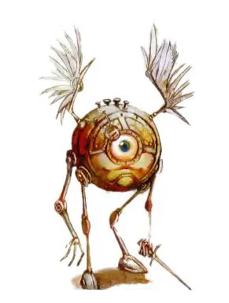
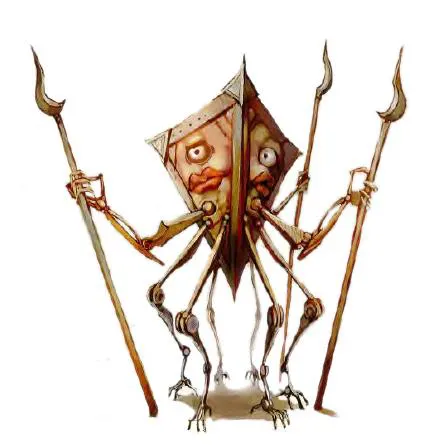
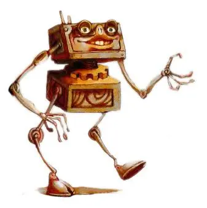
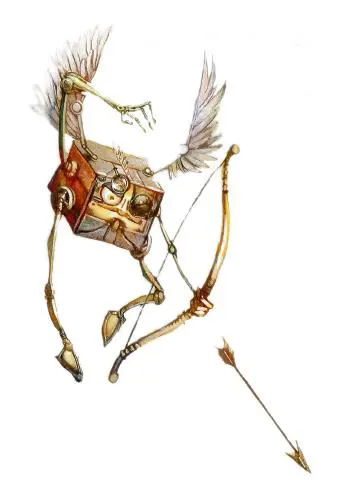
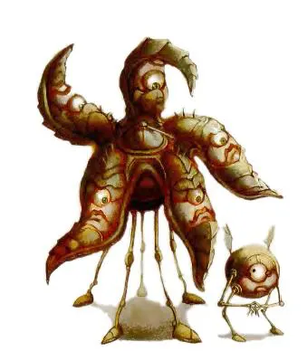

# Modrons

Os modrons são seres de lei absoluta que se devotam a uma hierarquia similar a uma colmeia. Eles vivem no plano de Mecânus e vigiam suas engrenagens eternamente rotativas, por toda sua existência em uma rotina rígida de ordem perfeita.

***Lei e Ordem Absolutas***. Sobre a direção de seus líder, Primus, os modrons ampliam a ordem no multiverso de acordo com as leis além da compreensão das mentes mortais. Suas próprias mentes estão interconectadas em uma pirâmide hierárquica, na qual cada modron recebe os comandos de superiores e delega ordens a seu subordinados. Um modron realiza comandos com total obediência, máxima eficiência e ausência de moralidade ou ego.

Os modrons não tem senso de autopreservação além do necessário para cumprir seus deveres. Eles existem como um coletivo unificado, divididos em níveis, mas eles sempre se referem a si mesmos no coletivo. Para um modron, não existe “eu”, mas apenas “nós”.

***Hierarquia Absoluta***. Os modrons se comunicam apenas com os de seu próprio nível ou com os de nível imediatamente acima ou abaixo deles. Os modrons com mais de um nível de diferença são ou muito avançados ou muito simplórios para compreender.

***Engrenagens da Grande Maquina***. Se um modron for destruído, seus restos se desintegram. Um substituto do nível seguinte abaixo então se transforma em um lampejo de luz, ganhando a forma física do seu novo nível. O modron promovido é substituído por um dos seus subordinados da mesma maneira, até chegar aos níveis mais baixos da hierarquia. Então, um novo modron é criado por Primus, com um fluxo constante de monodrones que saem da Grande Catedral de Modron em Mecânus, como resultado.

***A Grande Marcha Modron***. Quando as engrenagens de Mecânus completam dezessete ciclos a cada 289 anos, Primus envia um vasto exército de modrons pelos Planos Exteriores, ostensivamente, em uma missão de reconhecimento. A marcha é longa e perigosa, e apenas um pequeno número de modrons retorna para Mecânus.

### Monodrone

Um monodrone pode realizar uma tarefa simples por vez e pode transmitir uma única mensagem de até quarenta e oito palavras.

### Bidrone

Os cúbicos bidrones supervisionam unidades monodrones e podem realizar até duas tarefas por vez.

### Tridrone

Os tridrones tem formato de pirâmides invertidas. Eles lideram os modrons inferiores em batalha.

### Quadrone

Combatentes astutos, os quadrones servem como artilharia e oficiais de campo nos regimentos dos exércitos modron.

### Pentadrone

Os pentadrones supervisionam a população trabalhadora de Mecânus e podem improvisar em resposta a novas situações.

> **Variação: Modrons Desgarrados**
>
> Uma unidade modron, às vezes, torna-se defeituosa, ou por desgaste natural ou por exposição a forças caóticas. Modrons desgarrados não agem de acordo com os desejos e diretivas de Primus, infligindo leis, desobedecendo ordens e até se metendo em violência. Outros modrons caçam tais desgarrados. Um modron desgarrado perde o traço Mente Axiomática e pode ter qualquer tendência diferente de leal e neutro. No mais, ele possui as mesmas estatísticas de um modron regular do seu nível.

## Bloco de estatísticas: Monodrone

*Constructo Médio, leal e neutro*

**Classe de Armadura** 15 (armadura natural)  
**Pontos de Vida** 5 (1d8 + 1)  
**Deslocamento** 9 m, voo 9 m

| FOR | DES | CON | INT | SAB | CAR |
| :---: | :---: | :---: | :---: | :---: | :---: |
| 10 (+0) | 13 (+1) | 12 (+1) | 4 (–3) | 10 (+0) | 5 (–3) |

**Sentidos** visão verdadeira 36 m, Percepção passiva 10  
**Idiomas** Modron  
**Nível de Desafio** 1/8 (25 XP)

***Mente Axiomática***. O monodrone não pode ser compelido a agir de uma forma contraria a sua natureza ou a suas instruções.

***Desintegração***. Se o monodrone morrer, seu corpo se desintegra em pó, deixando para trás suas armas e qualquer outra coisa que ele esteja carregando.

### Ações

***Adaga***. *Ataque Corpo-a-Corpo com Arma*: +3 para atingir, alcance 1,5 m, um alvo. *Acerto*: 3 (1d4 + 1) de dano perfurante.

***Azagaia***. *Ataque Corpo-a-Corpo ou à Distância com Arma*: +2 para atingir, alcance 1,5 m ou distância 9/36 m, um alvo. *Acerto*: 3 (1d6) de dano perfurante.

## Bloco de estatísticas: Bidrone

*Constructo Médio, leal e neutro*

**Classe de Armadura** 15 (armadura natural)  
**Pontos de Vida** 11 (2d8 + 2)  
**Deslocamento** 9 m

| FOR | DES | CON | INT | SAB | CAR |
| :---: | :---: | :---: | :---: | :---: | :---: |
| 11 (+0) | 13 (+1) | 12 (+1) | 6 (–2) | 10 (+0) | 7 (–2) |

**Sentidos** visão verdadeira 36 m, Percepção passiva 10  
**Idiomas** Modron  
**Nível de Desafio** 1/4 (50 XP)

***Mente Axiomática***. O bidrone não pode ser compelido a agir de uma forma contraria a sua natureza ou a suas instruções.

***Desintegração***. Se o bidrone morrer, seu corpo se desintegra em pó, deixando para trás suas armas e qualquer outra coisa que ele esteja carregando.

### Ações

***Ataques Múltiplos***. O bidrone realiza dois ataques de punho ou dois ataques de azagaia.

***Punho***. *Ataque Corpo-a-Corpo com Arma*: +3 para atingir, alcance 1,5 m, um alvo. *Acerto*: 3 (1d4 + 1) de dano de concussão.

***Azagaia***. *Ataque Corpo-a-Corpo ou à Distância com Arma*: +3 para atingir, alcance 1,5 m ou distância 9/36 m, um alvo. *Acerto*: 4 (1d6 + 1) de dano perfurante.

## Bloco de estatísticas: Tridrone

*Constructo Médio, leal e neutro*

**Classe de Armadura** 15 (armadura natural)  
**Pontos de Vida** 16 (3d8 + 3)  
**Deslocamento** 9 m

| FOR | DES | CON | INT | SAB | CAR |
| :---: | :---: | :---: | :---: | :---: | :---: |
| 12 (+1) | 13 (+1) | 12 (+1) | 9 (–1) | 10 (+0) | 9 (–1) |

**Sentidos** visão verdadeira 36 m, Percepção passiva 10  
**Idiomas** Modron  
**Nível de Desafio** 1/2 (100 XP)

***Mente Axiomática***. O tridrone não pode ser compelido a agir de uma forma contraria a sua natureza ou a suas instruções.

***Desintegração***. Se o tridrone morrer, seu corpo se desintegra em pó, deixando para trás suas armas e qualquer outra coisa que ele esteja carregando.

### Ações

***Ataques Múltiplos***. O tridrone realiza três ataques de punho ou três ataques de azagaia.

***Punho***. *Ataque Corpo-a-Corpo com Arma*: +3 para atingir, alcance 1,5 m, um alvo. *Acerto*: 3 (1d4 + 1) de dano de concussão.

***Azagaia***. *Ataque Corpo-a-Corpo ou à Distância com Arma*: +3 para atingir, alcance 1,5 m ou distância 9/36 m, um alvo. *Acerto*: 4 (1d6 + 1) de dano perfurante.

## Bloco de estatísticas: Quadrone

*Constructo Médio, leal e neutro*

**Classe de Armadura** 15 (armadura natural)  
**Pontos de Vida** 22 (4d8 + 4)  
**Deslocamento** 9 m, voo 9 m

| FOR | DES | CON | INT | SAB | CAR |
| :---: | :---: | :---: | :---: | :---: | :---: |
| 12 (+1) | 14 (+2) | 12 (+1) | 10 (+0) | 10 (+0) | 11 (+0) |

**Perícias** Percepção +2  
**Sentidos** visão verdadeira 36 m, Percepção passiva 14  
**Idiomas** Modron  
**Nível de Desafio** 1 (200 XP)

***Mente Axiomática***. O quadrone não pode ser compelido a agir de uma forma contraria a sua natureza ou a suas instruções.

***Desintegração***. Se o quadrone morrer, seu corpo se desintegra em pó, deixando para trás suas armas e qualquer outra coisa que ele esteja carregando.

### Ações

***Ataques Múltiplos***. O quadrone realiza dois ataques de punho ou quatro ataques de arco curto.

***Punho***. *Ataque Corpo-a-Corpo com Arma*: +4 para atingir, alcance 1,5 m, um alvo. *Acerto*: 4 (1d4 + 2) de dano de concussão.

***Arco Curto***. *Ataque à Distância com Arma*: +4 para atingir, alcance 1,5 m ou distância 24/96 m, um alvo. *Acerto*: 5 (1d6 + 2) de dano perfurante.

## Bloco de estatísticas: Pentadrone

*Constructo Grande, leal e neutro*

**Classe de Armadura** 16 (armadura natural)  
**Pontos de Vida** 32 (5d10 + 5)  
**Deslocamento** 12 m

| FOR | DES | CON | INT | SAB | CAR |
| :---: | :---: | :---: | :---: | :---: | :---: |
| 15 (+2) | 14 (+2) | 12 (+1) | 10 (+0) | 10 (+0) | 13 (+1) |

**Perícias** Percepção +4  
**Sentidos** visão verdadeira 36 m, Percepção passiva 14  
**Idiomas** Modron  
**Nível de Desafio** 2 (450 XP)

***Mente Axiomática***. O pentadrone não pode ser compelido a agir de uma forma contraria a sua natureza ou a suas instruções.

***Desintegração***. Se o pentadrone morrer, seu corpo se desintegra em pó, deixando para trás suas armas e qualquer outra coisa que ele esteja carregando.

### Ações

***Ataques Múltiplos***. O pentadrone realiza cinco ataques com seus braços.

***Braço***. *Ataque Corpo-a-Corpo com Arma*: +4 para atingir, alcance 1,5 m, um alvo. *Acerto*: 5 (1d6 + 2) de dano de concussão.

***Gás Paralisante (Recarrega 5–6)***. O pentadrone exala um cone de 9 metros de gás. Cada criatura na área deve ser bem sucedida num teste de resistência de Constituição CD 11 ou ficará paralisada por 1 minuto. Uma criatura pode repetir o teste de resistência no final de cada um dos turnos dela, terminando o efeito sobre si num sucesso.
