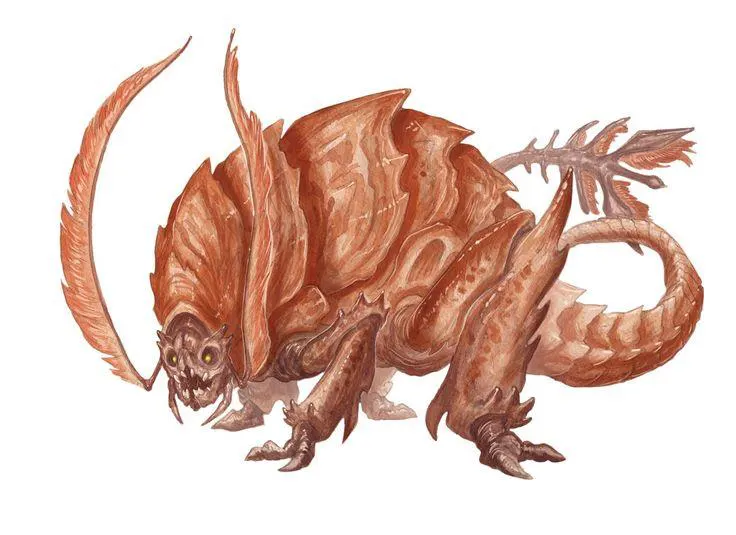

# Monstro da Ferrugem

A maioria dos anões prefere encarar um esquadrão de orcs a confrontar um único monstro da ferrugem. Essas criaturas estranhas e normalmente dóceis, corroem metais ferrosos, depois engolem a ferrugem que criaram. Nesse processo, eles arruinaram armaduras, escudos e armas de incontáveis aventureiros.

O corpo de um monstro da ferrugem é coberto por uma grossa armadura irregular, sua longa cauda termina em uma protuberância óssea e duas antenas emplumadas brotam de sua cabeça de inseto.

***Catadores do Subsolo***. Os monstros da ferrugem vagam por passagens subterrâneas em busca de metais ferrosos como ferro, aço, adamante e mitral, para consumir. Eles ignoram as criaturas que não estejam carregando tais metais, mas podem se tornar agressivos contra aqueles que estejam portando armas e armaduras de aço. Um monstro da ferrugem pode farejar sua comida à distância, imediatamente correndo para a fonte do cheiro para corroer e consumir o objeto.

Um monstro da ferrugem não se importa se a ferrugem que ele consome vem de um prego ou de uma espada. Os aventureiros podem distrair a criatura ao deixas objetos ferrosos para trás.

***Errantes Subterrâneos***. Os monstros da ferrugem raramente são encontrados em grandes números, preferindo caçar sozinhos ou em pequenos grupos. Eles vagam por túneis, se movendo de caverna em caverna em sua incansável busca por metais ferrosos para devorar. Suas andanças geralmente os leva ao encontro de outros habitantes do Subterrâneo que os consideram inofensivos ou pouco apetitosos. Por isso, os monstros da ferrugem podem ser encontrados bem próximos de outros monstros subterrâneos. Se eles forem bem tratados e bem alimentados, eles também podem se tornar companheiros e animais de estimação amigáveis.

## Bloco de estatísticas: Monstro da Ferrugem

*Monstruosidade Média, imparcial*

**Classe de Armadura** 14 (armadura natural)  
**Pontos de Vida** 27 (5d8 + 5)  
**Deslocamento** 12 m

| FOR | DES | CON | INT | SAB | CAR |
| :---: | :---: | :---: | :---: | :---: | :---: |
| 13 (+1) | 12 (+1) | 13 (+1) | 2 (–4) | 13 (+1) | 6 (–2) |

**Sentidos** visão no escuro 18 m, Percepção passiva 11  
**Idiomas** –  
**Nível de Desafio** 1/2 (100 XP)

***Enferrujar Metal***. Qualquer arma não-mágica feita de metal que atinja o monstro da ferrugem, é corroída. Após causar dano, a arma sofre uma penalidade permanente e cumulativa de –1 nas jogadas de dano. Se a penalidade chegar a –5, a arma é destruída. Munições não-mágicas feitas de metal que atingirem o monstro são destruídas depois de causarem dano.

***Farejar Metal***. O monstro da ferrugem pode localizar com precisão, pelo faro, metais ferrosos a até 9 metros dele.

### Ações

***Mordida***. *Ataque Corpo-a-Corpo com Arma*: +3 para atingir, alcance 1,5 m, um alvo. *Acerto*: 5 (1d8 + 1) de dano perfurante.

***Antenas***. O monstro corrói um objeto de metal ferroso não mágico que ele possa ver a 1,5 metro dele. Se o objeto não estiver sendo vestido ou carregado, o toque destrói um cubo de 30 centímetros dele. Se o objeto estiver sendo vestido ou carregado por uma criatura, ela pode realizar um teste de resistência de Destreza CD 11 para evitar o toque do monstro da ferrugem. Se o objeto tocado for ou uma armadura de metal ou um escudo de metal vestido ou carregado, ele sofre uma penalidade permanente e cumulativa de –1 na CA que ele concede. Uma armadura reduzida a CA 10 ou um escudo que chegue a +0 de bônus, é destruído. Se o objeto tocado for uma arma de metal empunhada, ela enferruja como descrito no traço Enferrujar Metal.
