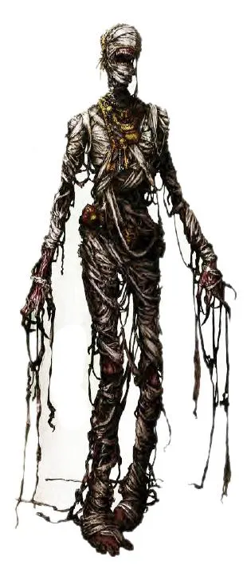

# Múmias

Levantada através de rituais fúnebres sombrios, uma múmia cambaleia envolta por quietude em um templo ou tumba há muito perdido. Tendo sido desperta de seu descanso, ela pude os transgressores com o poder de sua maldição profana.

***Ira Preservada***. Os longos rituais de enterro que acompanham o sepultamento de uma múmia ajudam a proteger seu corpo do apodrecimento. No processo de embalsamamento, os órgãos da criatura recém-morta são removidos e colocados em jarros especiais e seu corpo é tratado com óleos conservantes, ervas e invólucros. Após o corpo ter sido preparado, o cadáver é tipicamente é envolto em bandagens de linho.

***A Vontade dos Deuses Sombrios***. Uma múmia morta-viva é criada quando um sacerdote de um deus da morte ou outra divindade obscura imbui ritualmente um cadáver preparado com magia necromântica. As bandagens de linho envolvendo a múmia são inscritas com símbolos necromânticos antes do ritual de sepultamento ser concluído com uma invocação de trevas. Conforme a múmia sofre com a morte-vida, ela se anima em resposta às condições especificadas no ritual. Mais comumente, uma transgressão contra seu túmulo, tesouros, terras ou entes queridos irão fazer uma múmia se levantar.

***O Castigado***. Uma vez falecido, um indivíduo não tem escolha se seu corpo irá ou não se tornar uma múmia. Algumas múmias foram indivíduos poderosos que desagradaram alto sacerdotes ou faraós, ou que cometeram crimes de traição, adultério ou assassinato. Como castigo, eles foram amaldiçoados com a morte-vida eterna, embalsamados, mumificados e trancafiados. Em outros tempos, múmias agindo como guardiãs de tumbas foram criadas a partir de escravos mortos especificamente para servir a um propósito maior.

***Criatura de Ritual***. Uma múmia obedece às condições e parâmetros previstos pelos rituais que as criaram, impulsionadas apenas para punir transgressores. O terror avassalador que anuncia o ataque de uma múmia pode deixar as pretensas vítimas paralisadas de medo. Nos dias que seguem o toque de uma múmia, o corpo da vítima apodrece de fora para dentro, até não restar nada além de pó.

***Terminando a Maldição da Múmia***. Mágica rara pode desfazer ou dissipar o ritual que deu vida a uma múmia, permitindo que ela morra realmente. Mais comumente, uma múmia pode ser enviada de volta para seu descanso eterno ao se desfazer a transgressão que a fez se levantar. Um ídolo sagrado deveria ser recolocado em seu pedestal, um tesouro roubado poderia ser trazido de volta a sua tumba ou um templo poderia ser purificado do derramamento de sangue dos despojadores.

Ofensas mais efêmeras ou permanentes, como revelar um segredo que a múmia desejava manter ou matar um ente querido da múmia, não podem ser remediados com tanta facilidade. Em tais casos, uma múmia poderia massacrar todas as criaturas responsáveis e, ainda assim, não sessar sua ira.

***Arquivos Mortos-Vivos***. Embora raramente se preocupem em fazê-lo, as múmias podem falar. Como resultado, algumas servem como repositórios mortos-vivos de conhecimento perdido e podem ser consultadas pelos descendentes daqueles que as criaram. Indivíduos poderosos, às vezes, intencionalmente sequestram múmias para consultas ocasionais.

***Natureza Morta-Viva***. Uma múmia não precisa respirar, comer, beber ou dormir.

## Bloco de estatísticas: Múmia

*Morto-vivo Médio, leal e mau*

**Classe de Armadura** 11 (armadura natural)  
**Pontos de Vida** 58 (9d8 + 18)  
**Deslocamento** 6 m

| FOR | DES | CON | INT | SAB | CAR |
| :---: | :---: | :---: | :---: | :---: | :---: |
| 16 (+3) | 8 (–1) | 15 (+2) | 6 (–2) | 10 (+0) | 12 (+1) |

**Testes de Resistência** Sab +2  
**Vulnerabilidade a Dano** fogo  
**Resistência a Dano** concussão, cortante e perfurante de ataques não-mágicos  
**Imunidade a Dano** necrótico, veneno  
**Imunidade a Condição** amedrontado, enfeitiçado, envenenado, exausto, paralisado  
**Sentidos** visão no escuro 18 m, Percepção passiva 10  
**Idiomas** os idiomas que conhecia em vida  
**Nível de Desafio** 3 (700 XP)

### Ações

***Ataques Múltiplos***. A múmia pode usar seu Olhar Desesperador e realiza um ataque com seu punho pútrido.

***Punho Pútrido***. *Ataque Corpo-a-Corpo com Arma*: +5 para atingir, alcance 1,5 m, um alvo. *Acerto*: 10 (2d6 + 3) de dano de concussão mais 10 (3d6) de dano necrótico. Se o alvo for uma criatura, ele deve ser bem sucedido num teste de resistência de Constituição CD 12 ou será amaldiçoado com a podridão da múmia. O alvo amaldiçoado não pode recuperar pontos de vida e seu máximo de pontos de vida é reduzido em 10 (3d6) a cada 24 horas passadas. Se a maldição reduzir o máximo de pontos de vida do alvo a 0, ele morre e seu corpo se torna pó. A maldição dura até ser removida pela magia *remover maldição* ou mágica similar.

***Olhar Desesperador***. A múmia afeta uma criatura que ela possa ver, a até 18 metros dela. Se o alvo puder ver a múmia, ele deve ser bem sucedido num teste de resistência de Sabedoria CD 11 contra essa magia, ou ficará amedrontado até o final do próximo turno da múmia. Se o alvo fracassar no teste de resistência por 5 ou mais, ele também fica paralisado pelo mesmo tempo. Um alvo que seja bem sucedido no teste de resistência fica imune ao Olhar Desesperador de todas as múmias (exceto dos senhores das múmias) pelas próximas 24 horas.

### Senhor das Múmias

Nas tumbas em que os antigos monarcas tirânicos e os alto sacerdotes dos deuses sombrios descansam seu repouso sem sonhos, eles esperam pelo momento em que poderão reivindicar seus tronos e reforjar seus antigos impérios. A regalia dos seus terríveis governos ainda adornam seus corpos envoltos em bandagens, suas vestes são finamente costuradas com símbolos do mal e suas armaduras de bronze são gravadas com brasões de dinastias que sucumbiram a milhares de anos atrás.

Sob os direcionamentos dos mais poderosos sacerdotes, o ritual que cria uma múmia pode ser elevado em potência. O senhor das múmias que se ergue a partir de tais rituais, mantem as memórias e personalidade de sua vida anterior e é dotado com resistência sobrenatural. Imperadores mortos empunham as mesmas lâminas rúnicas infames que eles tinhas nas lendas. Lordes feiticeiros conjuram as magias proibidas que certa vez controlaram uma população aterrorizada e os deuses sombrios recompensam as orações de reis-sacerdotes mortos proporcionando a eles magias divinas.

***Coração do Senhor das Múmias***. Como parte do ritual que cria um senhor das múmias, o coração e as vísceras da criatura são removidos do cadáver e colocados em vasos canópicos. Esses vasos são, geralmente, esculpidos em pedra calcária ou feitos de cerâmica, gravados e pintados com hieróglifos religiosos.

Enquanto seu coração atrofiado permanecer intacto, um senhor das múmias não pode ser destruído permanentemente. Quando cai a 0 pontos de vida, o senhor das múmias se torna pó e se reforma com sua força total 24 horas depois, erguendo-se do pó bem próximo do vaso canópico contendo seu coração. Um senhor das múmias pode ser destruído ou impedido de se reformar ao se cremar seu coração até as cinzas. Por esse motivo, um senhor das múmias geralmente mantem seu coração e vísceras em tumbas ou câmaras escondidas.

O coração do senhor das múmias tem CA 5, 25 pontos de vida e é imune a todos os danos, exceto a fogo.

### O Covil do Senhor das Múmias

O senhor das múmias vigia de um antigo templo ou tumulo que é protegido por mortos-vivos menores e equipado com armadilhas. Escondido nesse templo está o sarcófago onde o senhor das múmias guarda seus maiores tesouros.

Um senhor das múmias enfrentado em seu covil tem um nível de desafio 16 (15.000 XP).

### Ações de Covil

No valor de iniciativa 20 (quebrando toda a sequência de iniciativa), o senhor das múmias realiza uma ação de covil fazendo um dos efeitos a seguir; o senhor das múmias não pode usar o mesmo efeito em duas rodadas consecutivas.

- Cada criatura morta-viva no covil pode localizar com precisão cada criatura viva a até 36 metros delas até a contagem de iniciativa 20, na próxima rodada.
- Cada morto-vivo no covil tem vantagem nos testes de resistência contra efeitos que expulsem mortos-vivos até a contagem de iniciativa 20, na próxima rodada.
- Até a contagem de iniciativa 20 na próxima rodada, qualquer criatura não-morta-viva que tentar conjurar uma magia de 4° nível ou inferior no covil do senhor das múmias, é assolado por dores. A criatura pode escolher outra ação, mas se tentar conjurar a magia, ela deve realizar um teste de resistência de Constituição. Se fracassar na resistência, ela sofre 1d6 de dano necrótico por nível da magia, e a magia não surte efeito e é perdida.

### Efeitos Regionais

O templo ou tumba de um senhor das múmias é distorcido de qualquer das seguintes formas pela presença obscura da criatura:

- A comida instantaneamente apodrece e a água instantaneamente evapora quando trazida para o covil. Outras bebidas não-mágicas estragam – vinho se torna vinagre, por exemplo.
- Magias de adivinhação conjuradas dentro do covil por outras criaturas que não o senhor das múmias, tem 25 por cento de chance de fornecerem resultados enganosos, como determinado pelo Mestre. Se uma magia de adivinhação já tiver chance de falhar ou de ser incerta quando conjurada diversas vezes, a chance disso ocorrer aumenta em 25 por cento.
- Uma criatura que pegue tesouros do covil é amaldiçoada até o tesouro ser devolvido. O alvo

## Bloco de estatísticas: Senhor das Múmias

*Morto-vivo Médio, leal e mau*

**Classe de Armadura** 17 (armadura natural)  
**Pontos de Vida** 97 (13d8 + 39)  
**Deslocamento** 6 m

| FOR | DES | CON | INT | SAB | CAR |
| :---: | :---: | :---: | :---: | :---: | :---: |
| 18 (+4) | 10 (+0) | 17 (+3) | 11 (+0) | 18 (+4) | 16 (+3) |

**Testes de Resistência** Con +8, Int +5, Sab +9, Car +8  
**Perícias** História +5, Religião +5  
**Vulnerabilidade a Dano** fogo  
**Resistência a Dano** concussão, cortante e perfurante de ataques não-mágicos  
**Imunidade a Dano** necrótico, veneno  
**Imunidade a Condição** amedrontado, enfeitiçado, envenenado, exausto, paralisado  
**Sentidos** visão no escuro 18 m, Percepção passiva 14  
**Idiomas** os idiomas que conhecia em vida  
**Nível de Desafio** 15 (13.000 XP)

***Conjuração***. O senhor das múmias é um conjurador de 10° nível. Sua habilidade de conjuração é Sabedoria (CD de resistência de magia 17, +9 para atingir com ataques com magia). Ele possui as seguintes magias de clérigo preparadas:

Truques (à vontade): *chama sagrada, taumaturgia* 1° nível (4 espaços): *comando, escudo da fé, raio teleguiado* 2° nível (3 espaços): *arma espiritual, imobilizar pessoa, silêncio* 3° nível (3 espaços): *animar mortos, dissipar magia* 4° nível (3 espaços): *adivinhação, guardião da fé* 5° nível (2 espaços): *praga, praga de insetos* 6° nível (1 espaços): *ferimento pleno*

***Rejuvenescimento.*** Um senhor das múmias destruído adquire um novo corpo em 24 horas, se seu coração estiver intacto, recuperando todos os seus pontos de vida e se tornando ativo novamente. O novo corpo aparece a 1,5 metro do coração do senhor das múmias.

***Resistência à Magia***. O senhor das múmias tem vantagem em testes de resistência contra magias e outros efeitos mágicos.

### Ações

***Ataques Múltiplos***. O senhor das múmias pode usar seu Olhar Desesperador e realiza um ataque com seu punho pútrido.

***Punho Pútrido***. *Ataque Corpo-a-Corpo com Arma*: +9 para atingir, alcance 1,5 m, um alvo. *Acerto*: 14 (3d6 + 4) de dano de concussão mais 21 (6d6) de dano necrótico. Se o alvo for uma criatura, ele

amaldiçoado tem desvantagem em todos os testes de resistência. A maldição dura até ser removida por uma magia *remover maldição* ou mágica similar.

Se o senhor das múmias for destruído, esses efeitos terminam imediatamente.

deve ser bem sucedido num teste de resistência de Constituição CD 16 ou será amaldiçoado com a podridão da múmia. O alvo amaldiçoado não pode recuperar pontos de vida e seu máximo de pontos de vida é reduzido em 10 (3d6) a cada 24 horas passadas. Se a maldição reduzir o máximo de pontos de vida do alvo a 0, ele morre e seu corpo se torna pó. A maldição dura até ser removida pela magia *remover maldição* ou mágica similar.

***Olhar Desesperador***. O senhor das múmias afeta uma criatura que ela possa ver, a até 18 metros dela. Se o alvo puder ver a múmia, ele deve ser bem sucedido num teste de resistência de Sabedoria CD 16 contra essa magia, ou ficará amedrontado até o final do próximo turno da múmia. Se o alvo fracassar no teste de resistência por 5 ou mais, ele também fica paralisado pelo mesmo tempo. Um alvo que seja bem sucedido no teste de resistência fica imune ao Olhar Desesperador de todas as múmias e senhores das múmias pelas próximas 24 horas.

### Ações Lendárias

O senhor das múmias pode realizar 3 ações lendárias, escolhidas dentre as opções abaixo. Apenas uma ação lendária pode ser usada por vez e apenas no final do turno de outra criatura. O senhor das múmias recupera as ações lendárias gastas no começo do turno dele.

**Ataque**. O senhor das múmias realiza um ataque com seu punho pútrido ou usa seu Olhar Desesperador.  
**Poeira Cegante**. Poeira e areia cegante rodopiam magicamente ao redor do senhor das múmias. Cada criatura a 1,5 metro dele, deve ser bem sucedida num teste de resistência de Constituição CD 16 ou ficará cega até o final do próximo turno da criatura.  
**Palavra Blasfema (Custa 2 Ações).** O senhor das múmias pronuncia uma palavra blasfema. Cada criatura não-morta-viva a até 3 metros dele que puder ouvir a pronuncia mágica, deve ser bem sucedida num teste de resistência de Constituição CD 16 ou ficará atordoada até o final do próximo turno do senhor das múmias.  
**Canalizar Energia Negativa (Custa 2 Ações).** O senhor das múmias libera magicamente energia negativa. As criaturas a até 18 metros dele, incluindo as atrás de barreiras ou em esquinas, não podem recuperar pontos de vida até o final do próximo turno do senhor das múmias.  
**Vendaval de Areia (Custa 2 Ações).** O senhor das múmias se transforma magicamente em um vendaval de areia, se movendo até 18 metros e voltando a sua forma normal. Enquanto estiver na forma de vendaval, ele é imune a todos os danos e não pode ser agarrado, petrificado, derrubado, impedido ou atordoado. O equipamento vestido ou carregado pelo senhor das múmias permanece em sua posse.
