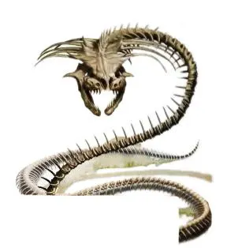
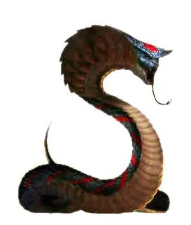
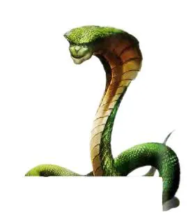

# Nagas

As nagas são serpentes inteligentes que habitam ruínas do passado, acumulando tesouros e conhecimentos arcanos.

As primeiras nagas foram criadas como guardiãs imortais por uma raça humanoide a muito perdida na história. Quando essa raça pereceu, as nagas consideraram-se as herdeiras legítimas dos tesouros e conhecimentos dos seus senhores. Esforçadas e focadas, as nagas, ocasionalmente, aventuram-se longe de seus covis para rastrear itens mágicos ou grimórios raros.

As nagas nunca sentem o desgaste do tempo ou sucumbem a doenças. Mesmo se for derrubada, o espírito imortal da naga reforma um novo corpo em questão de dias, pronto para continuar seu trabalho eterno.

***Ditadoras Benevolentes e Tiranas Brutais***. Uma naga governa seu domínio com autoridade absoluta. Independentemente se ela comanda com compaixão ou aterrorizando seus súditos, a naga acredita ser a senhora de todas as outras criaturas que habitem em seus domínios.

***Rivalidade***. As nagas são inimigas de longa data dos yuan-ti, com ambas as raças se enxergando como a epitome da evolução serpentina. Apesar da cooperação entre eles ser rara, as nagas e os yuan-ti as vezes colocam suas diferenças de lado para trabalhar em objetivos em comum. Porém, os yuan-ti sempre se irritam com o autoritarismo de uma naga.

***Natureza Imortal***. Uma naga não precisa respirar, comer, beber ou dormir.

### Naga dos Ossos

Em resposta a longa história de conflito entre yuan-ti e nagas, os yuan-ti criaram um ritual necromântico capaz de frear a ressurreição de uma naga ao transformar uma naga viva em um servo morto-vivo esquelético. Uma naga dos ossos mantem apenas algumas poucas magias que conhecia em vida.

### Naga Espiritual

As nagas espirituais vivem em melancolia e rancor, constantemente tramando vingança contra as criaturas que tenham as prejudicado – ou que elas creem terem as prejudicado. Se entocando em cavernas e ruínas sombrias, elas dedicam seu tempo a desenvolver novas magias e escravizar os mortais que as rodeiam. Uma naga espiritual gosta de enfeitiçar seus oponentes, atraindo-os para próximo para que possa fincar suas presas venenosas em suas carnes.

### Naga Guardiã

Sábias e boas, as belas nagas guardiãs protegem locais sagrados e impedem que itens de poder mágico caiam em mãos malignas. Em seus redutos escondidos, elas pesquisam magias e bolam planos mirabolantes para frustrar os desígnios malignos de seus inimigos.

Uma naga guardiã não busca violência, avisando os intrusos ao invés de ataca-los. Apenas se seus adversários persistirem a naga irá atacar, abordando os inimigos com suas magias e saliva venenosa.

## Bloco de estatísticas: Naga dos Ossos

*Morto-vivo Grande, leal e mau*

**Classe de Armadura** 15 (armadura natural)  
**Pontos de Vida** 58 (9d10 + 9)  
**Deslocamento** 9 m

| FOR | DES | CON | INT | SAB | CAR |
| :---: | :---: | :---: | :---: | :---: | :---: |
| 15 (+2) | 16 (+3) | 12 (+1) | 15 (+2) | 15 (+2) | 16 (+3) |

**Imunidade a Dano** veneno  
**Imunidade a Condição** enfeitiçado, envenenado, exausto, paralisado  
**Sentidos** visão da verdade 18 m, Percepção passiva 12  
**Idiomas** Comum mais um outro idioma  
**Nível de Desafio** 4 (1.100 XP)

***Conjuração***. A naga é uma conjuradora de 5° nível (CD de resistência de magia 12, +4 para atingir com ataques com magia) que precisa apenas dos componentes verbais para conjurar suas magias. Se a naga era uma naga guardiã em vida, sua habilidade de conjuração é Sabedoria e ela possuirá as seguintes magias de clérigo preparadas:

Truques (à vontade): *chama sagrada, consertar, taumaturgia* 1° nível (4 espaços): *comando, escudo da fé* 2° nível (3 espaços): *acalmar emoções, imobilizar pessoa* 3° nível (2 espaços): *rogar maldição*

Se a naga era uma naga espiritual em vida, sua habilidade de conjuração é Inteligência e ela possuirá as seguintes magias de mago preparadas:

Truques (à vontade): *ilusão menor, mãos mágicas, raio de gelo* 1° nível (4 espaços): *enfeitiçar pessoa, sono* 2° nível (3 espaços): *detectar pensamentos, imobilizar pessoa* 3° nível (2 espaços): *relâmpago*

### Ações

***Mordida***. *Ataque Corpo-a-Corpo com Arma*: +5 para atingir, alcance 3 m, uma criatura. *Acerto*: 10 (2d6 + 3) de dano perfurante mais 10 (3d6) de dano de veneno.

## Bloco de estatísticas: Naga Espiritual

*Monstruosidade Grande, caótico e mau*

**Classe de Armadura** 15 (armadura natural)  
**Pontos de Vida** 75 (10d10 + 20)  
**Deslocamento** 12 m

| FOR | DES | CON | INT | SAB | CAR |
| :---: | :---: | :---: | :---: | :---: | :---: |
| 18 (+4) | 17 (+3) | 14 (+2) | 16 (+3) | 15 (+2) | 16 (+3) |

**Testes de Resistência** Des +6, Con +5, Sab +5, Car +6  
**Imunidade a Dano** veneno  
**Imunidade a Condição** enfeitiçado, envenenado  
**Sentidos** visão da verdade 18 m, Percepção passiva 12  
**Idiomas** Abissal, Comum  
**Nível de Desafio** 8 (3.900 XP)

***Conjuração***. A naga é uma conjuradora de 10° nível. Sua habilidade de conjuração é Inteligência (CD de resistência de magia 14, +6 para atingir com ataques com magia) e ela precisa apenas dos componentes verbais para conjurar suas magias. Ela possui as seguintes magias de mago preparadas:

Truques (à vontade): *ilusão menor, mãos mágicas, raio de gelo* 1° nível (4 espaços): *detectar magia, enfeitiçar pessoa, sono* 2° nível (3 espaços): *detectar pensamentos, imobilizar pessoa* 3° nível (3 espaços): *relâmpago, respirar na água* 4° nível (2 espaços): *malogro, porta dimensional* 5° nível (2 espaços): *dominar pessoa*

***Rejuvenescimento.*** Se morrer, a naga retorna a vida em 1d6 dias e recupera todos os seus pontos de vida. Apenas a magia *desejo* pode impedir esse traço de funcionar.

### Ações

***Mordida***. *Ataque Corpo-a-Corpo com Arma*: +7 para atingir, alcance 3 m, uma criatura. *Acerto*: 7 (1d6 + 4) de dano perfurante e o alvo deve realizar um teste de resistência de Constituição CD 13, sofrendo 31 (7d8) de dano de veneno caso falhe na resistência, ou metade desse dano se obtiver sucesso.

## Bloco de estatísticas: Naga Guardiã

*Monstruosidade Grande, leal e bom*

**Classe de Armadura** 18 (armadura natural)  
**Pontos de Vida** 127 (15d10 + 45)  
**Deslocamento** 12 m

| FOR | DES | CON | INT | SAB | CAR |
| :---: | :---: | :---: | :---: | :---: | :---: |
| 19 (+4) | 18 (+4) | 16 (+3) | 16 (+3) | 19 (+4) | 18 (+4) |

**Testes de Resistência** Des +8, Con +7, Int +7, Sab +8, Car +8  
**Imunidade a Dano** veneno  
**Imunidade a Condição** enfeitiçado, envenenado  
**Sentidos** visão da verdade 18 m, Percepção passiva 14  
**Idiomas** Celestial, Comum  
**Nível de Desafio** 10 (5.900 XP)

***Conjuração***. A naga é uma conjuradora de 11° nível. Sua habilidade de conjuração é Sabedoria (CD de resistência de magia 16, +8 para atingir com ataques com magia) e ela precisa apenas dos componentes verbais para conjurar suas magias. Ela possui as seguintes magias de clérigo preparadas:

Truques (à vontade): *chama sagrada, consertar, taumaturgia* 1° nível (4 espaços): *comando, curar ferimentos, escudo da fé* 2° nível (3 espaços): *acalmar emoções, imobilizar pessoa* 3° nível (3 espaços): *clarividência, rogar maldição* 4° nível (3 espaços): *banimento, movimentação livre* 5° nível (2 espaços): *coluna de chamas, missão* 6° nível (1 espaços): *visão da verdade*

***Rejuvenescimento.*** Se morrer, a naga retorna a vida em 1d6 dias e recupera todos os seus pontos de vida. Apenas a magia *desejo* pode impedir esse traço de funcionar.

### Ações

***Mordida***. *Ataque Corpo-a-Corpo com Arma*: +8 para atingir, alcance 3 m, uma criatura. *Acerto*: 8 (1d8 + 4) de dano perfurante e o alvo deve realizar um teste de resistência de Constituição CD 15, sofrendo 45 (10d8) de dano de veneno caso falhe na resistência, ou metade desse dano se obtiver sucesso.

***Cuspir Veneno***. *Ataque à Distância com Arma*: +8 para atingir, distância 4,5/9 m, uma criatura. *Acerto*: o alvo deve realizar um teste de resistência de Constituição CD 15, sofrendo 45 (10d8) de dano de veneno caso falhe na resistência, ou metade desse dano se obtiver sucesso.
