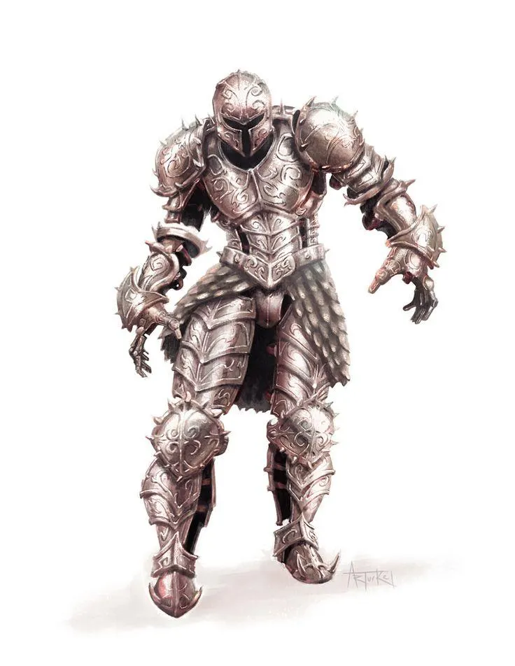
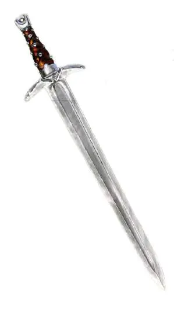
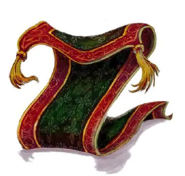

# Objetos Animados

Os objetos animados são construídos com magia potente para seguirem os comandos de seus criadores. Quando não estão sendo comandados, eles seguem a última ordem que receberam da melhor forma possível e podem agir independentemente para cumprir instruções simples. Alguns objetos animados (incluindo muitos dos criados em Faéria) podem conversar fluentemente ou adotar uma personalidade, mas a maioria são simples autômatos.

***Natureza de Constructo***. Um objeto animado não precisa respirar, comer, beber ou dormir.

A magia que anima um objeto é dissipada quando o constructo cai a 0 pontos de vida. Um objeto animado reduzido a 0 pontos de vida torna-se inanimado e também está muito danificado para servir para usar ou ter qualquer valor.

### Armadura Animada

Essa casca de aço vazia range quando se move, placas pesadas batem e esfregam-se umas contra as outras como o espírito vingativo ou um cavaleiro caído. Ponderoso, mas persistente, esse guardião mágico é quase sempre uma armadura de placas.

Para aumentar sua intimidação, uma armadura animada é frequentemente encantada com um discurso preparado, assim, a armadura pode proferir avisos, exigir senhas ou fornecer enigmas.

### Espada Voadora

Uma espada voadora dança no ar, lutando com a confiança de um guerreiro que não pode ser ferido. Espadas são as armas mais comuns animadas com magia. Machados, clavas, adagas, maças, lanças e até mesmo bestas auto carregáveis também são conhecidas por existir em forma de objeto animado.

### Tapete Sufocador

Pretensos ladrões e heróis descuidados chegam na entrada da residência de um inimigo, olhos e ouvidos alerta às armadilhas, apenas para terminar sua busca prematuramente enquanto o tapete sob seus pés se anima e os sufoca até a morte.

Um tapete sufocador pode ser feito de muitas formas diferentes, desde um tapete finamente tecido para uma rainha até um tapete grosso no casebre de um camponês. As criaturas com a habilidade de sentirem magia, detectam a aura mágica falsa do tapete.

Em alguns casos, um tapete sufocador é disfarçado como um *tapete voador* ou outro item mágico benéfico. Porém, um personagem que fique em cima ou sente no tapete, ou que tente proferir uma palavra de comando, é rapidamente preso conforme o tapete se enrola bem apertado ao redor da vítima.

## Bloco de estatísticas: Armadura Animada

*Constructo Médio, imparcial*

**Classe de Armadura** 18 (armadura natural)  
**Pontos de Vida** 33 (6d8 + 6)  
**Deslocamento** 7,5 m

| FOR | DES | CON | INT | SAB | CAR |
| :---: | :---: | :---: | :---: | :---: | :---: |
| 14 (+2) | 11 (+0) | 13 (+1) | 1 (–5) | 3 (–4) | 1 (–5) |

**Imunidade a Dano** psíquico, veneno  
**Imunidade a Condição** amedrontado, cego, enfeitiçado, envenenado, exausto, paralisado, petrificado, surdo  
**Sentidos** percepção às cegas 18 m (cego além desse raio), Percepção passiva 6  
**Idiomas** –  
**Nível de Desafio** 1 (200 XP)

***Aparência Falsa***. Enquanto a armadura permanecer imóvel, ela é indistinguível de uma armadura normal.

***Susceptibilidade à Antimagia***. A armadura fica incapacitada enquanto estiver na área de um *campo antimagia*. Se for alvo de *dissipar magia*, a armadura deve ser bem sucedida num teste de resistência de Constituição contra a CD de resistência de magia do conjurador, ou cairá inconsciente por 1 minuto.

### Ações

***Ataques Múltiplos***. A armadura realiza dois ataques corpo-a-corpo.

***Pancada***. *Ataque Corpo-a-Corpo com Arma*: +4 para atingir, alcance 1,5 m, um alvo. *Acerto*: 5 (1d6 + 2) de dano de concussão.

## Bloco de estatísticas: Espada Voadora

*Constructo Pequeno, imparcial*

**Classe de Armadura** 17 (armadura natural)  
**Pontos de Vida** 17 (5d6)  
**Deslocamento** 0 m, voo 15 m (planar)

| FOR | DES | CON | INT | SAB | CAR |
| :---: | :---: | :---: | :---: | :---: | :---: |
| 12 (+1) | 15 (+2) | 11 (+0) | 1 (–5) | 5 (–3) | 1 (–5) |

**Testes de Resistência** Des +4  
**Imunidade a Dano** psíquico, veneno  
**Imunidade a Condição** amedrontado, cego, enfeitiçado, envenenado, exausto, paralisado, petrificado, surdo  
**Sentidos** percepção às cegas 18 m (cego além desse raio), Percepção passiva 7  
**Idiomas** –  
**Nível de Desafio** 1/4 (50 XP)

***Aparência Falsa***. Enquanto a espada permanecer imóvel, ela é indistinguível de uma espada normal.

***Susceptibilidade à Antimagia***. A espada fica incapacitada enquanto estiver na área de um *campo antimagia*. Se for alvo de *dissipar magia*, a espada deve ser bem sucedida num teste de resistência de Constituição contra a CD de resistência de magia do conjurador, ou cairá inconsciente por 1 minuto.

### Ações

***Espada Longa***. *Ataque Corpo-a-Corpo com Arma*: +3 para atingir, alcance 1,5 m, um alvo. *Acerto*: 5 (1d8 + 1) de dano cortante.

## Bloco de estatísticas: Tapete Sufocador

*Constructo Grande, imparcial*

**Classe de Armadura** 12  
**Pontos de Vida** 33 (6d10)  
**Deslocamento** 3 m

| FOR | DES | CON | INT | SAB | CAR |
| :---: | :---: | :---: | :---: | :---: | :---: |
| 17 (+3) | 14 (+2) | 10 (+0) | 1 (–5) | 3 (–4) | 1 (–5) |

**Imunidade a Dano** psíquico, veneno  
**Imunidade a Condição** amedrontado, cego, enfeitiçado, envenenado, exausto, paralisado, petrificado, surdo  
**Sentidos** percepção às cegas 18 m (cego além desse raio), Percepção passiva 6  
**Idiomas** –  
**Nível de Desafio** 2 (450 XP)

***Aparência Falsa***. Enquanto o tapete permanecer imóvel, ela é indistinguível de um tapete normal.

***Susceptibilidade à Antimagia***. O tapete fica incapacitado enquanto estiver na área de um *campo antimagia*. Se for alvo de *dissipar magia*, o tapete deve ser bem sucedido num teste de resistência de Constituição contra a CD de resistência de magia do conjurador, ou cairá inconsciente por 1 minuto.

***Transferência de Dano***. Enquanto estiver agarrando uma criatura, o tapete sofre apenas metade do dano causado a ele e a criatura agarrada por ele sofre a outra metade.

### Ações

***Sufocar***. *Ataque Corpo-a-Corpo com Arma*: +5 para atingir, alcance 1,5 m, uma criatura Média ou menor. *Acerto*: a criatura é agarrada (CD 13 para escapar). Até esse agarrão acabar, o alvo fica impedido, cego e sofre risco de sufocar, e o tapete não pode sufocar outro alvo. Além disso, no início de cada turno do alvo, ele sofre 10 (2d6 + 3) de dano de concussão.
