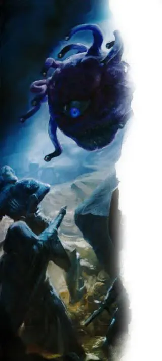
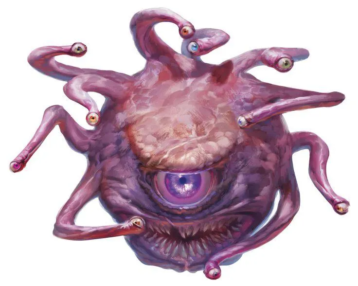
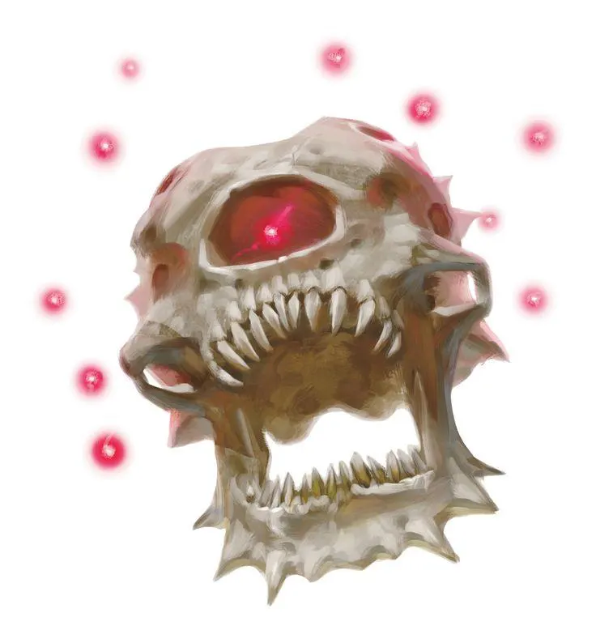
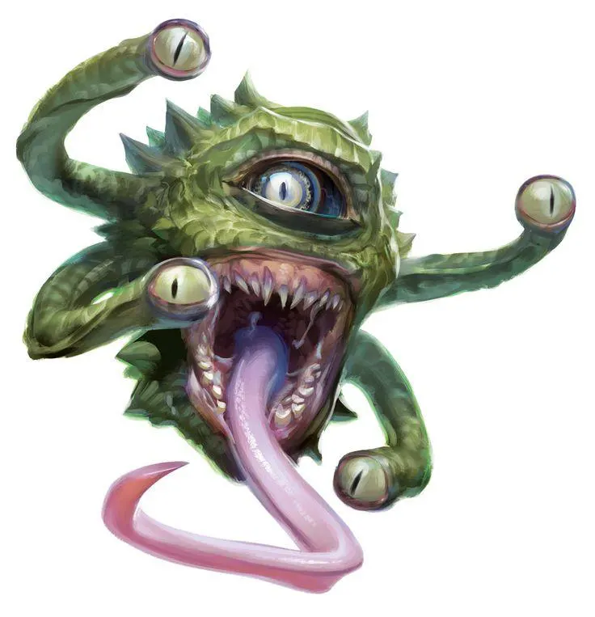

# Observadores

Um olhar para um observador é suficiente para identificar sua natureza alienígena e corrupta. Agressivas, odiosas e gananciosas, essas aberrações trata todas as outras criaturas como seres inferiores, manipulando-os ou destruindo-os quando desejam.

O corpo esférico de um observador levita todo o tempo e seu grande olho bojudo fixa-se acima de uma larga boca cheia de dentes, enquanto que os pedúnculos oculares menores que coroam seu corpo distorcido se viram para manter seus oponentes à vista. Quando um observador dorme, ele fecha seu olho central, mas deixa suas olhos menores abertos e alertas.

***Isolacionistas Xenofóbicos***. Os inimigos são abundantes, pelo menos é nisso que cada observador acredita. Os observadores estão convencidos que as outras criaturas ofendem-se por seu brilhantismo e poderes mágicos, desconsiderando que eles descartam essas criaturas inferiores com crueldade e repugnância. Os observadores sempre suspeitam que os outros estão tramando contra eles, mesmo que não existam outras criaturas nas redondezas.

O desdém que um observador tem pelas outras criaturas se estende a outros observadores. Cada observador acredita que sua forma é a ideal e que qualquer divergência dessa forma é uma falha na pureza racial da sua espécie. Os observadores variam vastamente em suas formas físicas, tornando os conflitos entre eles inevitáveis. Alguns observadores são protegidos por placas quitinosas sobrepostas. Alguns tem peles lisas. Outros tem pedúnculos oculares que se contorcem como tentáculos, enquanto que outros possuem talos com articulações similares a de crustáceos. Mesmo pequenas diferenças na tonalidade da pele podem tornar dois observadores em inimigos de longa data.

***Olho Tirano***. Alguns observadores conseguem canalizar sus tendências xenófobas em um terrível despotismo. Ao invés de viverem em isolamento, os, apropriadamente chamados, olhos tiranos, fundam e controlam vastos impérios. Um olho tirano, às vezes, esculpe um domínio dentro ou abaixo de uma cidade maior, comandando redes de agentes que operam em nome de seu mestre.

***Covis Alienígenas***. Por eles recusarem a partilhar território com outros, a maioria dos observadores escolhe colinas geladas, ruínas abandonadas e cavernas profundas para operar. O covil de um observador é esculpido pelo raio de desintegração do seu olho, enfatizando passagens verticais conectando câmaras empilhadas umas sobre as outras. Tal ambiente permite que um observador se mova livremente, ao mesmo tempo que impede que intrusos cheguem até ele facilmente. Quando intrusos chegam, a altura dos seus tetos abertos permite que um observador flutue para cima e assole seus inimigos no chão.

Tão alienígenas quanto seus criadores, as salas no covil de um observador refletem a arrogância da criatura. Ele infesta suas câmaras com troféus de suas batalhas vencidas, incluindo aventureiros petrificados que permanecem congelados em seus terríveis momentos finais, pedaços de outros observadores e itens mágicos adquiridos de adversários poderosos. Um observador julga sua própria riqueza por suas aquisições e nunca se desfaz de seus tesouros voluntariamente.

### O Covil do Observador

O centro do covil de um observador é tipicamente uma caverna grande e espaçosa com tetos altos, de onde ele pode atacar sem temer que oponentes entrem em combate corpo-a-corpo. Um observador enfrentado em seu covil tem um nível de desafio 14 (11.500 XP).

### Ações de Covil

Quando estiver lutando dentro de seu covil, um observador pode evocar a magia ambiente para realizar ações de covil. No valor de iniciativa 20 (quebrando toda a sequência de iniciativa), o observador realiza uma ação de covil fazendo um dos efeitos a seguir:

- Uma área de 15 metros quadrados a até 36 metros do observador torna-se pegajosa; essa área é terreno difícil até a contagem de iniciativa 20 na próxima rodada.
- Apêndices pegajosos brotam das paredes a até 36 metros do observador até a contagem de iniciativa 20 na rodada após a seguinte. Cada criatura, à escolha do observador, que comece seu turno a até 3 metros de tais paredes, deve ser bem sucedida num teste de resistência de Destreza CD 15 ou será agarrada. Escapar requer um teste bem sucedido de Força (Atletismo) ou de Destreza (Acrobacia) CD 15.
- Um olho se abre numa superfície sólida a até 18 metros do observador. Um raio ocular aleatório do observador é disparado desse olho em um alvo, à escolha do observador, que ele possa ver. O olho depois se fecha e desaparece.

Um observador não pode repetir um efeito até que todos tenham sido usado e não pode usar o mesmo efeito em duas rodadas consecutivas.

### Efeitos Regionais

A região contendo o covil de um observador é distorcida pela presença sobrenatural da criatura, o que cria um ou mais dos seguintes efeitos:

- As criaturas a até 1,5 quilômetro do covil do observador às vezes sentem como se estivessem sendo observadas quando não estão.
- Quando o observador dorme, pequenas deformações na realidade ocorrem a até 1,5 quilômetro do seu covil e então desaparecem 24 horas depois. Marcas nas paredes de cavernas podem mudar subitamente, um objeto misterioso pode aparecer onde não existia antes, limo inofensivo pode cobrir uma estátua e assim por diante. Esses efeitos se aplicam apenas a superfícies naturais e objetos não-mágicos que não estejam sob posse de ninguém.

Se o observador morrer, esses efeitos desaparecem ao decorrer de 1d10 dias.

### Tirano da Morte

Em raras ocasiões, a mente adormecida de um observador viaja para locais além da sua loucura normal, imaginando uma realidade em que ele existe além da morte. Quando tais sonhos acontecem, um observador pode se transformar, sua carne se desprende deixando um tirano da morte para trás. Esse monstro possui a astúcia e muito da magia que tinha em vida, mas é preenchido com o poder da morte-vida.

Um tirano da morte parece uma caveira pelada maciça, com um ponto de luz vermelha brilhando em sua órbita ocular vazia. Já que seus pedúnculos oculares apodreceram, dez olhos espectrais flutuam sobre a criatura e olha para todas as direções.

***Déspota Mortal***. Assim como faziam quando eram observadores, os tiranos da morte impelem seus poderes sobre outras criaturas. Além disso, a capacidade de um observador de anular energia mágica com seu olho central dá lugar a um poder mais sinistro em um tirano da morte, que pode transformar antigos escravos e inimigos em servos mortos-vivos.

Os zumbis criados por um tirano da morte são usados e descartados quando preciso. Eles montam guarda nas entradas do covil de um tirano da morte ou guardam suas câmaras de tesouro.

Agindo como iscas para armadilhas ou como linha de frente de combate, os zumbis mantem inimigos poderosos distraídos enquanto o tirano da morte toma posição e prepara-se para destruí-los.

***Exércitos dos Mortos***. Um tirano da morte que abrace a morte-vida torna-se uma máquina de destruição. Impulsionados por uma fome de poder e segurança, eles avançam contra assentamentos humanoides, usando seus raios oculares para destruir cada criatura que encontram, então criando um exército de mortos-vivos. Se não for controlado, um tirano da morte pode eliminar a população de uma cidade em semanas, em seguida, voltando seu olho morto-vivo para uma conquista mais ampla. Conforme cada colônia cai, as forças zumbis do tirano da morte crescem a números avassaladores.

***Natureza Morta-Viva***. Um tirano da morte não precisa respirar, comer, beber ou dormir.

### O Covil do Tirano da Morte

O covil de um tirano da morte é, geralmente, o mesmo local que ele mantinha como um observador, mas ele contém mais armadilhas de morte e decadência. Um tirano da morte enfrentado em seu covil tem um nível de desafio 15 (13.000 XP).

### Ações de Covil

Quando estiver lutando dentro de seu covil, um tirano da morte pode evocar a magia ambiente para realizar ações de covil. No valor de iniciativa 20 (quebrando toda a sequência de iniciativa), o tirano da morte realiza uma ação de covil fazendo um dos efeitos a seguir:

- Uma área de 15 metros quadrados a até 36 metros do observador é preenchida com olhos e tentáculos espectrais. Para as criaturas diferentes do tirano da morte, essa área é de escuridão leve e terreno difícil até a contagem de iniciativa 20 na próxima rodada.
- Apêndices pegajosos brotam das paredes a até 36 metros do observador até a contagem de iniciativa 20 na rodada após a seguinte. Todas as criaturas, incluindo as no Plano Etéreo, que forem hostis ao tirano da morte e que comecem seus turnos a até 3 metros de tais paredes, devem ser bem sucedidas num teste de resistência de Destreza CD 17 ou serão agarradas. Escapar requer um teste bem sucedido de Força (Atletismo) ou de Destreza (Acrobacia) CD 17.
- Um olho espectral se abre no ar num ponto a até 15 metros do tirano da morte. Um raio ocular aleatório do tirano é disparado desse olho, o que é considerado como uma fonte etérea, num alvo, à escolha do tirano. O olho depois se fecha e desaparece.

O tirano da morte não pode repetir um efeito até que todos tenham sido usado e não pode usar o mesmo efeito em duas rodadas consecutivas.

### Efeitos Regionais

A região contendo o covil de um tirano da morte é distorcida pela presença sobrenatural da criatura, o que cria um ou mais dos seguintes efeitos:

- As criaturas a até 1,5 quilômetro do covil do tirano da morte às vezes sentem como se estivessem sendo observadas quando não estão.
- Quando uma criatura hostil ao tirano e ciente da existência dele terminar um descanso longo a até 1,5 quilômetro do covil do tirano, role um d20 para essa criatura. Num resultado de 10 ou inferior, a criatura é alvo de um raio ocular aleatório do tirano. Se o tirano da morte morrer, esses efeitos desaparecem ao decorrer de 1d10 dias.

## Bloco de estatísticas: Observador

*Aberração Grande, leal e mau*

**Classe de Armadura** 18 (armadura natural)  
**Pontos de Vida** 180 (19d10 + 76)  
**Deslocamento** 0 m, voo 6 m (planar)

| FOR | DES | CON | INT | SAB | CAR |
| :---: | :---: | :---: | :---: | :---: | :---: |
| 10 (+0) | 14 (+2) | 18 (+4) | 17 (+3) | 15 (+2) | 17 (+3) |

**Testes de Resistência** Int +8, Sab +7, Car +8  
**Perícias** Percepção +12  
**Imunidade a Condição** caído  
**Sentidos** visão no escuro 36 m, Percepção passiva 22  
**Idiomas** Dialeto Subterrâneo, Subcomum  
**Nível de Desafio** 13 (10.000 XP)

***Cone Antimagia***. O olho central do observador cria uma área de antimagia, como na magia *campo antimagia*, num cone de 45 metros. No início de cada turno dele, o observador decide em que direção seu cone estará e se o cone estará ativo ou não. A área também afeta os raios oculares do observador.

### Ações

***Mordida***. *Ataque Corpo-a-Corpo com Arma*: +5 para atingir, alcance 1,5 m, um alvo. *Acerto*: 14 (4d6) de dano perfurante.

***Raios Oculares***. O observador dispara três dos seguintes raios oculares mágicos aleatoriamente (jogue novamente para duplicatas), escolhendo entre um e três alvos que ele possa ver a até 36 metros dele:

*1. Raio Enfeitiçador*. A criatura alvo deve ser bem sucedida num teste de resistência de Sabedoria CD 16 ou ficará enfeitiçada pelo observador por 1 hora, ou até o observador ferir a criatura. *2. Raio Paralisante*. A criatura alvo deve ser bem sucedida num teste de resistência de Constituição CD 16 ou ficará paralisada por 1 minuto. O alvo pode repetir o teste de resistência no final de cada um dos turnos dele, terminando o efeito sobre si com um sucesso. 3. *Raio Apavorante*. A criatura alvo deve ser bem sucedida num teste de resistência de Sabedoria CD 16 ou ficará amedrontada pelo observador por 1 minuto. O alvo pode repetir o teste de resistência no final de cada um dos turnos dele, terminando o efeito sobre si com um sucesso. *4. Raio Letárgico*. A criatura alvo deve ser bem sucedida num teste de resistência de Destreza CD 16. Se fracassar na resistência, o deslocamento do alvo é reduzido à metade por 1 minuto. Além disso, a criatura não pode realizar reações e ela só pode realizar uma ação ou uma ação bônus por turno, mas não ambas. A criatura pode repetir o teste de resistência no final de cada um dos turnos dele, terminando o efeito sobre si com um sucesso. *5. Raio Enervante*. A criatura alvo deve realizar um teste de resistência de Constituição CD 16, sofrendo 36 (8d8) de dano necrótico num fracasso na resistência, ou metade desse dano caso seja bem sucedido. *6. Raio Telecinético*. Se o alvo for uma criatura, ela deve ser bem sucedida num teste de resistência de Força CD 16 ou o observador a moverá até 9 metros em qualquer direção. Ela é impedida pelo agarrão telecinético do raio até o começo do próximo turno do observador, ou até o observador ficar incapacitado. Se o alvo for um objeto pesando 150 quilos ou menos que não esteja sendo vestido ou carregado, ele é movido até 9 metros em qualquer direção. O observador também pode exercer controle preciso sobre objetos com esse raio, como ao manipular uma ferramenta simples ou abrir uma porta ou recipiente. *7. Raio Adormecente*. A criatura alvo deve ser bem sucedida num teste de resistência de Sabedoria CD 16 ou adormecerá e permanecerá inconsciente por 1 minuto. O alvo acorda se sofrer dano ou se outra criatura usar sua ação para acorda-lo. Esse raio não tem efeito em constructos e mortos-vivos. *8. Raio Petrificante*. A criatura alvo deve realiza um teste de resistência de Destreza CD 16. Se fracassar na resistência, a criatura começa a se transformar em pedra e fica impedida. Ela deve repetir o teste de resistência no final do próximo turno dela. Se obtiver sucesso, ela termina o efeito. Se fracassar, a criatura é petrificada até ser liberta pela magia *restauração maior* ou outra mágica. *9. Raio Desintegrador*. Se o alvo for uma criatura, ela deve ser bem sucedida num teste de resistência de Destreza CD 16 ou o sofrerá 45 (10d8) de dano de energia. Se esse dano reduzir a criatura a 0 pontos de vida, seu corpo torna-se uma pilha de fina poeira cinzenta. Se o alvo for um objeto não-mágico ou uma criação de energia mágica Grande ou menor, ele é desintegrado sem teste de resistência. Se o alvo for um objeto ou uma criação de energia mágica Enorme ou maior, o raio desintegra 3 metros cúbicos dele. *10. Raio Mortal*. A criatura alvo deve ser bem sucedida num teste de resistência de Destreza CD 16 ou sofrerá 55 (10d10) de dano necrótico. O alvo morre se o raio reduzir seus pontos de vida a 0.

### Ações Lendárias

O observador pode realizar 3 ações lendárias, usando a ação de Raio Ocular abaixo. Apenas uma ação lendária pode ser usada por vez e apenas no final do turno de outra criatura. O observador recupera as ações lendárias gastas no começo do turno dele.

**Raio Ocular**. O tirano da morte usa um raio ocular aleatório.

## Bloco de estatísticas: Tirano da Morte

*Morto-vivo Grande, leal e mau*

**Classe de Armadura** 19 (armadura natural)  
**Pontos de Vida** 187 (25d10 + 50)  
**Deslocamento** 0 m, voo 6 m (planar)

| FOR | DES | CON | INT | SAB | CAR |
| :---: | :---: | :---: | :---: | :---: | :---: |
| 10 (+0) | 14 (+2) | 14 (+2) | 19 (+4) | 15 (+2) | 19 (+4) |

**Testes de Resistência** For +5, Con +7, Int +9, Sab +7, Car +9  
**Perícias** Percepção +12  
**Imunidade a Dano** veneno  
**Imunidade a Condição** caído, enfeitiçado, envenenado, exausto, paralisado, petrificado  
**Sentidos** visão no escuro 36 m, Percepção passiva 22  
**Idiomas** Dialeto Subterrâneo, Subcomum  
**Nível de Desafio** 14 (11.500 XP)

***Cone de Energia Negativa***. O olho central do tirano da morte emite um cone mágico invisível de 45 metros de energia negativa. No início de cada turno dele, o tirano da morte decide em que direção seu cone estará e se o cone estará ativo ou não. Qualquer criatura na área não pode recuperar pontos de vida. Qualquer humanoide que morra nele, torna-se um zumbi sob controle do tirano. O humanoide morto mantem sua posição na ordem e iniciativa e se anima no início do seu próximo turno, considerando que o corpo não tenha sido completamente destruído.

### Ações

***Mordida***. *Ataque Corpo-a-Corpo com Arma*: +5 para atingir, alcance 1,5 m, um alvo. *Acerto*: 14 (4d6) de dano perfurante.

***Raios Oculares***. O tirano dispara três dos seguintes raios oculares mágicos aleatoriamente (jogue novamente para duplicatas), escolhendo entre um e três alvos que ele possa ver a até 36 metros dele:

*1. Raio Enfeitiçador*. A criatura alvo deve ser bem sucedida num teste de resistência de Sabedoria CD 17 ou ficará enfeitiçada pelo tirano por 1 hora, ou até o tirano ferir a criatura. *2. Raio Paralisante*. A criatura alvo deve ser bem sucedida num teste de resistência de Constituição CD 17 ou ficará paralisada por 1 minuto. O alvo pode repetir o teste de resistência no final de cada um dos turnos dele, terminando o efeito sobre si com um sucesso. 3. *Raio Apavorante*. A criatura alvo deve ser bem sucedida num teste de resistência de Sabedoria CD 17 ou ficará amedrontada pelo tirano por 1 minuto. O alvo pode repetir o teste de resistência no final de cada um dos turnos dele, terminando o efeito sobre si com um sucesso. *4. Raio Letárgico*. A criatura alvo deve ser bem sucedida num teste de resistência de Destreza CD 17. Se fracassar na resistência, o deslocamento do alvo é reduzido à metade por 1 minuto. Além disso, a criatura não pode realizar reações e ela só pode realizar uma ação ou uma ação bônus por turno, mas não ambas. A criatura pode repetir o teste de resistência no final de cada um dos turnos dele, terminando o efeito sobre si com um sucesso. *5. Raio Enervante*. A criatura alvo deve realizar um teste de resistência de Constituição CD 17, sofrendo 36 (8d8) de dano necrótico num fracasso na resistência, ou metade desse dano caso seja bem sucedido. *6. Raio Telecinético*. Se o alvo for uma criatura, ela deve ser bem sucedida num teste de resistência de Força CD 17 ou o tirano a moverá até 9 metros em qualquer direção. Ela é impedida pelo agarrão telecinético do raio até o começo do próximo turno do tirano, ou até o tirano ficar incapacitado. Se o alvo for um objeto pesando 150 quilos ou menos que não esteja sendo vestido ou carregado, ele é movido até 9 metros em qualquer direção. O tirano também pode exercer controle preciso sobre objetos com esse raio, como ao manipular uma ferramenta simples ou abrir uma porta ou recipiente. *7. Raio Adormecente*. A criatura alvo deve ser bem sucedida num teste de resistência de Sabedoria CD 17 ou adormecerá e permanecerá inconsciente por 1 minuto. O alvo acorda se sofrer dano ou se outra criatura usar sua ação para acorda-lo. Esse raio não tem efeito em constructos e mortos-vivos. *8. Raio Petrificante*. A criatura alvo deve realiza um teste de resistência de Destreza CD 17. Se fracassar na resistência, a criatura começa a se transformar em pedra e fica impedida. Ela deve repetir o teste de resistência no final do próximo turno dela. Se obtiver sucesso, ela termina o efeito. Se fracassar, a criatura é petrificada até ser liberta pela magia *restauração maior* ou outra mágica. *9. Raio Desintegrador*. Se o alvo for uma criatura, ela deve ser bem sucedida num teste de resistência de Destreza CD 17 ou o sofrerá 45 (10d8) de dano de energia. Se esse dano reduzir a criatura a 0 pontos de vida, seu corpo torna-se uma pilha de fina poeira cinzenta. Se o alvo for um objeto não-mágico ou uma criação de energia mágica Grande ou menor, ele é desintegrado sem teste de resistência. Se o alvo for um objeto ou uma criação de energia mágica Enorme ou maior, o raio desintegra 3 metros cúbicos dele. *10. Raio Mortal*. A criatura alvo deve ser bem sucedida num teste de resistência de Destreza CD 17 ou sofrerá 55 (10d10) de dano necrótico. O alvo morre se o raio reduzir seus pontos de vida a 0.

### Ações Lendárias

O tirano da morte pode realizar 3 ações lendárias, usando a ação de Raio Ocular abaixo. Apenas uma ação lendária pode ser usada por vez e apenas no final do turno de outra criatura. O tirano recupera as ações lendárias gastas no começo do turno dele.

**Raio Ocular**. O tirano da morte usa um raio ocular aleatório.

## Bloco de estatísticas: Espectador

*Aberração Média, leal e neutro*

**Classe de Armadura** 14 (armadura natural)  
**Pontos de Vida** 39 (6d8 + 12)  
**Deslocamento** 0 m, voo 9 m (planar)

| FOR | DES | CON | INT | SAB | CAR |
| :---: | :---: | :---: | :---: | :---: | :---: |
| 8 (–1) | 14 (+2) | 14 (+2) | 13 (+1) | 14 (+2) | 11 (+0) |

**Perícias** Percepção +6  
**Imunidade a Condição** caído  
**Sentidos** visão no escuro 36 m, Percepção passiva 16  
**Idiomas** Dialeto Subterrâneo, Subcomum, telepatia 36 m  
**Nível de Desafio** 3 (700 XP)

### Ações

***Mordida***. *Ataque Corpo-a-Corpo com Arma*: +1 para atingir, alcance 1,5 m, um alvo. *Acerto*: 2 (1d6 – 1) de dano perfurante.

***Raios Oculares***. O espectador dispara dois dos seguintes raios oculares mágicos em um ou dois alvos que ele possa ver a até 27 metros dele. Ele pode usar cada raio apenas uma vez por turno.

*1. Raio de Confusão*. O alvo deve ser bem sucedida num teste de resistência de Sabedoria CD 13 ou não poderá realizar reações até o final do próximo turno dele. No seu turno, o alvo não pode se mover e usa sua ação para realizar um ataque corpo-a-corpo ou à

### Espectador

Um espectador é um observador menor que é invocado de outro plano de existência através de um ritual mágico, cujos componentes para ele incluem quatro pedúnculos oculares de observador que são consumidos pela magia do ritual. Apropriadamente, um espectador possui quatro pedúnculos oculares, dois de cada lado de seu amplo olho no centro de seu corpo de 1,2 metro de diâmetro.

***Guardiões Mágicos***. Um espectador invocado guarda um local ou um tesouro, à escolha de seu invocador, por 101 anos, não permitindo que qualquer criatura além do seu invocador adentre a área ou acesse o item, a não ser que seu invocador o instrua do contrário. Se o item for roubado ou destruído antes dos anos se passarem, um espectador invocado desaparece. Do contrário, ele nunca abandonará seu posto.

***Vislumbres de Loucura***. Apesar de poder falar, um espectador se comunica principalmente por meio de telepatia. Ele é civilizado enquanto está de guarda, discutindo sobre suas ordens e seu invocador abertamente. Porém, mesmo uma breve conversa com um espectador é suficiente para revelar trejeitos em sua personalidade adquiridas com os anos de isolamento. Ele pode inventar inimigos imaginários, referir a si mesmo na terceira pessoa ou tentar adotar a voz do seu invocador.

Como qualquer observador, um espectador se enxerga como a epitome de sua espécie e tem um ódio intenso por outros espectadores. Se dois espectadores se encontrarem, na maioria das vezes eles lutarão até a morte.

***Liberto da Servidão***. Quando um espectador tiver cumprido seu serviço, ele é livre para fazer o que quiser. Muitos fazem residência no local que guardavam anteriormente, especialmente se o invocador tiver morrido. Com a perda de propósito do espectador, os trejeitos de loucura que ele demonstrava durante sua servidão se ampliam.

distância contra uma criatura determinada aleatoriamente, no alcance. Se o alvo não puder atacar, ele não fará nada no seu turno. *2. Raio Paralisante*. O alvo deve ser bem sucedida num teste de resistência de Constituição CD 13 ou ficará paralisada por 1 minuto. O alvo pode repetir o teste de resistência no final de cada um dos turnos dele, terminando o efeito sobre si com um sucesso. 3. *Raio Apavorante*. O alvo deve ser bem sucedida num teste de resistência de Sabedoria CD 13 ou ficará amedrontado p por 1 minuto. O alvo pode repetir o teste de resistência no final de cada um dos turnos dele, com desvantagem se o espectador for visível para ele, terminando o efeito sobre si com um sucesso. *4. Raio de Ferimento*. O alvo deve realizar um teste de resistência de Constituição CD 13, sofrendo 16 (3d10) de dano necrótico se fracassar ou metade desse dano num sucesso.

***Criar Alimentos***. O espectador cria magicamente comida e água suficiente para sustentar a si próprio por 24 horas.

### Reações

***Reflexão de Magia***. Se o espectador realizar um teste de resistência bem sucedido contra uma magia, ou se um ataque mágico o errar, ele pode escolher outra criatura (incluindo o conjurador) que ele possa ver, a até 9 metros dele. A magia afeta a criatura escolhida ao invés do espectador. Se a magia forçar um teste de resistência, a criatura escolhida deve fazê-lo. Se a magia por um ataque, a jogada de ataque é jogada novamente contra a criatura escolhida.
