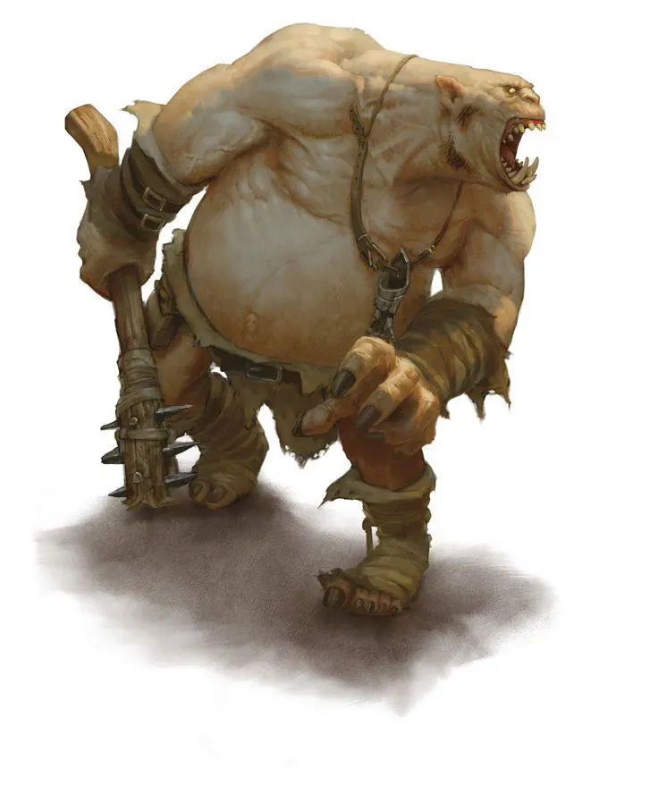
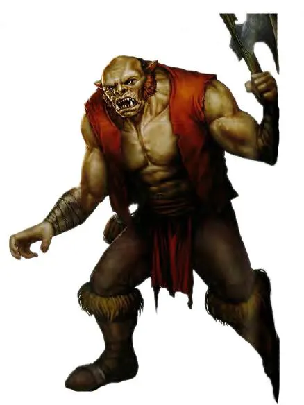

# Ogros

## Bloco de estatísticas: Ogro

*Gigante Grande, caótico e mau*

**Classe de Armadura** 11 (gibão de peles)  
**Pontos de Vida** 59 (7d10 + 21)  
**Deslocamento** 12 m

| FOR | DES | CON | INT | SAB | CAR |
| :---: | :---: | :---: | :---: | :---: | :---: |
| 19 (+4) | 8 (–1) | 16 (+3) | 5 (–3) | 7 (–2) | 7 (–2) |

**Sentidos** visão no escuro 18 m, Percepção passiva 8  
**Idiomas** Comum, Gigante  
**Nível de Desafio** 2 (450 XP)

### Ações

***Clava Grande***. *Ataque Corpo-a-Corpo com Arma*: +6 para atingir, alcance 1,5 m, um alvo. *Acerto*: 13 (2d8 + 4) de dano de concussão.

***Azagaia***. *Ataque Corpo-a-Corpo ou à Distância com Arma*: +6 para atingir, alcance 1,5 m, distância 9/36 m, um alvo. *Acerto*: 11 (2d6 + 4) de dano perfurante.

Os ogros são tão lentos de raciocínio quando fortes de corpo. Eles vivem invadindo, saqueando e matando por comida e prazer. Um espécime adulto padrão tem entre 2,70 e 3 metros de altura e pesa aproximadamente 500 quilos.

***Temperamento Furioso***. Os ogros são notórios por seus temperamentos voláteis, que se inflam com a menor percepção de ofensa. Insultos e xingamentos podem despertar a ira de um ogro num instante – assim como roubar deles, esbarrar, apontar ou cutucar, rindo, fazendo caretas, ou simplesmente olhando pra ele de forma errada. Quando sua fúria é incitada, um ogro ataca, em um acesso de raiva frustrada, até que não reste mais nenhum objeto ou criatura para esmagar.

***Glutões Horrendos***. Os ogros comem praticamente tudo, mas eles tem uma preferência especial pelo gosto dos anões, halflings e elfos. Sempre que podem, eles combinam jantar com prazer, perseguindo vítimas correndo nas redondezas antes de comê-las cruas. Se restarem vítimas suficientes após o ogro ter se empanturrado, ele pode fazer uma tanga da pele de suas presas e colares de seus ossos restantes. Essas miscelâneas macabras são o ápice da cultura dos ogros.

***Coletores Gananciosos***. Os olhos de um ogro brilham com avareza quando eles veem as posses de outrem. Os ogros carregam sacos rústicos em seus saques, os quais eles enchem com fabulosos “tesouros” pegos de suas vítimas. Podem estar inclusos uma coleção de elmos surrados, um pedaço de queijo mofado, um tufo duro de pelos de animais presos como uma capa, ou um porco esperneante salpicado de lama. Os outros também adoram o brilho do ouro e prata e eles irão lutar uns com os outros por pequenos punhados de moedas. Criaturas mais espertas podem ganhar a confiança de um ogro oferecendo ouro ou uma arma forjada para uma criatura do tamanho dele.

***Estupidez Lendária***. Poucos ogros podem contar até dez, mesmo olhando para seus próprios dedos. A maioria fala apenas uma forma rudimentar de Gigante e tem um conhecimento limitado de palavras em Comum. Os ogros acreditam no que lhes é contado e são fáceis de enganar ou confundir, mas eles quebras as coisas que não compreendem. Trapaceiros eloquentes que testem seus talentos nestes selvagens, normalmente acabam engolindo suas palavras eloquentes – e então são devorados em consequência.

***Errantes Primitivos***. Os ogros vestem-se com peles de animais e arrancam árvores para usar como ferramentas rudimentares e armas. Eles criam azagaias com pontas de pedra para caçar. Quando eles estabelecem um covil, eles o fazem nas margens de terras rurais ou civilizadas, tomando vantagem da pecuária mal protegida, das despensas indefesas e dos agricultores incautos.

Um ogro dorme em cavernas, tocas de animais ou debaixo de árvores até encontrar uma cabana ou fazenda isolada, onde ele irá matar seus moradores e se estabelecer ali. Sempre que estiver entediado ou faminto, um ogro se aventurará fora de seu covil, atacando qualquer coisa que cruze seu caminho. Só após ter acabado com os alimentos de uma área, um ogro irá embora de um local.

***Gangues de Ogros***. Os ogros, às vezes, se juntam em pequenos grupos nômades, mas lhes falta um senso real de tribalismo. Quando bandos de ogros se encontram, um irá tentar capturar os membros do outro grupo para aumentar seus números. Porém, grupos de ogros são propensos a negociar seus membros livremente, especialmente se o bando anfitrião esteja temporariamente equilibrado em comida e armas.

Quando for possível, os ogros se juntaram com outros monstros para oprimir ou caçar as criaturas mais fracas que eles. Eles se associam deliberadamente com goblinoides, orcs e trolls e praticamente veneram gigantes. Na complexa estrutura social dos gigantes (conhecida como ordenamento), os ogros se localizam abaixo dos menores gigantes em posição. Como resultado, um ogro fará praticamente tudo que um gigante pedir.

### Meio-Ogro (Ogrillon)

Quando um ogro copula com um humano, hobgoblin, bugbear ou um orc, o resultado é sempre um meio-ogro. (Ogros não copulam com anões, halflings ou elfos. Eles os comem). Mães humanas raramente sobrevivem ao nascimento de uma prole meio-ogra.

A prole meio-ogra entre um ogro e um orc também é chamada de ogrillon. Um meio-ogro ou ogrillon adulto mede 2,40 metros de altura e pesa 225 quilos aproximadamente.

## Bloco de estatísticas: Meio-Ogro

*Gigante Grande, qualquer tendência caótica*

**Classe de Armadura** 12 (gibão de peles)  
**Pontos de Vida** 30 (4d10 + 8)  
**Deslocamento** 9 m

| FOR | DES | CON | INT | SAB | CAR |
| :---: | :---: | :---: | :---: | :---: | :---: |
| 17 (+3) | 10 (+0) | 14 (+2) | 7 (–2) | 9 (–1) | 10 (+0) |

**Sentidos** visão no escuro 18 m, Percepção passiva 9  
**Idiomas** Comum, Gigante  
**Nível de Desafio** 1 (200 XP)

### Ações

***Machado de Batalha***. *Ataque Corpo-a-Corpo com Arma*: +5 para atingir, alcance 1,5 m, um alvo. *Acerto*: 12 (2d8 + 3) de dano cortante, ou 14 (2d10 + 3) de dano cortante se usado com as duas mãos.

***Azagaia***. *Ataque Corpo-a-Corpo ou à Distância com Arma*: +5 para atingir, alcance 1,5 m, distância 9/36 m, um alvo. *Acerto*: 10 (2d6 + 3) de dano perfurante.
