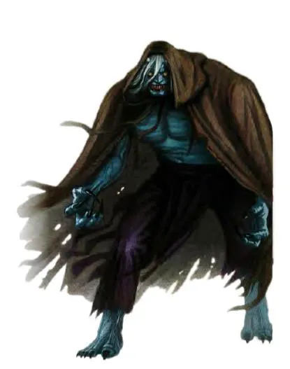

# Oni

Nas canções de ninar, os oni são bichos-papões assustadores que assombram os pesadelos das crianças e adultos, mesmo eles sendo muito reais e sempre famintos. Eles consideram os bebes humanos especialmente deliciosos. Um oni se parece com um ogro demoníaco com peles azuladas ou esverdeadas, cabelos negros e um par de pequenos chifres de marfim brotando de suas testas. Seus olhos são negros com pupilas surpreendentemente brancas e seus dentes e garras são negros como azeviche.

***Terrores Noturnos***. A luz do dia, um oni esconde sua forma verdadeira através de magia, ganhando a confiança daqueles que pretende trair quando a escuridão chegar. Essas criaturas podem mudar seu tamanho assim como seu formato, se parecendo com um humanoide enquanto passam por cidades, fingindo ser viajantes, lenhadores ou forasteiros. Em tal forma, um oni faz um balanço da seleção de humanoides no assentamento e bola uma maneira de raptar e devorar alguns deles.

***Ogros Magos***. Os oni são, às vezes, chamados de ogros magos devido a sua habilidade mágica inata. Apesar de terem apenas uma relação distante com ogros verdadeiros, eles partilham dos hábitos dos ogros de juntar forças com outras criaturas malignas. Um oni serve um mestre se fazê-lo se mostrar lucrativo ou se lhe for concedida uma luxuosa casa bem protegida. Os oni cobiçam magia e eles trabalham para magos malignos e bruxas em troca de itens mágicos úteis.

## Bloco de estatísticas: Oni

*Gigante Grande, leal e mau*

**Classe de Armadura** 16 (cota de malha)  
**Pontos de Vida** 110 (13d10 + 39)  
**Deslocamento** 9 m, voo 9 m

| FOR | DES | CON | INT | SAB | CAR |
| :---: | :---: | :---: | :---: | :---: | :---: |
| 19 (+4) | 11 (+0) | 16 (+3) | 14 (+2) | 12 (+1) | 15 (+1) |

**Testes de Resistência** Des +3, Con +6, Sab +4, Car +5  
**Perícias** Arcanismo +5, Enganação +8, Percepção +4  
**Sentidos** visão no escuro 18 m, Percepção passiva 14  
**Idiomas** Comum, Gigante  
**Nível de Desafio** 7 (2.900 XP)

***Arma Mágica***. O ataque de arma de um oni é mágico.

***Conjuração Inata***. A habilidade de conjuração de um oni é Carisma (CD de resistência de magia 13, +5 para atingir com ataques de magia). Ele pode conjurar, inatamente, as seguintes magias, sem necessidade de componentes materiais:

À vontade: *escuridão, invisibilidade* 1/dia cada: *cone de frio, enfeitiçar pessoa, forma gasosa, sono*

***Regeneração***. O oni recupera 10 pontos de vida no início de cada um dos seus turnos se tiver, pelo menos, 1 ponto de vida.

### Ações

***Ataques Múltiplos***. O oni realiza dois ataques, ambos com suas garras ou com sua glaive.

***Garras (Forma de Oni Apenas)***. *Ataque Corpo-a-Corpo com* *Arma*: +7 para atingir, alcance 1,5 m, um alvo. *Acerto*: 8 (1d8 + 4) de dano cortante.

***Glaive***. *Ataque Corpo-a-Corpo com Arma*: +7 para atingir, alcance 3 m, um alvo. *Acerto*: 15 (2d10 + 4) de dano cortante, ou 9 (1d10 + 4) de dano cortante em forma Pequena ou Média.

***Alterar Forma***. O oni, magicamente, se metamorfoseia em um humanoide Pequeno ou Médio, em um gigante Grande ou de volta para sua forma verdadeira. Além do seu tamanho, nenhuma outra de suas estatísticas muda em cada forma. O único equipamento que se transforma é sua glaive, que se reduz para que possa ser empunhada por uma forma humanoide. Se o oni morrer, ele reverte para sua forma verdadeira e sua glaive reverte para o tamanho normal.
