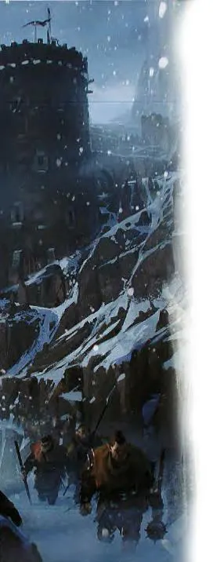
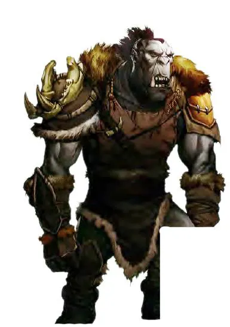
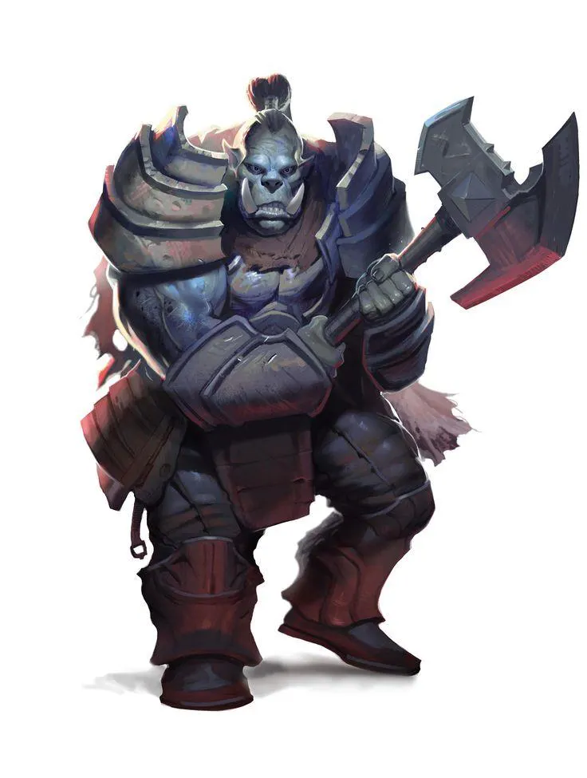

# Orcs

Os orcs são invasores e saqueadores selvagens com posturas curvadas, testas baixas e rostos suínos com caninos inferiores proeminentes, semelhantes a presas.

***Gruumsh, o Caolho***. Os orcs veneram Gruumsh, a mais poderosa das divindades orcs e seu criador. Os orcs acreditam que nos dias antigos, os deuses se juntaram para dividir o mundo entre seus seguidores. Quando Gruumsh reivindicou as montanhas, ele descobriu que elas já haviam sido tomadas pelos anões. Ele então mudou sua reivindicação para as florestas, mas essas já haviam sido determinadas para os elfos. Os outros deuses riram de Gruumsh, mas ele respondeu com um rugido furioso. Agarrando sua poderosa lança, ele devastou as montanhas, ateou fogo nas florestas e esculpiu sulcos nos campos. Ele proclamou que esse seria o papal dos orcs, tomar e destruir tudo que as outras raças lhes negaram. Desde esse dia, os orcs travam uma guerra interminável com os seres humanos, elfos, anões e outros povos.

Os orcs nutrem um odeio particular pelos elfos. O deus elfo Corellon Larethian deixou Gruush caolho com uma flecha certeira no olho do deus orc. Desde então, os orcs tem um prazer particular em chacinar elfos. Transformando seu ferimento em um uma dádiva sinistra, Gruumsh concede força divina a qualquer campeão que arranque um de seus olhos voluntariamente em seu nome.

***Tribos como Pragas***. Os orcs se juntam em tribos que exercem seu domínio e satisfazem sua sede de sangue ao saquear vilas, devorando e afugentando o rebanho quieto e matando quaisquer humanoides que se coloquem contra eles. Após devastarem um assentamento, os orcs pegam todas as riquezas e itens utilizáveis e levam para suas próprias terras. Eles ateiam fogo nos camponeses e acampamentos restantes, então voltando de onde vieram com seu desejo de sangue satisfeito.

***Saqueadores Diversos***. Seu desejo por matança requer que os orcs sempre residam a uma distância razoável de seus novos alvos. Por isso, eles raramente se estabelecem de forma permanente, em vez disso, eles convertem ruínas, complexos de cavernas e vilas de inimigos derrotados em campos fortificados e fortalezas. Os orcs constroem apenas para se defender, não fazendo quaisquer inovações ou aprimoramentos em seus covis além de amontoarem as partes decepadas dos corpos de suas vítimas em muros de paliçada pontudos ou em lanças sobressaindo-se de trincheiras e fossos áridos.

Quando um território existente fica sem comida, uma tribo orc divide-se em bandos errantes que exploram para escolher um território de caça. Quando cada grupo retorna, eles trazem troféus e notícias dos alvos prontos para serem atacados, o mais rico deles é escolhido. A tribo, em seguida, se reagrupa para esculpir um caminho sangrento até seu novo território.

Em raras ocasiões, um líder da tribo escolhe manter um covil defensável em particular por décadas. Os orcs de tais tribos devem se espalhar por toda a região para saciar seus apetites.

***Liderança e Força***. As tribos de orcs são, em sua maioria, patriarcais, exibindo títulos vívidos ou grotescos como Muitas Flechas, Olhos Gritantes e Estripador de Elfos. Ocasionalmente, um comandante de guerra poderoso une tribos orcs espalhadas em uma única horda devastadora, que passa por cima de outras tribos orcs e assentamentos humanoides com uma força esmagadora.

Força e poder são as maiores das virtudes orcs, e os orcs aceitam todos os tipos de criaturas poderosas em suas tribos. Rejeitando noções de pureza racial, eles recebem orgulhosamente ogros, trolls, meio-orcs e orogs em suas fileiras. Da mesma forma, os orcs respeitam e temem o tamanho e poder dos gigantes malignos e, frequentemente, servem-nos como guardas ou soldados.

***Orcs Mestiços***. Luthic, a deusa orc da fertilidade e esposa de Gruumsh, exige que os orcs procriem frequentemente e indiscriminadamente para que as hordas orcs cresçam geração após geração. A vontade de se reproduzir dos orcs é mais forte que em qualquer outra raça humanoide e eles prontamente se misturam com outras raças. Quando um orc procria com um humanoide não-orc de tamanho e estatura similar (como um humano ou um anão), a criança resultante é ou um orc ou um meio-orc. Quando um orc produz um filho com um ogro, a criança é um meio-ogro de força intimidante e traços brutais chamado de ogrillon.

### Orc Comandante de Guerra

O comandante de guerra de uma tribo orc é seu membro mais forte e mais astuto. O reinado de um comandante de guerra dura apenas enquanto ele tiver o medo e respeito dos outros membros da tribo, cuja sede de sangue deve ser satisfeita regularmente para que o comandante não pareça fraco.

***Herdeiros da Carnificina***. Gruumsh concedeu bênçãos especiais para os comandantes de guerra que se provam em tempos de batalha diversas vezes, imbuindo-os com porções de selvageria. Um comandante de guerra tão abençoado descobre que suas armas cortam seus inimigos profundamente, permitindo que eles inflijam mais carnificina.

> **Rei Obould Muitas-Flechas**
>
> Rei Obould da tribo das Muitas-Flechas é uma lenda entre os comandantes de guerra dos Reinos Esquecidos e ele é o comandante orc mais famoso da história dos jogos de D&D. Mais esperto e mais intuitivo que a maioria de sua espécie, Obould matou seu comandante para tomar o controle de sua tribo. Experiente nas artes da guerra e conhecido por seu temperamento violento, Obould provou ser um oponente feroz em tempos de batalha diversas vezes. Ao decorrer dos anos, ele subsumiu outras tribos de orcs para a sua, até comandar uma horda de milhares. Obould alavancou sua força e influência para esculpir seu próprio reino na Espinha do Mundo, uma cadeia de montanhas com vista para inúmeros fortes anões, humanos e élficos. Após anos de conflitos sangrentos com seus vizinhos mais civilizados, Obould fez o impensável e mediou um acordo de paz com seus inimigos. Esse acordo confundiu muitos orcs sob o comando de Obould. Ele foi ou uma jogada inteligente de Obould para ganhar tempo enquanto fortalecia seu exército para o ataque final decisivo através da Fronteira Selvagem, ou um sinal preocupante de que Obould havia abandonado os meios de Gruumsh e precisava ser destruído.

### Orc Olho de Gruumsh

Quando um orc mata um elfo em nome de Gruumsh e oferece o corpo de seu inimigo como sacrifício para o deus da matança, um aspecto do deus pode aparecer. Esse aspecto exige um sacrifício adicional: um dos olhos do orc, simbolizando a perda sofrida por Gruumsh nas mãos do seu maior inimigo, Corellon Larethian.

Se o orc arrancar um de seus olhos, Gruumsh irá conceder ao orc habilidade de conjuração e benefícios especiais, junto com o direito de se intitular como um Olho d Gruumsh. Quando não estiver utilizando seus augúrios para aconselhar seus comandantes de guerra, esses devotos selvagens do deus da matança lançam-se na batalha, com suas armas manchadas de sangue.

### Orog

Os orogs são orcs abençoados com um intelecto surpreendentemente aguçado que os orcs ordinários acreditam ser uma dádiva da deusa orc Luthic. Como Luthic, os orogs preferem viver no subterrâneo, apesar da escassez de comida frequentemente leva-los até a superfície para caçar. Os orcs respeitam a força e astúcia de um orog e um único orog pode comandar um bando de guerra orc.

***Mais Fortes e Espertos***. Um orog usa sua força para ameaçar outros orcs e sua inteligência para surpreender seus inimigos no campo de batalha. Muitos comandantes élficos, humanos ou anões superconfiantes avistaram um “simples” senhor da guerra orc executando uma manobra inteligente para flanquear e destruir uma força opositora, sem perceber que o orc era um orog.

Quando encontram-se em grandes números, os orogs formam seus próprios destacamentos dentro de hordas orcs muito maiores e eles sempre estão na linha de frente de qualquer ataque, confiando em sua força superior e visão tática para sobrepujar qualquer coisa que esteja em seu caminho.

Algumas tribos orcs buscam ativamente por orogs para implementar suas fileiras. A superioridade dos orogs faz deles líderes ideais e, portanto, rivais letais para os comandantes de guerra orcs, que devem ter cuidado com a traição orog.

***Assassinos Imparciais***. Buscando nada além de fazer seus inimigos em pedaços, os orogs são uma presença aterrorizante no campo de batalha. Eles não fazem quaisquer laços, nem mesmo com seus pais e irmãos, e não tem qualquer conceito de amor ou dedicação. Eles veneram o panteão de deuses orcs – Gruumsh e Luthic acima de todos – pois eles acreditam que os deuses tem a força acima da razão e a força física é tudo que eles respeitam.

***Servos das Trevas***. Desconfiados dos orcs, alguns orogs formam bandos de guerra de mercenários independentes que se vendem pelo maior preço. Enquanto forem recompensados, os mercenários orogs servirão de bom grado como guerreiros de elite e tropas de choque para magos malignos, gigantes depravados e outros vilões.

## Bloco de estatísticas: Orc

*Humanoide Médio (orc), caótico e mau*

**Classe de Armadura** 13 (gibão de peles)  
**Pontos de Vida** 15 (2d8 + 6)  
**Deslocamento** 9 m

| FOR | DES | CON | INT | SAB | CAR |
| :---: | :---: | :---: | :---: | :---: | :---: |
| 16 (+3) | 12 (+1) | 16 (+3) | 7 (–2) | 11 (+0) | 10 (+0) |

**Perícias** Intimidação +2  
**Sentidos** visão no escuro 18 m, Percepção passiva 10  
**Idiomas** Comum, Orc  
**Nível de Desafio** 1/2 (100 XP)

***Agressivo***. Com uma ação bônus, o orc pode se mover até seu deslocamento até uma criatura hostil que ele possa ver.

### Ações

***Machado Grande***. *Ataque Corpo-a-Corpo com Arma*: +5 para atingir, alcance 1,5 m, um alvo. *Acerto*: 9 (1d12 + 3) de dano cortante.

***Azagaia***. *Ataque Corpo-a-Corpo ou à Distância com Arma*: +5 para atingir, alcance 1,5 m, distância 9/36 m, um alvo. *Acerto*: 6 (1d6 + 3) de dano perfurante.

## Bloco de estatísticas: Comandante de Guerra Orc

*Humanoide Médio (orc), caótico e mau*

**Classe de Armadura** 16 (cota de malha)  
**Pontos de Vida** 93 (11d8 + 44)  
**Deslocamento** 9 m

| FOR | DES | CON | INT | SAB | CAR |
| :---: | :---: | :---: | :---: | :---: | :---: |
| 18 (+4) | 12 (+1) | 18 (+4) | 11 (+0) | 11 (+0) | 16 (+3) |

**Testes de Resistência** For +6, Con +6, Sab +2  
**Perícias** Intimidação +5  
**Sentidos** visão no escuro 18 m, Percepção passiva 10  
**Idiomas** Comum, Orc  
**Nível de Desafio** 4 (1.100 XP)

***Agressivo***. Com uma ação bônus, o orc pode se mover até seu deslocamento até uma criatura hostil que ele possa ver.

***Fúria de Gruumsh***. O orc causa 4 (1d8) de dano extra quando atinge com um ataque com arma (incluso nos ataques).

### Ações

***Ataques Múltiplos***. O orc realiza dois ataques com seu machado grande ou lança.

***Machado Grande***. *Ataque Corpo-a-Corpo com Arma*: +6 para atingir, alcance 1,5 m, um alvo. *Acerto*: 14 (1d12 + 4 mais 1d8) de dano cortante.

***Lança***. *Ataque Corpo-a-Corpo ou à Distância com Arma*: +6 para atingir, alcance 1,5 m, distância 6/18 m, um alvo. *Acerto*: 12 (1d6 + 4 mais 1d8) de dano perfurante, ou 13 (2d8 + 4) de dano perfurante se usada com as duas mãos para realizar ataques corpo-a-corpo.

***Grito de Guerra (1/Dia)***. Cada criatura, à escolha do comandante de guerra, que estiver a até 9 metros dele, puder ouvi-lo e já não tenha sido afetada por um Grito de Guerra recebe vantagem nas jogadas e ataque até o início do próximo turno do comandante de guerra. O comandante de guerra pode, então, realizar um ataque com uma ação bônus.

## Bloco de estatísticas: Orc Olho de Gruumsh

*Humanoide Médio (orc), caótico e mau*

**Classe de Armadura** 16 (cota de anéis e escudo)  
**Pontos de Vida** 45 (6d8 + 18)  
**Deslocamento** 9 m

| FOR | DES | CON | INT | SAB | CAR |
| :---: | :---: | :---: | :---: | :---: | :---: |
| 16 (+3) | 12 (+1) | 16 (+3) | 9 (–1) | 13 (+1) | 12 (+1) |

**Perícias** Intimidação +3, Religião +1  
**Sentidos** visão no escuro 18 m, Percepção passiva 11  
**Idiomas** Comum, Orc  
**Nível de Desafio** 2 (450 XP)

***Agressivo***. Com uma ação bônus, o orc pode se mover até seu deslocamento até uma criatura hostil que ele possa ver.

***Conjuração***. O orc é um conjurador de 3° nível. Sua habilidade de conjuração é Sabedoria (CD de resistência de magia 11, +3 para atingir com ataques com magia). Ele possui as seguintes magias de clérigo preparadas:

Truques (à vontade): *orientação, resistência, taumaturgia* 1° nível (4 espaços): *bênção, comando* 2° nível (2 espaços): *arma espiritual* (lança), *augúrio*

***Fúria de Gruumsh***. O orc causa 4 (1d8) de dano extra quando atinge com um ataque com arma (incluso nos ataques).

### Ações

***Lança***. *Ataque Corpo-a-Corpo ou à Distância com Arma*: +5 para atingir, alcance 1,5 m, distância 6/18 m, um alvo. *Acerto*: 11 (1d6 + 3 mais 1d8) de dano perfurante, ou 12 (2d8 + 4) de dano perfurante se usada com as duas mãos para realizar ataques corpo-a-corpo.

## Bloco de estatísticas: Orog

*Humanoide Médio (orc), caótico e mau*

**Classe de Armadura** 18 (placas)  
**Pontos de Vida** 42 (5d8 + 20)  
**Deslocamento** 9 m

| FOR | DES | CON | INT | SAB | CAR |
| :---: | :---: | :---: | :---: | :---: | :---: |
| 18 (+4) | 12 (+1) | 18 (+4) | 12 (+1) | 11 (+0) | 12 (+1) |

**Perícias** Intimidação +5, Sobrevivência +2  
**Sentidos** visão no escuro 18 m, Percepção passiva 10  
**Idiomas** Comum, Orc  
**Nível de Desafio** 2 (450 XP)

***Agressivo***. Com uma ação bônus, o orog pode se mover até seu deslocamento até uma criatura hostil que ele possa ver.

### Ações

***Ataques Múltiplos***. O orog realiza dois ataques com machado grande.

***Machado Grande***. *Ataque Corpo-a-Corpo com Arma*: +6 para atingir, alcance 1,5 m, um alvo. *Acerto*: 10 (1d12 + 4) de dano cortante.

***Azagaia***. *Ataque Corpo-a-Corpo ou à Distância com Arma*: +6 para atingir, alcance 1,5 m, distância 9/36 m, um alvo. *Acerto*: 7 (1d6 + 4) de dano perfurante.
