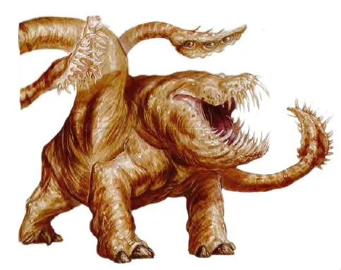

# Otyugh

Um otyugh é uma grotesca criatura bulbosa sustentada por três pernas robustas, com olhos e nariz situados ao longo de uma haste flexível que serpenteia do topo do seu corpo inchado. Dois tentáculos terminados em apêndices em forma de folhas espinhosos que o otyugh usa para levar a comida até sua boca aberta.

Um otyugh se enterra embaixo de montes de vísceras e carniça, deixando apenas sua haste sensorial exposta. Quando uma criatura comestível aparece, os tentáculos do otyugh emergem da imundície a agarram.

Os otyughs aproveitam ao máximo cada oportunidade para emboscar e devorar uma presa. Eles usam uma forma limitada de telepatia para incitar criaturas racionais em direção aos seus covis, às vezes fingindo ser outra coisa.

***Moradores do Escuro***. Os otyughs toleram luz plena apenas quando montantes consideráveis de carniça ou lixo estão dentro do alcance. No ambiente selvagem, eles vivem em pântanos estagnados, lagoas cheias de escumalha e vales de florestas úmidas. O cheiro de cemitérios, esgotos de cidades, estrumeiras de vilas e currais cheios de estrume, atraem-nos para áreas civilizadas.

Já que os otyughs não tem interesse em qualquer coisa além de comida, seus ninho, às vezes, acumulam uma variedade de tesouros vindos de suas vítimas e misturados entre o lixo.

***Guardiões Simbióticos***. Seres racionais do subterrâneo podem coexistir com os otyughs, empregando-os como trituradores de lixo. Com tais sustentos abundantes, os otyughs engordam em seus lamaçais, impassíveis por qualquer outro impulso ou desejo. Essa gula sedentária faz deles guardiões confiáveis. Enquanto estiver alimentado, um otyugh abstém-se de atacar outras criaturas. Porém, pretensos mestres de otyughs podem facilmente subestimar a quantidade de resíduos, carniça e carne necessários para impedir um otyugh de vagar a procura de comida. Mais de um otyugh “domesticado” já devoraram seus zeladores após devorar todos os dejetos em seu lamaçal.

## Bloco de estatísticas: Otyugh

*Aberração Grande, neutro*

**Classe de Armadura** 14 (armadura natural)  
**Pontos de Vida** 114 (12d10 + 48)  
**Deslocamento** 9 m

| FOR | DES | CON | INT | SAB | CAR |
| :---: | :---: | :---: | :---: | :---: | :---: |
| 16 (+3) | 11 (+0) | 19 (+4) | 6 (–2) | 13 (+1) | 6 (–2) |

**Testes de Resistência** Con +7  
**Sentidos** visão no escuro 18 m, Percepção passiva 11  
**Idiomas** Otyugh  
**Nível de Desafio** 5 (1.800 XP)

***Telepatia Limitada***. O otyugh pode magicamente transmitir mensagens e imagens simples para qualquer criatura a até 36 metros dele, que possa compreender um idioma. Essa forma de telepatia não permite que a criatura receptora responda telepaticamente.

### Ações

***Ataques Múltiplos***. O otyugh realiza três ataques: um com sua mordida e dois com seus tentáculos.

***Mordida***. *Ataque Corpo-a-Corpo com Arma*: +6 para atingir, alcance 1,5 m, um alvo. *Acerto*: 12 (2d8 + 3) de dano perfurante. Se o alvo for uma criatura, ela deve ser bem sucedida num teste de resistência de Constituição CD 15 contra doença ou ficará envenenada até a doença ser curada. A cada 24 horas passadas, o alvo deve repetir o teste de resistência, reduzindo seu máximo de pontos de vida em 5 (1d10) em uma falha. A doença é curada com um sucesso. O alvo morre se a doença reduzir seu máximo de pontos de vida a 0. Essa redução no máximo de pontos de vida do alvo dura até a doença ser curada.

***Tentáculo***. *Ataque Corpo-a-Corpo com Arma*: +6 para atingir, alcance 3 m, um alvo. *Acerto*: 7 (1d8 + 3) de dano de concussão mais 4 (1d8) de dano perfurante. Se o alvo for Médio ou menor, ele é agarrado (CD 13 para escapar) e impedido até o agarrão terminar. O otyugh possui dois tentáculos, cada um pode agarrar um alvo.

***Pancada com Tentáculo***. *O otyugh* golpeia as criaturas agarradas por ele umas nas outras ou em superfícies sólidas. Cada criatura deve ser bem sucedida num teste de resistência de Constituição CD 15 ou sofrerá 10 (2d6 + 3) de dano de concussão e ficará atordoada até o final do próximo turno do otyugh. Com um sucesso na resistência, o alvo sofre metade do dano de concussão e não fica atordoado.
