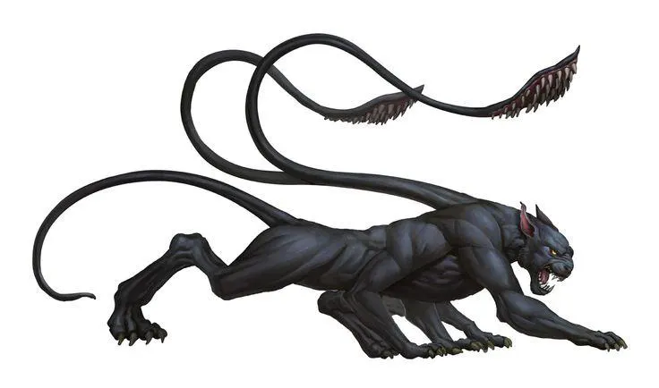

# Pantera Deslocadora

Esse predador monstruoso recebe seu nome por sua habilidade de deslocar a luz fazendo com que ele pareça estar a alguns metros da sua localização atual. Uma pantera deslocadora lembra um grande felino lustroso coberto por uma pelagem azul escura. Porém, sua origem sobrenatural são claras em suas seis patas e dois tentáculos que brotam de seus ombros, ambos terminados em patas cheias de saliências pontiagudas. Os olhos de uma pantera deslocadora brilham com uma malevolência medonha que persiste mesmo na morte.

***Origens Sombrias***. As panteras deslocadoras percorrem as terras crepusculares de Faéria por eras, até serem capturadas e treinadas pela Corte Sombria. Os guerreiros da corte fizeram reproduções seletivas das bestas para reforçar sua ferocidade e natureza predatória, usando-as para caçar unicórnios, pégasos e outras presas fantásticas. Porém, isso não demorou muito para que as panteras deslocadoras usassem sua inteligência malévola para escapar de seus mestres.

Correndo e reproduzindo-se livremente em Faéria, as panteras deslocadoras logo chamaram a atenção da Corte Luminosa. Com companheiros cães teleportadores do seu lado, as fadas caçadoras afugentaram esses predadores para as fronteiras de Faéria, de onde muitas atravessaram para o Plano Material. Desde esse dia, as panteras deslocadoras e os cães teleportadores se atacam quando se avistam.

***Amor pela Matança***. As panteras deslocadoras não matam apenas para comer, mas também por esporte. Elas atacam presas mesmo quando não estão famintas, frequentemente brincando com suas vítimas para se entreterem até estarem prontas para comer. Após matar sua presa usando seus tentáculos, uma pantera deslocadora arrasta o corpo para um local tranquilo onde ela possa comer sem distrações.

As panteras deslocadoras caçam sozinhas ou em pequenos bandos que demonstram perícia em preparar emboscadas. Uma única pantera irá atacar e recuar, atraindo as presas para uma área densamente arborizada, onde seus companheiros de matilha aguardam. Matilhas de panteras deslocadoras caçam próximo a estradas comerciais recordando da frequência e horário de caravanas regulares, preparando emboscadas para apanhar essas caravanas.

## Bloco de estatísticas: Pantera Deslocadora

*Monstruosidade Grande, leal e mau*

**Classe de Armadura** 13 (armadura natural)  
**Pontos de Vida** 85 (10d10 + 30)  
**Deslocamento** 12 m  
**FOR** **DES** **COM** **INT** **SAB** **CAR**

| FOR | DES | CON | INT | SAB | CAR |
| :---: | :---: | :---: | :---: | :---: | :---: |
| 18 (+4) | 15 (+2) | 16 (+3) | 6 (–2) | 12 (+1) | 8 (–1) |

**Sentidos** visão no escuro 18 m, Percepção passiva 11  
**Idiomas** –  
**Nível de Desafio** 3 (700 XP)

***Evasão***. Se a pantera for alvo de um efeito que permita que ela realiza um teste de resistência para sofrer apenas metade do dano, ela não recebe nenhum dano se for bem sucedida no teste de resistência e apenas metade do dano se fracassar.

***Deslocamento***. A pantera projeta uma ilusão mágica que faz com que ela parece estar próxima da sua localização atual, fazendo as jogadas de ataque contra ela terem desvantagem. Se ela for atingida por um ataque, esse traço é interrompido até o final do próximo turno dela. Esse traço também é interrompido enquanto a pantera estiver incapacitada ou com deslocamento 0.

### Ações

***Ataques Múltiplos***. A pantera realiza dois ataques com seus tentáculos.

***Tentáculo***. *Ataque Corpo-a-Corpo com Arma*: +6 para atingir, alcance 3 m, um alvo. *Acerto*: 7 (1d6 + 4) de dano de concussão mais 3 (1d6) de dano perfurante.

***Guardas e Animais de Estimação Apreciados***. Criaturas malignas inteligentes apreciam as panteras deslocadoras como animais de estimação, mas uma pantera deslocadora faz uma aliança dessas apenas caso lhe pareça vantajoso. Uma pantera deslocadora pode guardar uma câmara ou agir como um guarda-costas para um indivíduo proeminente.
