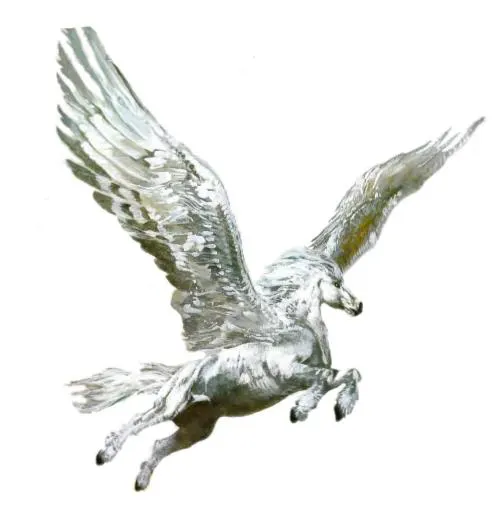

# Pégaso

## Bloco de estatísticas: Pégaso

*Celestial Grande, caótico e bom*

**Classe de Armadura** 12  
**Pontos de Vida** 59 (7d10 + 21)  
**Deslocamento** 18 m, voo 27 m

| FOR | DES | CON | INT | SAB | CAR |
| :---: | :---: | :---: | :---: | :---: | :---: |
| 18 (+4) | 15 (+2) | 16 (+3) | 10 (+0) | 15 (+2) | 13 (+1) |

**Testes de Resistência** Des +4, Sab +4, Car +3  
**Perícias** Percepção +6  
**Sentidos** Percepção passiva 16  
**Idiomas** compreende Celestial, Comum, Élfico e Silvestre, mas não pode falar  
**Nível de Desafio** 2 (450 XP)

### Ações

***Cascos***. *Ataque Corpo-a-Corpo com Arma*: +6 para atingir, alcance 1,5 m, um alvo. *Acerto*: 11 (2d6 + 4) de dano de concussão.

Os cavalos brancos alados conhecidos como pégasos voando pelos céus, são uma visão de graça e majestade. Quando eles tocam em solo firme, eles permanecem apenas por um momento, bebendo de nascentes de montanhas e lagos cristalinos. Qualquer som ou sinal de outra criatura assusta-os, fazendo-os voar mais uma vez para as nuvens.

***Montarias Nobres***. Os pégasos são altamente valorizados como corcéis rápidos e confiáveis, sendo mais rápidos e menos temperamentais que os grifos, hipogrifo e wyverns. Porém, essas criaturas selvagens e tímidas são tão inteligentes quando um humanoide e não podem ser controladas e domadas tradicionalmente. Um pégaso deve ser persuadido a servir uma criatura de tendência boa como sua montaria, mas quando o faz, ele forja um elo para toda a vida com seu novo companheiro.

***Nascido dos Planos***. Os pégasos traçam suas origens das Clareiras Olímpicas de Arbórea, onde eles voavam pelos céus do plano e serviam como fieis montarias aos Seldarine, o panteão de deuses élficos. Esses deuses são conhecidos por enviar os pégasos para o Plano Material para ajudar os necessitados.

***Ninhos de Pégasos***. Os pégasos tem um parceiro por toda a vida, construindo seus ninhos em locais difíceis de alcançar, e dando à luz a filhotes.
