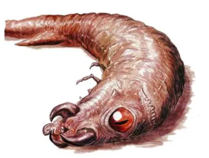

# Perfurador

## Bloco de estatísticas: Perfurador

*Monstruosidade Média, imparcial*

**Classe de Armadura** 15 (armadura natural)  
**Pontos de Vida** 22 (3d8 + 9)  
**Deslocamento** 1,5 m, escalada 1,5 m

| FOR | DES | CON | INT | SAB | CAR |
| :---: | :---: | :---: | :---: | :---: | :---: |
| 10 (+0) | 13 (+1) | 16 (+3) | 1 (–5) | 7 (–2) | 3 (–4) |

**Perícias** Furtividade +5  
**Sentidos** percepção às cegas 9 m, visão no escuro 18 m, Percepção passiva 8  
**Idiomas** –  
**Nível de Desafio** 1/2 (100 XP)

***Aparência Falsa***. Enquanto o perfurador permanecer imóvel no teto, ele é indistinguível de uma estalactite normal.

***Escalada Aracnídea***. O perfurador pode escalar superfícies difíceis, incluindo andar de cabeça para baixo em tetos, sem precisar realizar um teste de habilidade.

### Ações

***Queda***. *Ataque Corpo-a-Corpo com Arma*: +3 para atingir, uma criatura diretamente abaixo do perfurador. *Acerto*: 3 (1d6) de dano perfurante para cada 3 metros de queda, até 21 (6d6). *Errar*: O perfurador sofre metade do dano normal de queda para a distância caída.

Prendendo-se aos tetos de grandes cavernas e passagens subterrâneas, os perfuradores mesclam-se perfeitamente com as rochas naturais, caindo silenciosamente para empalar adversários desavisados no solo abaixo.

Um perfurador é a forma larval do estrangulador, e ambas as criaturas frequentemente atacam em conjunto. Uma carapaça de aparência rochosa envolve o corpo do perfurador, dando-lhe a aparência e textura de uma estalactite. Essa carapaça protege um corpo mole como de uma lesma de sua parte superior que permite que o perfurador se movimente pelas paredes e tetos das cavernas para se posicionar acima de suas presas. Com seu olho e boca fechados, o perfurador é difícil de diferenciar de formações rochosas ordinárias.

***Caçadores Pacientes***. Os perfuradores podem ver, mas eles também podem responder ao barulho e calor, esperando por criaturas vivas passarem abaixo dele, então caindo para atacar. Um perfurador que perca sua chance de matar deve lentamente fazer seu caminho de volta ao teto. Um perfurador caindo excreta uma gosma fétida quando ataca, fazendo a maioria dos predadores pensarem duas vezes antes de comê-lo.

Os perfuradores se juntam em colônias para maximizar a eficácia de seus ataques, caindo simultaneamente para aumentar as chances de atingir a presa. Após um perfurador matar uma criatura com sucesso, os outros lentamente rastejam até o corpo para se juntar ao banquete.
