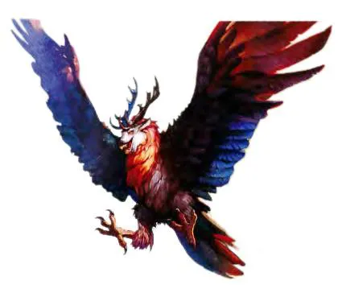

# Peryton

Apesar dessa monstruosidade carnívora se alimentar de qualquer criatura, ela prefere humanoides, especialmente elfos, meio-elfos e humanos. Quando mata um humanoide, um peryton arranca o coração de sua presa e leva-o de volta ao seu ninho para devora-lo.

Um peryton é uma criatura bizarra que mescla o corpo e asas de uma ave de rapina com a cabeça de um cervo. Sua característica mais estranha é sua sombra, que aparenta ser humanoide ao invés de refletir a forma física da criatura. Sábios dizem que os primeiros perytons foram humanos transformados por uma maldição hedionda ou um experimento mágico, mas os bardos contam uma história diferente de um homem cuja infidelidade fez com que a esposa desprezada arrancasse o coração da sua rival mais jovem e bela e consumisse-o em um ritual intencionado a ganhar o coração do seu marido para sempre. O ritual teve sucesso até a vilania da mulher ser descoberta. Ela foi enforcada por seu crime, mas a magia persistente do ritual hediondo dela fez com que os pássaros carniceiros que se alimentavam de seu cadáver se transformassem nos primeiros perytons.

***Fome Sobrenatural***. O ciclo reprodutivo de um peryton depende do coração de um humanoide morto recentemente. O órgão deve ser consumido por uma peryton fêmea antes de ela poder se reproduzir. Quando um peryton consome um coração, sua sombra muda por um curto tempo para refletir sua verdadeira forma monstruosa.

Quando ataca um humanoide, um peryton é focado e implacável, lutando até ele ou sua presa estar morto. Se um peryton for afastado de alguma forma, ele perseguirá sua presa perdida de longe, atacando novamente quando a oportunidade surgir.

***Flagelo da Montanhas***. Os perytons se empoleiram no topo de cordilheiras de montanhas e fazem seus covis em cavernas altas. Eles caçam as criaturas vivas ou vagam nos vales abaixo e os viajantes em estradas solitárias na montanha aprendem a manter seus olhos atentos aos céus. Já que armas normais são menos eficientes contra os perytons, o povo das montanhas sabem como evitar confrontos com esses monstros a todo custo.

Assentamentos permanentes são atraentes aos perytons como fonte de alimento renovável. Por isso, conselheiros de vila e nobres locais frequentemente contratam aventureiros para eliminar os ninhos de peryton.

## Bloco de estatísticas: Peryton

*Monstruosidade Média, caótico e mau*

**Classe de Armadura** 13 (armadura natural)  
**Pontos de Vida** 33 (6d8 + 6)  
**Deslocamento** 6 m, voo 18 m

| FOR | DES | CON | INT | SAB | CAR |
| :---: | :---: | :---: | :---: | :---: | :---: |
| 16 (+3) | 12 (+1) | 13 (+1) | 9 (–1) | 12 (+1) | 10 (+0) |

**Perícias** Percepção +5  
**Resistência a Dano** concussão, cortante e perfurante de ataques não-mágicos  
**Sentidos** Percepção passiva 15  
**Idiomas** compreende Comum e Élfico, mas não pode falar  
**Nível de Desafio** 2 (450 XP)

***Ataque de Mergulho***. Se o peryton estiver voando e mergulhar, pelo menos 9 metros, em linha reta em direção de um alvo e então atingi-lo com um ataque corpo-a-corpo com arma, o ataque causa 9 (2d8) de dano extra ao alvo.

***Sobrevoo.*** O peryton não provoca ataques de oportunidade quando voa para fora do alcance de um inimigo.

***Visão e Faro Aguçado***. O peryton tem vantagem em testes de Sabedoria (Percepção) relacionados à visão e ao olfato.

### Ações

***Ataques Múltiplos***. O peryton realiza um ataque de chifre e um ataque de garras.

***Chifre***. *Ataque Corpo-a-Corpo com Arma*: +5 para atingir, alcance 1,5 m, um alvo. *Acerto*: 7 (1d8 + 3) de dano perfurante.

***Garras***. *Ataque Corpo-a-Corpo com Arma*: +5 para atingir, alcance 1,5 m, um alvo. *Acerto*: 8 (2d4 + 3) de dano perfurante.
