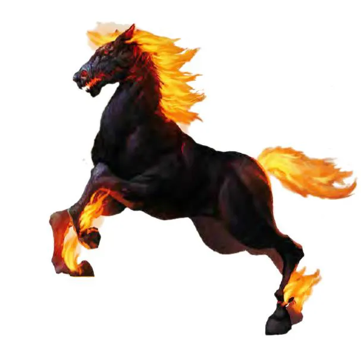

# Pesadelo

## Bloco de estatísticas: Pesadelo

*Corruptor Grande, neutro e mau*

**Classe de Armadura** 13 (armadura natural)  
**Pontos de Vida** 68 (8d10 + 24)  
**Deslocamento** 18 m, voo 27 m

| FOR | DES | CON | INT | SAB | CAR |
| :---: | :---: | :---: | :---: | :---: | :---: |
| 18 (+4) | 15 (+2) | 16 (+3) | 10 (+0) | 13 (+1) | 15 (+2) |

**Imunidade a Dano** fogo  
**Sentidos** Percepção passiva 11  
**Idiomas** compreende Abissal, Comum e Infernal, mas não pode falar  
**Nível de Desafio** 3 (700 XP)

***Conceder Resistência a Fogo***. O pesadelo pode garantir resistência a dano de fogo a qualquer criatura cavalgando-o.

***Iluminação***. O pesadelo emite luz plena num raio de 3 metros e penumbra por mais 3 metros adicionais.

### Ações

***Cascos***. *Ataque Corpo-a-Corpo com Arma*: +6 para atingir, alcance 1,5 m, um alvo. *Acerto*: 13 (2d8 + 4) de dano de concussão mais 7 (2d6) de dano de fogo.

***Viagem Etérea***. O pesadelo e até três criaturas voluntárias a 1,5 metro dele, magicamente entram no Plano Etéreo a partir do Plano Material, ou vice-versa.

Um pesadelo aparece em uma nuvem turva de fumaça, sua crina, rabo e cascos estão em chamas. A forma negra extranatural da criatura se move com uma velocidade sobrenatural, sumindo em uma nuvem de enxofre tão rapidamente quanto aparece.

***Montaria Pavorosa***. Também chamado de “cavalo demônio” ou “cavalo infernal”, o pesadelo serve como montaria para criaturas excepcionalmente malignas, carregando demônios, diabos, cavaleiros da morte, liches, bruxas da noite e outros monstros vis. Ele se parece com um cavalo abissal e os olhos vermelhos ferozes de um pesadelo denunciam sua inteligência malévola.

Um pesadelo pode ser invocador dos Planos Inferiores, mas a não ser que um sacrifício digno seja oferecido a ele como alimento em sua chegada, o pesadelo não demonstrará qualquer lealdade especial a criatura que ele serve.

***Criando um Pesadelo***. Os pesadelos não aparecem naturalmente no multiverso. Eles devem ser criados a partir de pégasos. O ritual que cria um pesadelo requer a torturante remoção das asas de um pégaso, impelindo a nobre criatura ao mal conforme ela é transformada por magia negra.
