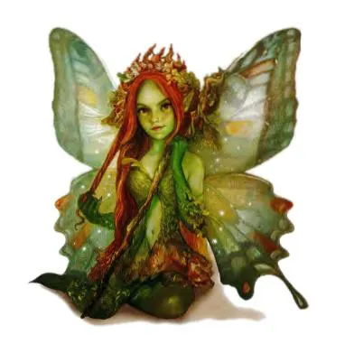

# Pixie

Medindo apenas 30 centímetros de altura, os pixies lembram elfos diminutos com finas asas como as de libélulas ou borboletas, brilhantes como o amanhecer claro e tão luminosas quanto o nascer da lua cheia. Curiosos como gatos e tímidos como cervos, os pixies vão onde querem. Eles gostam de espiar as outras criaturas e dificilmente conseguem conter sua agitação em volta deles. O desejo de se apresentar e iniciar uma amizade é quase esmagador; apenas o medo de ser capturado ou atacado mantem o pixie alerta. Aqueles que vagam por uma clareira de um pixie podem nunca ver a criatura, ainda assim ouvem os ocasionais risos, arfadas ou suspiros.

Os pixies se ornam como príncipes e princesas das fadas, vestindo roupas leves e parelhas de seda que brilham como o luar em uma lagoa. Alguns vestem-se com bolotas, folhas, cascas e peles de pequenos animais da floresta. Eles tem grande orgulho de sua regalia e brilham de alegria quando complementam seus conjuntos.

***Povo Feérico Mágico***. Com seu poder inato de invisibilidade, os pixies raramente aparecem, a não ser que desejem ser vistos. Em Faéria e no Plano Material, os pixies gravam padrões de geada nas lagoas durante o inverno e despertam os brotos na primavera. Eles fazem as flores brilharem com o orvalho no verão e colorem as folhas com tons quentes no outono.

***Pó de Fada***. Quando os pixies voam visíveis, uma cascata de pó cintilante segue seu rastro como a cauda brilhante de uma estrela cadente. Uma mera pitada de pó de fada dizem ser capaz de conceder o poder de voar, confundir uma criatura irremediavelmente ou fazer inimigos caírem em um sono mágico. Apenas os pixies podem usar seu pó com o potencial máximo, mas essas fadas são constantemente caçadas por magos e monstros que buscam estudar ou dominar seus poderes.

***Brincalhões Miúdos***. Embora a chegada de visitantes desperte sua curiosidade, os pixies são muito tímidos para se revelarem de primeira. Eles estudam seus visitantes de longe avaliando seu temperamento e fazendo truques inofensivos com eles para medir suas reações. Por exemplo, os pixies poderiam amarrar as botas de um anão juntas, criar ilusões de criaturas estranhas e tesouros ou usar globos de luz para desencaminhar intrusos. Se os visitantes responderem com hostilidade, os pixies irão se afastar. Se os visitantes forem de boa índole, os pixies serão mais corajosos e mais amigáveis. A fada pode até surgir e oferecer-se para guiar seus “convidados” por uma rota segura ou convida-los para um diminuto, porém satisfatório, banquete preparado em sua homenagem.

***Avessos à Violência***. Diferentes dos seus primos feéricos, os sprites, os pixies abominam armas e preferirão fugir a entrar em confronto físico com qualquer inimigo.

## Bloco de estatísticas: Pixie

*Fada Miúda, neutro e bom*

**Classe de Armadura** 15  
**Pontos de Vida** 1 (1d4 – 1)  
**Deslocamento** 3 m, voo 9 m

| FOR | DES | CON | INT | SAB | CAR |
| :---: | :---: | :---: | :---: | :---: | :---: |
| 2 (–4) | 20 (+5) | 8 (–1) | 10 (+0) | 14 (+2) | 15 (+2) |

**Perícias** Furtividade +7, Percepção +4  
**Sentidos** Percepção passiva 14  
**Idiomas** Silvestre  
**Nível de Desafio** 1/4 (50 XP)

***Conjuração Inata***. A habilidade de conjuração de um pixie é Carisma (CD de resistência de magia 12, +4 para atingir com ataques de magia). Ele pode conjurar, inatamente, as seguintes magias, necessitando apenas do seu pó de fada como componente:

À vontade: *druidismo* 1/dia cada: *confusão, constrição, detectar bem e mal, detectar* *pensamentos, dissipar magia, força fantasmagórica, globos de luz,* *metamorfose, sono, voo*

***Resistência à Magia***. O pixie possui vantagem nos testes de resistência contra magias e outros efeitos mágicos.

### Ações

***Invisibilidade Superior***. O pixie torna-se magicamente invisível até sua concentração acabar (como se estivesse se concentrando em uma magia). Qualquer equipamento que o pixie esteja vestindo ou carregando fica invisível com ele.
