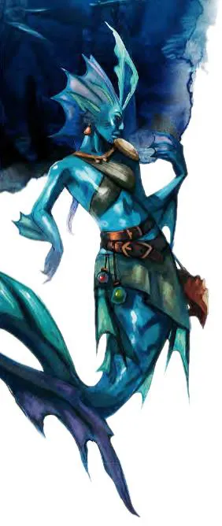

# Povo do Mar

Humanoides aquáticos com a parte superior do corpo de um humano e a parte inferior de um peixe, adornam sua pele e escamas com conchas decorativas.

As tribos e reinos de povos do mar espalham-se pelo mundo e sua gente é tão variada em cores, cultura e perspectiva quando as raças humanas da superfície. Povos da terra e povos do mar raramente se encontram, exceto por acaso, marinheiros apaixonados contem histórias de romances com essas criaturas ao longo dos arquipélagos de ilhas distantes.

O povo do mar não tem os materiais e meios práticos para forjar armas abaixo das ondas, de escrever livros ou manter conhecimento ou de moldar pedra para erguer construções e cidades. Como resultado, a maioria vive em pequenas tribos de caça e coleta, cada uma com seus valores e credos únicos. Apenas ocasionalmente o povo do mar se une sob o comando de um único líder. Eles o fazem para enfrentar uma ameaça em comum ou para completar uma conquista. Tais unificações podem ser o começo de reinos submarinos com dinastias que duram por centenas de anos.

***Colônias de Povos do Mar***. Os povos do mar constroem suas colônias em vastas cavernas submarinas, labirintos de corais e ruínas de cidades submersas ou estruturas que eles esculpem a partir do leito rochoso. Eles vivem em águas profundas o suficiente para que a passagem do tempo possa ser marcada pelo brilho e desvanecimento da luz solar através da água. Nos arrecifes e valas próximas de suas colônias, o povo do mar colhe corais, semeia o fundo do mar e pastoreia cardumes de peixes como agricultores terrestres cuidam de rebanhos de ovelhas. Apenas raramente o povo do mar se aventura nas profundezas escuras do oceano. Em tais profundezas e nas cavernas submarinas, o povo do mar conta com a luz da flora e fauna bioluminescente, como de águas-vivas, cujos lentos movimentos pulsantes dão às colônias de povos do mar uma estética de outro mundo.

O povo do mar defende suas comunidades com lanças feitas de quaisquer materiais que eles possam recuperar de naufrágios, praias e criaturas submarinas mortas.

## Bloco de estatísticas: Povo do Mar

*Humanoide Médio (povo do mar), neutro*

**Classe de Armadura** 11  
**Pontos de Vida** 11 (2d8 + 2)  
**Deslocamento** 3 m, natação 12 m

| FOR | DES | CON | INT | SAB | CAR |
| :---: | :---: | :---: | :---: | :---: | :---: |
| 10 (+0) | 13 (+1) | 12 (+1) | 11 (+0) | 11 (+0) | 12 (+1) |

**Perícias** Percepção +2  
**Sentidos** Percepção passiva 12  
**Idiomas** Aquan, Comum  
**Nível de Desafio** 1/8 (25 XP)

***Anfíbio***. O povo do mar pode respirar ar e água.

### Ações

***Lança***. *Ataque Corpo-a-Corpo ou à Distância com Arma*: +2 para atingir, alcance 1,5 m, distância 6/18 m, um alvo. *Acerto*: 3 (1d6) de dano perfurante, ou 4 (1d8) de dano perfurante se usada com as duas mãos para realizar ataques corpo-a-corpo.
