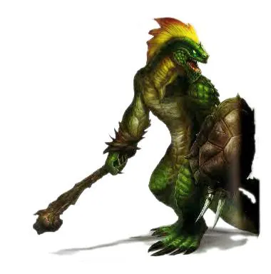

# Povo Lagarto

Os homens-lagarto são humanoides reptilianos primitivos que espreitam nos pântanos e selvas do mundo. Suas aldeias de cabanas crescem em grutas proibidas, ruínas quase submersas e cavernas aquosas.

***Xenófobos Territorialistas***. O povo lagarto lida e negocia com outras raças raramente. Ferozmente territorialistas, eles usam batedores camuflados para guardar o perímetro de seus domínios. Quando visitantes indesejados são detectados, uma tribo envia um bando de caça para agredir ou expulsar os invasores, ou conduzi-los a cair em tocas de crocodilos ou outras criaturas perigosas.

O povo lagarto não tem noção de moralidade tradicional e eles consideram o conceito de bem e mal profundamente alienígena. Como criaturas verdadeiramente neutras, eles matam quando é conveniente e fazem o que for preciso para sobreviver.

Os homens-lagarto raramente se aventura além dos seus territórios de caça. Qualquer criatura que entre em seus territórios, está suscetível de ser caçada, morta e devorada. Eles não fazem distinção entre humanoides, bestas e monstros. Similarmente, o povo lagarto não gosta de ir muito além de suas fronteiras, onde eles podem facilmente se tornar a caça ao invés do caçador.

Podem surgir ocasiões em que o povo lagarto irá formar alianças com seus vizinhos. Esse povo lagarto, geralmente, aprende em primeira mão que os seres humanos, anões, halflings e elfos, às vezes, podem ser úteis e confiáveis. Uma vez que o povo lagarto tenha forjado laços com estrangeiros, eles são aliados perseverantes e ferozes.

***Grandes Banquetes e Sacrifícios***. Os homens-lagarto são onívoros, mas eles tem um gosto pela carne humanoide. Os prisioneiros frequentemente são trazidos de volta para seus acampamentos para se tornarem o prato principal de grandes festas e ritos que envolvem dança, narração de histórias e rituais de combate. As vítimas são ou cozidas e comidas pela tribo, ou sacrificadas para Semuanya, o deus de povo lagarto.

***Artesões Sagazes***. Apesar de não serem artesões especializados, os homens-lagarto constrói ferramentas e joias ornamentais a partir de ossos de suas matanças e eles usam o couro e carapaças de monstros mortos para criar escudos.

***Líderes do Povo Lagarto***. O povo lagarto respeita e teme a magia com uma respeito religioso. Os xamãs do povo lagarto lideram suas tribos, supervisionando ritos e cerimônias realizadas para honrar Semuanya. De tempos em tempos, no entanto, uma tribo de homens-lagarto produz uma poderosa figura tocada não por Semuanya, mas por Sess’inek – um lorde demônio reptiliano que busca corromper e controlar o povo lagarto.

Os homens-lagarto que nasce a imagem de Sess’inek são maiores e mais astutos que os outros homens-lagarto e são completamente malignos. Esses reis e rainhas lagartos dominam as tribos de homens-lagarto, usurpando a autoridade do xamã e inspirando agressões atípicas entre seus súditos.

***Veneradores de Dragões***. O povo lagarto fala Dracônico, que eles creem ter aprendido com os dragões em tempos antigos. Uma tribo que adentre no território de um dragão irá oferecer tributo a ele para ganhar seus favores. Um dragão maligno pode explorar o povo lagarto para seus próprios objetivos vis, transformando-os em invasores e saqueadores.

## Bloco de estatísticas: Povo Lagarto

*Humanoide Médio (povo lagarto), neutro*

**Classe de Armadura** 15 (armadura natural, escudo)  
**Pontos de Vida** 22 (4d8 + 4)  
**Deslocamento** 9 m, natação 9 m

| FOR | DES | CON | INT | SAB | CAR |
| :---: | :---: | :---: | :---: | :---: | :---: |
| 15 (+2) | 10 (+0) | 13 (+1) | 7 (–2) | 12 (+1) | 7 (–2) |

**Perícias** Furtividade +4, Percepção +3, Sobrevivência +5  
**Sentidos** Percepção passiva 13  
**Idiomas** Dracônico  
**Nível de Desafio** 1/2 (100 XP)

***Prender a Respiração***. O povo lagarto pode prender a respiração por 15 minutos.

### Ações

***Ataques Múltiplos***. O povo lagarto realiza dois ataques, cada um com uma arma diferente.

***Mordida***. *Ataque Corpo-a-Corpo com Arma*: +4 para atingir, alcance 1,5 m, um alvo. *Acerto*: 5 (1d6 + 2) de dano perfurante.

***Clava Pesada***. *Ataque Corpo-a-Corpo com Arma*: +4 para atingir, alcance 1,5 m, um alvo. *Acerto*: 5 (1d6 + 2) de dano de concussão.

***Azagaia***. *Ataque Corpo-a-Corpo ou à Distância com Arma*: +4 para atingir, alcance 1,5 m, distância 9/36 m, um alvo. *Acerto*: 5 (1d6 + 2) de dano perfurante.

***Escudo com Cravos***. *Ataque Corpo-a-Corpo com Arma*: +4 para atingir, alcance 1,5 m, um alvo. *Acerto*: 5 (1d6 + 2) de dano perfurante.

## Bloco de estatísticas: Xamã do Povo Lagarto

*Humanoide Médio (povo lagarto), neutro*

**Classe de Armadura** 13 (armadura natural)  
**Pontos de Vida** 27 (5d8 + 5)  
**Deslocamento** 9 m, natação 9 m

| FOR | DES | CON | INT | SAB | CAR |
| :---: | :---: | :---: | :---: | :---: | :---: |
| 15 (+2) | 10 (+0) | 13 (+1) | 10 (+0) | 15 (+2) | 8 (–1) |

**Perícias** Furtividade +4, Percepção +4, Sobrevivência +6  
**Sentidos** Percepção passiva 14  
**Idiomas** Dracônico  
**Nível de Desafio** 2 (450 XP)

***Prender a Respiração***. O povo lagarto pode prender a respiração por 15 minutos.

***Conjuração (Forma de Povo Lagarto Apenas)***. O povo lagarto é um conjurador de 5° nível. Sua habilidade de conjuração é Sabedoria (CD de resistência de magia 12, +4 para atingir com ataques de magia):

Truques (à vontade): *druidismo, criar chamas, chicote de espinhos* 1° nível (4 espaços): *constrição, nevoa obscurecente* 2° nível (3 espaços): *esquentar metal, crescer espinhos* 3° nível (2 espaços): *conjurar animais* (répteis apenas), *ampliar* *plantas*

### Ações

***Ataques Múltiplos (Forma de Povo Lagarto Apenas)***. O povo lagarto realiza dois ataques: um com sua mordida e um com suas garras.

***Mordida***. *Ataque Corpo-a-Corpo com Arma*: +4 para atingir, alcance 1,5 m, um alvo. *Acerto*: 5 (1d6 + 2) de dano perfurante, ou 7 (1d10 + 2) de dano perfurante na forma de crocodilo. Se o povo lagarto estiver na forma de crocodilo e o alvo for uma criatura Grande ou menor, o alvo fica agarrado (CD 12 para escapar). Até esse agarrão acabar, o alvo está impedido e o povo lagarto não pode morder outro alvo. Se o povo lagarto voltar para sua forma verdadeira, o agarrão acaba.

***Garras (Forma de Povo Lagarto Apenas)***. *Ataque Corpo-a-Corpo* *com Arma*: +4 para atingir, alcance 1,5 m, um alvo. *Acerto*: 4 (1d4 + 2) de dano cortante.

***Mudar Forma (Recarrega após um Descanso Curto ou Longo)***. O povo lagarto se metamorfoseia magicamente em um crocodilo, permanecendo nessa forma por até 1 hora. Ele pode voltar para sua forma verdadeira com uma ação bônus. Suas estatísticas, além do tamanho, são as mesmas em cada forma. Qualquer equipamento que ele esteja vestindo ou carregando não é transformado. Ele volta a sua forma verdadeira se morrer.

## Bloco de estatísticas: Rei/Rainha do Povo Lagarto

*Humanoide Médio (povo lagarto), caótico e mau*

**Classe de Armadura** 15 (armadura natural)  
**Pontos de Vida** 78 (12d8 + 24)  
**Deslocamento** 9 m, natação 9 m

| FOR | DES | CON | INT | SAB | CAR |
| :---: | :---: | :---: | :---: | :---: | :---: |
| 17 (+3) | 12 (+1) | 15 (+2) | 11 (+0) | 11 (+0) | 15 (+2) |

**Testes de Resistência** Con +4, Sab +2  
**Perícias** Furtividade +5, Percepção +4, Sobrevivência +4  
**Imunidade a Condição** amedrontado  
**Sentidos** visão no escuro 18 m, Percepção passiva 14  
**Idiomas** Dracônico  
**Nível de Desafio** 4 (1.100 XP)

***Prender a Respiração***. O povo lagarto pode prender a respiração por 15 minutos.

### Ações

***Ataques Múltiplos***. O povo lagarto realiza dois ataques: um com sua mordida e um com suas garras ou tridente, ou dois ataques corpo-a-corpo com seu tridente.

***Mordida***. *Ataque Corpo-a-Corpo com Arma*: +5 para atingir, alcance 1,5 m, um alvo. *Acerto*: 6 (1d6 + 3) de dano perfurante.

***Garras***. *Ataque Corpo-a-Corpo com Arma*: +5 para atingir, alcance 1,5 m, um alvo. *Acerto*: 5 (1d4 + 3) de dano cortante.

***Tridente***. *Ataque Corpo-a-Corpo ou à Distância com Arma*: +5 para atingir, alcance 1,5 m, distância 6/18 m, um alvo. *Acerto*: 6 (1d6 + 3) de dano perfurante ou 7 (1d8 + 3) de dano perfurante se usado com as duas mãos para realizar um ataque corpo-a-corpo.
