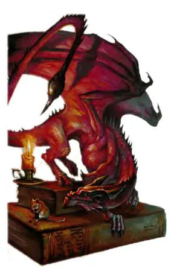

# Pseudodragão

O elusivo pseudodragão vive em locais calmos do mundo, fazendo seus lares em árvores ocas e pequenas grutas. Com suas escamas vermelho-amarronzadas, chifres e mandíbulas cheias de dentes afiados, um pseudodragão lembra um dragão vermelho miúdo, mas com disposição para brincadeiras.

***Quietos e Defensivos***. Os pseudodragões tem pouco interesse em outras criaturas e eles evitam-nas sempre que possível. Se for atacado, um pseudodragão lutará usando seu ferrão venenoso na ponta de sua cauda, uma ferroada dele pode colocar uma criatura em um estado catatônico que pode durar horas.

***Familiares Dracônicos***. Magos frequentemente buscam pseudodragões, cuja boa disposição, habilidade telepática e resistência à magia os torna familiares superiores. Os pseudodragões são seletivos quando ele chega a escolher companheiros, mas eles podem às vezes ser conquistados com comida ou tesouro. Quando um pseudodragão encontra um companheiro aceitável, ele se vincula a essa pessoa enquanto for tratado de forma justa. Um pseudodragão não tolera maus-tratos e abandonará um companheiro manipulador ou abusivo sem aviso.

***Linguagem da Emoção***. Os pseudodragões não podem falar, mas eles se comunicam usando uma forma limitada de telepatia que os permite partilhar ideias básicas como fome, curiosidade e afeição. Quando se vincula a um companheiro, um pseudodragão pode comunicar o que ele vê e ouve mesmo através de longas distâncias.

Um pseudodragão frequentemente vocaliza sons de animais. Um ronrono áspero indica prazer, enquanto que um silvo significa surpresa desagradável. Um chilrear de pássaro representa desejo e um grunhido sempre significa raiva ou descontentamento.

> **Variação: Familiar Pseudodragão**
>
> Alguns pseudodragões estão dispostos a servir conjuradores como seus familiares. Tais pseudodragões tem o seguinte traço. Familiar. O pseudodragão pode servir outra criatura como um familiar, formando um elo telepático mágico com esse companheiro disposto. Enquanto ambos estiverem ligados, o companheiro pode sentir o que o pseudodragão sente contanto que ambos estejam a até 1,5 quilômetro um do outro. Enquanto o pseudodragão estiver a 3 metros de seu companheiro, o companheiro partilha do traço Resistência à Magia do pseudodragão. A qualquer momento e por qualquer razão, o pseudodragão pode terminar seu serviço como familiar, terminando o elo telepático.

## Bloco de estatísticas: Pseudodragão

*Dragão Miúdo, neutro e bom*

**Classe de Armadura** 13 (armadura natural)  
**Pontos de Vida** 7 (2d4 + 2)  
**Deslocamento** 4,5 m, voo 18 m

| FOR | DES | CON | INT | SAB | CAR |
| :---: | :---: | :---: | :---: | :---: | :---: |
| 6 (–2) | 15 (+2) | 13 (+1) | 10 (+0) | 12 (+1) | 10 (+0) |

**Perícias** Furtividade +4, Percepção +3  
**Sentidos** percepção às cegas 3 m, visão no escuro 18 m, Percepção passiva 13  
**Idiomas** compreende Comum e Dracônico, mas não pode falar  
**Nível de Desafio** 1/4 (50 XP)

***Resistência à Magia***. O pseudodragão tem vantagem em testes de resistência contra magias e outros efeitos mágicos.

***Sentidos Aguçados***. O pseudodragão tem vantagem em testes de Sabedoria (Percepção) relacionados à audição, ao olfato e a visão.

***Telepatia Limitada***. O pseudodragão pode comunicar ideias, emoções e imagens simples, telepaticamente, com qualquer criatura a até 30 metros dele que possa compreender um idioma.

### Ações

***Ferrão***. *Ataque Corpo-a-Corpo com Arma*: +5 para atingir, alcance 1,5 m, um alvo. *Acerto*: 4 (1d4 + 2) de dano perfurante e o alvo deve ser bem sucedido num teste de resistência de Constituição CD 11 ou ficará envenenado por 1 hora. Se o resultado do teste de resistência for 6 ou inferior, o alvo cairá inconsciente pela duração ou até sofrer dano ou outra criatura usar sua ação para acorda-lo.

***Mordida***. *Ataque Corpo-a-Corpo com Arma*: +4 para atingir, alcance 1,5 m, um alvo. *Acerto*: 4 (1d4 + 2) de dano perfurante.
