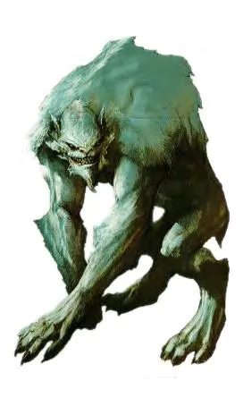

# Quaggoth

## Bloco de estatísticas: Quaggoth

*Humanoide Médio (quaggoth), caótico e neutro*

**Classe de Armadura** 13 (armadura natural)  
**Pontos de Vida** 45 (6d8 + 18)  
**Deslocamento** 9 m, escalada 9 m

| FOR | DES | CON | INT | SAB | CAR |
| :---: | :---: | :---: | :---: | :---: | :---: |
| 17 (+3) | 12 (+1) | 16 (+3) | 6 (–2) | 12 (+1) | 7 (–2) |

**Perícias** Atletismo +5  
**Imunidade a Dano** veneno  
**Imunidade a Condição** envenenado  
**Sentidos** visão no escuro 36 m, Percepção passiva 11  
**Idiomas** Subcomum  
**Nível de Desafio** 2 (450 XP)

***Ferimento Enfurecedor***. Enquanto estiver com 10 ou menos pontos de vida, o quaggoth possui vantagem nas jogadas de ataque. Além disso, ele causa 7 (2d6) de dano extra a qualquer alvo que ele atinja com seus ataques corpo-a-corpo.

### Ações

***Ataques Múltiplos***. O quaggoth realiza dois ataques de garra.

***Garras***. *Ataque Corpo-a-Corpo com Arma*: +5 para atingir, alcance 1,5 m, um alvo. *Acerto*: 6 (1d6 + 3) de dano cortante.

Selvagens e territorialistas, os quaggoths escalam os precipícios do Subterrâneo. Eles esmagam seu inimigos em um frenesi, tornando-se ainda mais sanguinários quando estão próximos da morte.

***Origem dos Quaggoths***. Os quaggoths nunca foram espécies cultas, mas eles nem sempre foram os habitantes brutais do Subterrâneo que são hoje em dia. Numa era distante, tribos de quaggoths habitavam a superfície como arbóreos caçadores noturnos que possuíam sua própria língua e cultura. Quando os elfos apareceram no reino mortal, eles entraram em conflito com os quaggoths, eventualmente, levando-os a quase extinção. Apenas fugindo para as profundezas do Subterrâneo os quaggoths conseguiram sobreviver.

Conforme passaram as eras nas profundezas do mundo, a pelagem dos quaggoths perdeu sua cor e sua visão se adaptou a escuridão, mesmo enquanto o perigo constante e a magia estranha de seu novo reino os transformava. Ficando cada vez mais brutais e selvagens, eles comiam quaisquer alimentos que encontravam – e quando não conseguiam encontrar, eles caçavam uns aos outros. Assim, o canibalismo se tornou parte de sua cultura, seu passado havia sido abandonado.

***Servos dos Drow***. A antiga inimizade entre os quaggoths e os elfos da superfície fez com que eles facilmente se convertessem para a causa dos elfos negros. Nos anos recentes, os drow tem adquirido um interesse em reproduzir os quaggoths, incentivando sua ferocidade enquanto fortalecem sua obediência. Casas drow abastadas tem legiões de quaggoths sob seu comando. Pra piorar, os drow cultivam o ódio que os quaggoths sentem pelos elfos, levando-os em incursões a superfície contra enclaves élficos conhecidos.

***Thonots***. Alguns quaggoths absorveram energia psiônica impregnada em certas partes do Subterrâneo. Quando uma tribo descobriu que um dos seus possuía tais poderes inerentes, eles o colocaram no papel de xamã tribal, ou thonot. Um thonot guarda o conhecimento da tribo e garante sua superioridade contra seus inimigos. Um thonot que fracasse com a tribo é morto e devorado em um ritual canibalesco, na esperança que seus poderes passem para outro quaggoth mais digno.

***Imunidade a Veneno***. Gerações caçando criaturas subterrâneas venenosas e exposição constante aos bolores e fungos que crescem nas profundezas, forçaram os quaggoths a se adaptar, adquirindo imunidade a todos os tipos de venenos.

> **Variação: Quaggoth Thonot**
>
> Um quaggoth thonot é um quaggoth normal com nível de desafio 3 (700 XP) e o seguinte traço adicional.
>
> ***Conjuração Inata***. A habilidade de conjuração de um quaggoth é Sabedoria (CD de resistência de magia 11, +3 para atingir com ataques de magia). Ele pode conjurar, inatamente, as seguintes magias, sem necessidade de componentes materiais:
>
> À vontade: *mãos mágicas* (a mão é invisível), *queda suave* 1/dia cada: *aumentar/reduzir, curar ferimentos, esquentar metal,* *reflexos*
