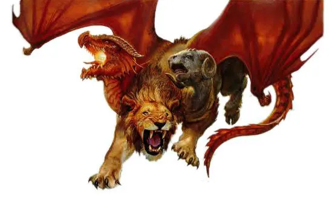

# Quimera

## Bloco de estatísticas: Quimera

*Monstruosidade Grande, caótico e mau*

**Classe de Armadura** 14 (armadura natural)  
**Pontos de Vida** 114 (12d10 + 48)  
**Deslocamento** 9 m, voo 18 m

| FOR | DES | CON | INT | SAB | CAR |
| :---: | :---: | :---: | :---: | :---: | :---: |
| 19 (+4) | 11 (+0) | 19 (+4) | 3 (–4) | 14 (+2) | 10 (+0) |

**Perícias** Percepção +8  
**Sentidos** visão no escuro 18 m, Percepção passiva 18  
**Idiomas** compreende Dracônico, mas não pode falar  
**Nível de Desafio** 6 (2.300 XP)

### Ações

***Ataques Múltiplos***. A quimera realiza três ataques: um com sua mordida, um com seus chifres e um com suas garras. Quando seu sopro flamejante está disponível, ela pode usar o sopro no lugar de sua mordida ou chifres.

***Mordida***. *Ataque Corpo-a-Corpo com Arma*: +7 para atingir, alcance 1,5 m, um alvo. *Acerto*: 11 (2d6 + 4) de dano perfurante.

***Chifres***. *Ataque Corpo-a-Corpo com Arma*: +7 para atingir, alcance 1,5 m, um alvo. *Acerto*: 10 (1d12 + 4) de dano perfurante.

***Garras***. *Ataque Corpo-a-Corpo com Arma*: +7 para atingir, alcance 1,5 m, um alvo. *Acerto*: 11 (2d6 + 4) de dano cortante.

***Sopro Flamejante (Recarrega 5–6)***. A cabeça de dragão expele fogo num cone de 4,5 metros. Cada criatura na área deve ser bem sucedida num teste de resistência de Destreza CD 15, sofrendo 31 (7d8) de dano de fogo caso fracassem, ou metade desse dano caso obtenham sucesso.

As quimeras foram criadas após mortais invocarem Demogorgon para o mundo. O Príncipe dos Demônios, impressionado com as criaturas que o cercavam, as transformou em terríveis monstruosidade de várias cabeças. Esse ato deu origem às primeiras quimeras.

Dotada de crueldade demoníaca, uma quimera serve como um lembrete macabro do que acontece quando príncipes demônios encontram seu caminho para o Plano Material. Uma espécime típica tem o quarto traseiro de um bode grande, o quarto dianteiro de um leão e as asas de couro de um dragão, junto com as três cabeças de todas essas criaturas. O monstro gosta de surpreender suas vítimas, descendo dos céus e engolfando suas presas com seus sopros flamejantes antes de aterrissar.

***Criatura Conflituosa***. Uma quimera combina os piores aspectos de suas três partes. Sua cabeça de dragão a leva a saquear, pilhar e acumular grandes tesouros. Sua natureza leonina a impele a caçar e matar criaturas poderosas que ameacem seu território. E sua cabeça de bode concede-lhe uma veia cruel e teimosa que a obriga a lutar até a morte.

Esses três aspectos levam a quimera a demarcar um território de até quinze quilômetros de extensão. Ela caça animais selvagens, vendo as criaturas mais poderosas como rivais a serem humilhados e derrotados. Seus maiores rivais são os dragões, grifos, manticoras, perytons e wyverns.

Quando caça, a quimera procura por meios mais fáceis de se divertir. Ela aprecia o medo e sofrimento das criaturas mais fracas. O monstro frequentemente brinca com suas presas, terminando um ataque prematuramente e deixando uma criatura ferida e aterrorizada antes de voltar para acabar com ela.

***Servos do Mal***. Embora as quimeras estejam longe de serem astutas, seu ego dracônico as torna susceptíveis a bajulação e presentes. Se lhe for oferecido comida e tesouros, uma quimera pode poupar um viajante. Um vilão pode convencer uma quimera a servi-lo ao mantê-la bem alimentada e seus tesouros bem guardados.
