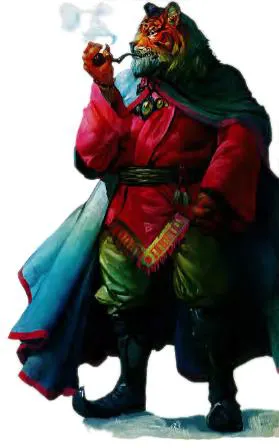

# Rakshasa

O rakshasa aplica delicadeza e desorientação na sua busca de domínio sobre os outros. Poucas criaturas já viram o corruptor em sua forma verdadeira, pois ele pode se disfarçar do que quiser, apesar de preferir se mascarar como alguém poderoso ou influente: um nobre, cardeal ou mercador rico, por exemplo. A forma verdadeira de um rakshasa combina os traços de um humano e de um tigre, com uma notável deformação: suas palmas estão voltadas para onde seriam as costas das mãos de um humano.

***Espíritos Malignos em Carne Mortal***. Os rakshasas originaram-se há muito tempo nos Nove Infernos, quando poderosos diabos criaram um ritual sombrio para libertar suas essências de seus corpos diabólicos para escapar dos Planos Inferiores. Um rakshasa adentra o Plano Material para alimentar seu apetite por carne humanoide e pôr em pratica seus esquemas malignos. Ele escolhe suas presas com cuidado, planejando manter sua presença no mundo em segredo.

***Renascimento Maligno***. Para um rakshasa, a morte no Plano Material significa um agonizante e torturante retorno para os Nove Infernos, onde sua essência permanece presa até seu corpo se reformar – um processo que pode levar meses ou anos. Quando rakshasa renasce, ele possui todas as lembranças e conhecimentos de sua vida anterior e busca retribuição contra quem o matou. Se o alvo de alguma forma escapou de suas garras, o rakshasa pode punir a família, amigos ou descendentes do seu assassino.

Como diabos, os rakshasas mortos nos Nove Infernos são destruídos para sempre.

## Bloco de estatísticas: Rakshasa

*Corruptor Médio, leal e mau*

**Classe de Armadura** 16 (armadura natural)  
**Pontos de Vida** 110 (13d8 + 52)  
**Deslocamento** 12 m

| FOR | DES | CON | INT | SAB | CAR |
| :---: | :---: | :---: | :---: | :---: | :---: |
| 14 (+2) | 17 (+3) | 18 (+4) | 13 (+1) | 16 (+3) | 20 (+5) |

**Perícias** Enganação +10, Intuição +8  
**Vulnerabilidade a Dano** perfurante de armas mágicas empunhadas por criaturas boas  
**Imunidade a Dano** concussão, cortante e perfurante de ataques não-mágicos  
**Sentidos** visão no escuro 18 m, Percepção passiva 13  
**Idiomas** Comum, Infernal  
**Nível de Desafio** 13 (10.000 XP)

***Conjuração Inata***. A habilidade de conjuração de um rakshasa é Carisma (CD de resistência de magia 18, +10 para atingir com ataques de magia). Ele pode conjurar, inatamente, as seguintes magias, sem necessidade de componentes materiais:

À vontade: *detectar pensamentos, disfarçar-se, ilusão menor,* *mãos mágicas* 3/dia cada: *detectar magia, enfeitiçar pessoa, imagem maior,* *invisibilidade, sugestão* 1/dia cada: *dominar pessoa, viagem planar, visão da verdade,* *voo*

***Imunidade à Magia Limitada***. O rakshasa não pode ser afetado ou detectado por magias de 6° nível ou inferior, a não ser que ele deseje ser. Ele tem vantagem nos testes de resistência contra todas as outras magias e efeitos mágicos.

### Ações

***Ataques Múltiplos***. O rakshasa realiza dois ataques de garra.

***Garras***. *Ataque Corpo-a-Corpo com Arma*: +7 para atingir, alcance 1,5 m, um alvo. *Acerto*: 9 (2d6 + 2) de dano cortante e o alvo é amaldiçoado, se for uma criatura. A maldição mágica começa a funcionar quando o alvo realizar um descanso curto ou longo, preenchendo os pensamentos do alvo com imagens e sonhos horrendos. O alvo amaldiçoado não recebe qualquer benefício de um descanso curto ou longo. A maldição dura até o alvo ser liberto pela magia *remover maldição* ou mágica similar.
