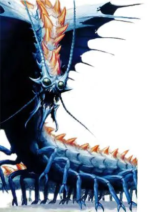

# Remorhazes

## Bloco de estatísticas: Remorhaz Jovem

*Monstruosidade Grande, imparcial*

**Classe de Armadura** 14 (armadura natural)  
**Pontos de Vida** 93 (11d10 + 33)  
**Deslocamento** 9 m, escavação 6 m

| FOR | DES | CON | INT | SAB | CAR |
| :---: | :---: | :---: | :---: | :---: | :---: |
| 18 (+4) | 13 (+1) | 17 (+3) | 3 (–4) | 10 (+0) | 4 (–3) |

**Imunidade a Dano** frio, fogo  
**Sentidos** visão no escuro 18 m, sentido sísmico 18 m, Percepção passiva 10  
**Idiomas** –  
**Nível de Desafio** 5 (1.800 XP)

***Corpo Aquecido***. Uma criatura que toque o remorhaz ou atinja-o com um ataque corpo-a-corpo a 1,5 metro dele, sofre 7 (2d6) de dano de fogo.

### Ações

***Mordida***. *Ataque Corpo-a-Corpo com Arma*: +6 para atingir, alcance 1,5 m, um alvo. *Acerto*: 20 (3d10 + 4) de dano perfurante mais 7 (2d6) de dano de fogo.

De debaixo da neve e gelo emerge um remorhaz em uma nuvem de vapor, seu corpo pulsa com o calor interno. Barbatanas similares a asas surgem de trás da cabeça da criatura e sua boca larga está cheia de dentes irregulares.

***Predadores Árticos***. Os remorhazes vivem em climas árticos, caçando alces, ursos polares e outras criaturas com quem dividem o território. Eles não toleram climas quentes, tendo se adaptado ao frio, gerando um calor similar ao de uma fornalha de dentro de seus corpos. Quando está caçando, um remorhaz se enterra fundo na neve ou gelo e aguarda pelas suaves vibrações criadas pelo movimento de uma criatura acima. Enquanto estiver escondido sob o gelo e neve, ele pode baixar sua temperatura corporal para que não derreta sua cobertura.

***Os Jovens***. Gigantes do gelo caçadores vasculham os desertos glaciais em busca de ninhos e ovos de remorhaz. Os gigantes apreciam remorhazes jovens, que podem ser treinados desde larvas a obedecer os comandos e guardar as cidadelas glaciais dos gigantes. Diferente das espécimes totalmente crescidas, remorhazes jovens roem suas vítimas ao invés de engoli-las inteiras.

## Bloco de estatísticas: Remorhaz

*Monstruosidade Enorme, imparcial*

**Classe de Armadura** 17 (armadura natural)  
**Pontos de Vida** 195 (17d12 + 85)  
**Deslocamento** 9 m, escavação 6 m

| FOR | DES | CON | INT | SAB | CAR |
| :---: | :---: | :---: | :---: | :---: | :---: |
| 24 (+7) | 13 (+1) | 21 (+5) | 4 (–3) | 10 (+0) | 5 (–3) |

**Imunidade a Dano** frio, fogo  
**Sentidos** visão no escuro 18 m, sentido sísmico 18 m, Percepção passiva 10  
**Idiomas** –  
**Nível de Desafio** 11 (7.200 XP)

***Corpo Aquecido***. Uma criatura que toque o remorhaz ou atinja-o com um ataque corpo-a-corpo a 1,5 metro dele, sofre 10 (3d6) de dano de fogo.

### Ações

***Mordida***. *Ataque Corpo-a-Corpo com Arma*: +11 para atingir, alcance 3 m, um alvo. *Acerto*: 40 (6d10 + 7) de dano perfurante mais 10 (3d6) de dano de fogo. Se o alvo for uma criatura, ela fica agarrada (CD 17 para escapar). Até o agarrão acabar, o alvo fica impedido e o remorhaz não pode morder outro alvo.

***Engolir***. O remorhaz realiza um ataque de mordida contra um alvo Médio ou menor que esteja agarrando. Se o ataque atingir, a criatura sofre o dano da mordida, é engolido e o agarrão termina. Enquanto estiver engolido, o alvo estará cego e impedido, ele terá cobertura total contra ataques e outros efeitos de fora do remorhaz e sofre 21 (6d6) de dano ácido no começo de cada turno do remorhaz. Se o remorhaz sofrer 30 de dano ou mais em um único turno por uma criatura engolida, o remorhaz deve ser bem sucedido num teste de resistência de Constituição CD 15 no final desse turno ou regurgitará todas as criaturas engolidas, que cairão em um espaço a até 3 metros do remorhaz. Se o remorhaz morrer, uma criatura engolida não estará mais impedida por ele e poderá escapar do corpo usando 4,5 metro de movimento, estando caída ao sair.
