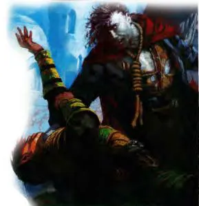

# Ressurgido

Um ressurgido se forma da alma de um mortal que teve um destino cruel e indigno. Ele agarra seu caminho de volta para o mundo em busca de vingança contra aquele que o injustiçou. O ressurgido reivindica seu corpo mortal e lembra superficialmente um zumbi. Porém, ao invés de olhos sem vida, os olhos de um ressurgido queimam com determinação e fúria. Se o corpo original do ressurgido for destruído ou estiver, de alguma outra forma, indisponível, o espírito do ressurgido entrará no corpo de outro humanoide. Independentemente de que corpo o ressurgido esteja utilizando como receptáculo, seu adversário sempre reconhece o ressurgido por quem ele realmente é.

***Sede de Vingança***. Um ressurgido tem apenas um ano para reclamar sua vingança. Quando seu adversário morrer ou se o ressurgido fracassar em matar seu adversário antes do seu tempo acabar, ele desmorona em poeira e sua alma desaparece no além-vida. Se seu inimigo for muito poderoso para ser destruído pelo ressurgido sozinho, ele buscará aliados valorosos para ajudá-lo a cumprir sua missão.

***Justiça Divina***. Nenhuma magia pode esconder uma criatura perseguida por um ressurgido, que sempre sabe a direção e distância entre ele e o alvo de sua vingança. Nos casos em que o ressurgido busca vingança contra mais de um adversário, ele persegue um de cada vez, começando com a criatura que lhe deu o golpe fatal. Se o corpo do ressurgido for destruído, sua alma desencarna e busca um novo corpo de onde possa retomar sua caçada.

***Natureza Morta-Viva***. O ressurgido não precisa respirar, comer, beber ou dormir.

## Bloco de estatísticas: Ressurgido

*Morto-vivo Médio, neutro*

**Classe de Armadura** 13 (armadura de couro)  
**Pontos de Vida** 136 (16d8 + 64)  
**Deslocamento** 9 m

| FOR | DES | CON | INT | SAB | CAR |
| :---: | :---: | :---: | :---: | :---: | :---: |
| 18 (+4) | 14 (+2) | 18 (+4) | 13 (+1) | 16 (+3) | 18 (+4) |

**Testes de Resistência** For +7, Con +7, Sab +6, Car +7  
**Resistência a Dano** necrótico, psíquico  
**Imunidade a Dano** veneno  
**Imunidade a Condição** amedrontado, atordoado, enfeitiçado, envenenado, exausto, paralisado  
**Sentidos** visão no escuro 18 m, Percepção passiva 13  
**Idiomas** os idiomas que conhecia em vida  
**Nível de Desafio** 6 (2.300 XP)

***Imunidade à Expulsão***. O ressurgido é imune a efeitos que expulsem mortos-vivos.

***Rastreador Vingativo***. O ressurgido sabe a distância e a direção de qualquer criatura contra quem busque vingança, mesmo se a criatura e o ressurgido estiverem em planos de existência diferentes. Se a criatura que está sendo rastreada pelo ressurgido morrer, o ressurgido saberá.

***Regeneração***. O ressurgido recupera 10 pontos de vida no início de seu turno. Se o ressurgido sofrer dano de fogo ou radiante, esse traço não funcionará até o início do próximo turno do

### Variação: Ressurgidos com Armas e Magias

Os ressurgidos que eram conjuradores antes de morrerem podem conservar alguma ou toda a sua capacidade de conjuração. Similarmente, ressurgidos que usavam armaduras e empunhavam armas em vida podem continuar a fazê-lo.

ressurgido. O corpo do ressurgido é destruído apenas se ele começar seu turno com 0 pontos de vida e não puder se regenerar.

***Rejuvenescimento***. Quando o corpo do ressurgido é destruído, sua alma persiste. Após 24 horas, a alma entra e anima outro corpo no mesmo plano de existência e recupera todos os seus pontos de vida. Enquanto a alma estiver incorpórea, uma magia *desejo* pode ser usada para força-la a ir para o além-vida e não retornar.

### Ações

***Ataques Múltiplos***. O ressurgido realiza dois ataques de punho.

***Punho***. *Ataque Corpo-a-Corpo com Arma*: +7 para atingir, alcance 1,5 m, um alvo. *Acerto*: 11 (2d6 + 4) de dano de concussão. Se o alvo for uma criatura contra quem o ressurgido jurou vingança, o alvo sofre 14 (4d6) de dano de concussão extra. Ao invés de causar dano, o ressurgido pode agarrar o alvo (CD 14 para escapar) considerando que o alvo seja Grande ou menor.

***Olhar Vingativo***. O ressurgido afeta uma criatura que ele possa ver, a até 9 metros dele e contra quem tenha jurado vingança. O alvo deve realizar um teste de resistência de Sabedoria CD 15. Se fracassar, o alvo fica paralisado até o ressurgido causar dano a ele, ou até o final do próximo turno do ressurgido. Quando a paralisia acabar, o alvo fica amedrontado por 1 minuto. O alvo amedrontado pode repetir o teste de resistência no final de cada um dos turnos dele, com desvantagem se ele puder ver o ressurgido, terminando a condição amedrontado sobre si, com um sucesso.
