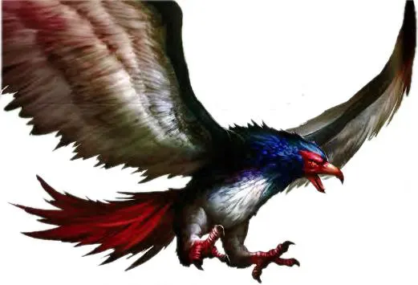

# Roca

A primeira vista, a silhueta de um roca parece mais com a de qualquer ave de rapina. Conforme ele desce, porém, seu tamanho descomunal torna-se terrivelmente claro. Durante o voo, a envergadura de asas de um roca chega a sessenta metros ou mais. Durante o descanso, empoleirados nos picos das montanhas que são seus lares, esses pássaros monstruosos rivalizam os antigos dragões em tamanho.

***Titãs do Céu***. Nos dias antigos, quando os gigantes batalhavam com os dragões pelo controle do mundo, Annam, o pai dos deuses gigantes, criou os rocas para que seus devotos pudessem confrontar a dominância aérea dos dragões. Quando a guerra terminou, os rocas estavam livres da dominação dos gigantes e se espalharam pelo mundo.

Embora os gigantes das nuvens e os gigantes da tempestade às vezes domem esses pássaros gigantes, os rocas tratam até os gigantes como presas em potencial. Eles voam grandes distâncias em busca de comida, voando bem acima das nuvens para alcançar seus territórios de caça preferidos. Um roca raramente caça criaturas rápidas ou pequenas e ignora cidades e florestas onde as presas podem buscar abrigo facilmente. Quando ele encontra um alvo grande e lento como um gigante, uma baleia ou um elefante, ele mergulha para agarrar a presa com suas garras maciças.

***Afastados e Solitários***. Os rocas são criaturas solitárias que podem viver por séculos. Eles vivem em ninhos feitos de árvores, tendas, navios quebrados e restos de caravanas que eles coletaram, colocando esses entulhos maciços em fendas montanhosas fora do alcance de criaturas menores.

Às vezes, o ninho de um roca contem tesouros de caravanas e barcos que eles assaltaram, mas essas criaturas não se importam com essas bugigangas. Mais raramente, um ninho contem ovos que são maiores que humanos, gerados do infrequente acasalamento dos rocas.

## Bloco de estatísticas: Roca

*Monstruosidade Imensa, imparcial*

**Classe de Armadura** 15 (armadura natural)  
**Pontos de Vida** 248 (16d20 + 80)  
**Deslocamento** 6 m, voo 36 m

| FOR | DES | CON | INT | SAB | CAR |
| :---: | :---: | :---: | :---: | :---: | :---: |
| 28 (+9) | 10 (+0) | 20 (+5) | 3 (–4) | 10 (+0) | 9 (–1) |

**Testes de Resistência** Des +4, Con +9, Sab +4, Car +3  
**Perícias** Percepção +4  
**Sentidos** Percepção passiva 14  
**Idiomas** –  
**Nível de Desafio** 11 (7.200 XP)

***Visão Aguçada***. O roca tem vantagem em testes de Sabedoria (Percepção) relacionados à visão.

### Ações

***Ataques Múltiplos***. O roca realiza dois ataques: um com sua bicada e um com suas garras.

***Bicada***. *Ataque Corpo-a-Corpo com Arma*: +13 para atingir, alcance 4,5 m, um alvo. *Acerto*: 27 (4d8 + 9) de dano perfurante.

***Garras***. *Ataque Corpo-a-Corpo com Arma*: +13 para atingir, alcance 3 m, um alvo. *Acerto*: 23 (4d6 + 9) de dano cortante e o alvo é agarrado (CD 19 para escapar). Até esse agarrão terminar, o alvo está impedido e o roca não pode usar suas garras em outro alvo.
