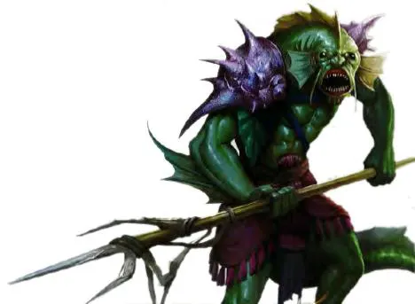
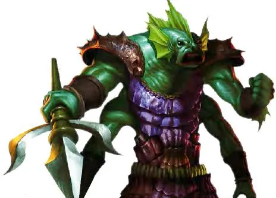

# Sahuagin

Pelas costas envoltas em névoa ou pelo crescente oceano interminável, um zumbido sinistro soou em uma concha, congelando o coração de todos que o ouviram. Esse é o som da trompa de caça sahuagin – um chamado para ataque e batalha. Moradores costeiros referem-se aos sahuagin como “diabos do mar”, pois os sahuagin não tem qualquer compaixão, massacrando as tripulações dos navios e dizimando aldeias costeiras.

***Diabos das Profundezas***. Os sahuagin são uma raça písceo e predatória que se aventura das profundezas escuras do oceano para caçar as criaturas de águas rasas e do litoral. Embora eles habitem nas mais profundas fendas oceânicas, os sahuagin veem todo o domínio aquático como seu reino e as criaturas nele como presas para seus grupos de caça.

Os governantes autoproclamados dos domínios oceânicos dos sahuagin são grandes mutantes machos com um par de braços secundário. Eles são oponentes terríveis em batalha e todos os sahuagin ajoelham-se perante esses poderosos barões.

***Caminho do Tubarão***. Os sahuagin veneram o deus tubarão Sekolah. Apenas as sahuagin fêmeas são consideradas dignas de canalizar o poder do deus e as sacerdotisas possuem uma enorme influência nas comunidades sahuagin.

Os sahuagin entram em frenesi quando sentem cheiro de sangue fresco. Como adoradores de Sekolah, eles também tem uma afinidade especial com os tubarões, os quais eles treinando como animais de ataque. Mesmo os tubarões destreinados reconhecem os sahuagin como aliados e não como suas presas.

***Inimizade Élfica***. Os sahuagin poderiam controlar os oceanos, se não fosse a presença de seus inimigos mortais, os elfos aquáticos. Guerras entre as duas raças tem ocorrido por séculos por todas as costas e mares do mundo, prejudicando o comércio marítimo e trazendo outras raças para esse conflito sangrento.

O ódio dos sahuagin pelos elfos aquáticos é tão intenso que os diabos do mar se adaptaram para combater seus antigos adversários. Um sahuagin que nasça próximo o bastante de uma comunidade de elfos aquáticos pode vir ao mundo como um malenti – um sahuagin que lembra fisicamente um elfo aquático em todas as formas. Os sahuagin são propensos a mutação, mas se esse raro fenômeno é resultado das guerras entre os sahuagin e os elfos aquáticos – ou se eles precederam ou mesmo deram início ao conflito – ninguém pode dizer.

Os sahuagin fazem bom uso dos malenti como espiões e assassinos nas cidades de elfos aquáticos e sociedades de outras criaturas que representem um ameaça aos sahuagin. A mera sombra da ameaça malenti incita a paranoia e desconfiança entre os elfos aquáticos, cuja resistência é enfraquecida com o prelúdio de uma efetiva invasão sahuagin.

## Bloco de estatísticas: Sahuagin

*Humanoide Médio (sahuagin), leal e mau*

**Classe de Armadura** 12 (armadura natural)  
**Pontos de Vida** 22 (4d8 + 4)  
**Deslocamento** 9 m, natação 12 m

| FOR | DES | CON | INT | SAB | CAR |
| :---: | :---: | :---: | :---: | :---: | :---: |
| 13 (+1) | 11 (+0) | 12 (+1) | 12 (+1) | 13 (+1) | 9 (–1) |

**Perícias** Percepção +5  
**Sentidos** visão no escuro 36 m, Percepção passiva 15  
**Idiomas** Sahuagin  
**Nível de Desafio** 1/2 (100 XP)

***Anfíbio Limitado***. O sahuagin pode respirar ar e água, mas ele precisa submergir, pelo menos, a cada 4 horas para evitar sufocação.

***Frenesi de Sangue***. O sahuagin tem vantagem nas jogadas de ataque corpo-a-corpo contra qualquer criatura que não esteja com todos os seus pontos de vida.

***Telepatia com Tubarões***. O sahuagin pode comandar magicamente qualquer tubarão a até 36 metros dele, usando uma telepatia limitada.

### Ações

***Ataques Múltiplos***. O sahuagin realiza dois ataques: um com sua mordida e um com suas garras ou lança.

***Mordida***. *Ataque Corpo-a-Corpo com Arma*: +3 para atingir, alcance 1,5 m, um alvo. *Acerto*: 3 (1d4 + 1) de dano perfurante.

***Garras***. *Ataque Corpo-a-Corpo com Arma*: +3 para atingir, alcance 1,5 m, um alvo. *Acerto*: 3 (1d4 + 1) de dano cortante.

***Lança***. *Ataque Corpo-a-Corpo ou à Distância com Arma*: +3 para atingir, alcance 1,5 m, distância 6/18 m, um alvo. *Acerto*: 4 (1d6 + 1) de dano perfurante, ou 5 (1d8 + 1) de dano perfurante se usada com as duas mãos para realizar ataques corpo-a-corpo.

## Bloco de estatísticas: Barão Sahuagin

*Humanoide Grande (sahuagin), leal e mau*

**Classe de Armadura** 16 (peitoral)  
**Pontos de Vida** 76 (9d10 + 27)  
**Deslocamento** 9 m, natação 15 m

| FOR | DES | CON | INT | SAB | CAR |
| :---: | :---: | :---: | :---: | :---: | :---: |
| 19 (+4) | 15 (+2) | 16 (+3) | 14 (+2) | 13 (+1) | 17 (+3) |

**Testes de Resistência** Des +5, Con +6, Int +5, Sab +4  
**Perícias** Percepção +7  
**Sentidos** visão no escuro 36 m, Percepção passiva 17  
**Idiomas** Sahuagin  
**Nível de Desafio** 5 (1.800 XP)

***Anfíbio Limitado***. O sahuagin pode respirar ar e água, mas ele precisa submergir, pelo menos, a cada 4 horas para evitar sufocação.

***Frenesi de Sangue***. O sahuagin tem vantagem nas jogadas de ataque corpo-a-corpo contra qualquer criatura que não esteja com todos os seus pontos de vida.

***Telepatia com Tubarões***. O sahuagin pode comandar magicamente qualquer tubarão a até 36 metros dele, usando uma telepatia limitada.

### Ações

***Ataques Múltiplos***. O sahuagin realiza três ataques: um com sua mordida e dois com suas garras ou tridente.

***Mordida***. *Ataque Corpo-a-Corpo com Arma*: +7 para atingir, alcance 1,5 m, um alvo. *Acerto*: 9 (2d4 + 4) de dano perfurante.

***Garras***. *Ataque Corpo-a-Corpo com Arma*: +3 para atingir, alcance 1,5 m, um alvo. *Acerto*: 11 (2d6 + 4) de dano cortante.

***Tridente***. *Ataque Corpo-a-Corpo ou à Distância com Arma*: +7 para atingir, alcance 1,5 m, distância 6/18 m, um alvo. *Acerto*: 11 (2d6 + 4) de dano perfurante, ou 13 (2d8 + 4) de dano perfurante se usada com as duas mãos para realizar ataques corpo-a-corpo.

## Bloco de estatísticas: Sacerdotisa Sahuagin

*Humanoide Médio (sahuagin), leal e mau*

**Classe de Armadura** 12 (armadura natural)  
**Pontos de Vida** 33 (6d8 + 6)  
**Deslocamento** 9 m, natação 12 m

| FOR | DES | CON | INT | SAB | CAR |
| :---: | :---: | :---: | :---: | :---: | :---: |
| 13 (+1) | 11 (+0) | 12 (+1) | 12 (+1) | 14 (+1) | 13 (+1) |

**Perícias** Religião +3, Percepção +6  
**Sentidos** visão no escuro 36 m, Percepção passiva 16  
**Idiomas** Sahuagin  
**Nível de Desafio** 3 (700 XP)

***Anfíbio Limitado***. A sahuagin pode respirar ar e água, mas ela precisa submergir, pelo menos, a cada 4 horas para evitar sufocação.

***Conjuração***. A sahuagin é uma conjuradora de 6° nível. Sua habilidade de conjuração é Sabedoria (CD de resistência de magia 12, +4 para atingir com ataques com magia). Ela possui as seguintes magias de clérigo preparadas:

Truques (à vontade): *orientação, taumaturgia* 1° nível (4 espaços): *bênção, detectar magia, raio teleguiado* 2° nível (3 espaços): *arma espiritual* (tridente), *imobilizar pessoa* 3° nível (3 espaços): *idiomas, palavra de cura em massa*

***Frenesi de Sangue***. A sahuagin tem vantagem nas jogadas de ataque corpo-a-corpo contra qualquer criatura que não esteja com todos os seus pontos de vida.

***Telepatia com Tubarões***. A sahuagin pode comandar magicamente qualquer tubarão a até 36 metros dele, usando uma telepatia limitada.

### Ações

***Ataques Múltiplos***. A sahuagin realiza dois ataques: um com sua mordida e um com suas garras.

***Mordida***. *Ataque Corpo-a-Corpo com Arma*: +3 para atingir, alcance 1,5 m, um alvo. *Acerto*: 3 (1d4 + 1) de dano perfurante.

***Garras***. *Ataque Corpo-a-Corpo com Arma*: +3 para atingir, alcance 1,5 m, um alvo. *Acerto*: 3 (1d4 + 1) de dano cortante.
