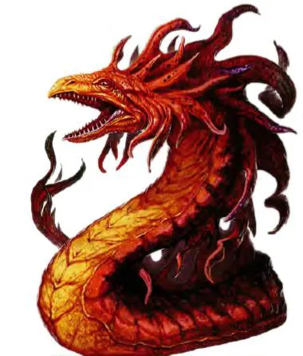
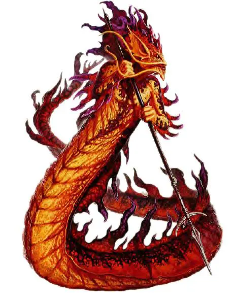

# Salamandras

As salamandras deslizam pelo Mar de Cinzas no Plano Elemental do Fogo, com suas silhuetas sinuosas e espinhos irregulares fumegando. Um calor imenso emana de seus corpos, enquanto seus olhos amarelados brilham como velas nas cavidades profundamente marcadas de seus rostos beligerantes.

As salamandras adoram o poder e tem prazer em incendiar coisas. Fora de seu plano natal, elas vagam entre os restos queimados de árvores carbonizadas enquanto o fogo da floresta dança ao seu redor, ou descem deslizando pelas encostas de vulcões em erupção para relaxar em fogueiras e poços de magma.

***Serpentes de Fogo***. As salamandras nascem de ovos que são esferas de obsidiana ardente de 60 centímetros de diâmetro. Quando uma salamandra está pronta para chocar, ela derrete seu caminho através da fina casca do ovo e emerge como uma serpente de fogo. Uma serpente de fogo amadurece se tornando uma salamandra adulta dentro de um ano.

***Escravas dos Efreet***. Muito tempo atrás, os efreet contrataram os azers para construir a fabulosa Cidade de Bronze, mas eles fracassaram em sua tentativa de escravizar aquela raça mística quando o trabalho dos azers terminou. Se virando, ao invés, contra as salamandras, os efreet tiveram mais sorte em estabelecer uma raça escrava, a qual eles usam para propagar guerra e destruição pelos planos.

As salamandras odeiam os azers, acreditando que se os efreet tivessem sucesso em dominar aquela raça de artífices elementais, as salamandras ainda poderiam estar livres. Os efreet usam essa inimizada em sua vantagem, atiçando o ódio das salamandras e colocando-as contra os antigos servos dos efreet.

Os efreet obrigam as salamandras a não servir a nenhum outro mestre; quando os efreet encontram salamandras dedicando-se a cultos do Mal Elemental, eles as matam ao invés de toma-las como escravas.

***Nobres Autoritárias***. Embora as salamandras sigam os impulsos destrutivos de sua natureza ardente, a escravidão pelos efreet teve impacto na cultura das salamandras livres. Elas governam suas próprias sociedade de acordo com o modelo efreet, no qual as salamandras maiores e mais fortes reivindicam a dominação sobre os menores da raça.

Conforme as salamandras envelhecem, elas crescem em tamanho e posição, erguendo-se a posições de poder como nobres cruéis entre sua espécie. As nobres governam bandos errantes de salamandras, que se movem pelo Plano Elemental do Fogo como nômades do deserto, atacando outras comunidades atrás de tesouros.

***Forjas Vivas***. As salamandras geram um calor intenso e quando elas lutam, suas armas brilham vermelho e queimam os corpos de seus inimigos ao contato. Mesmo se aproximar de uma salamandra é perigoso, já que ela causa bolhas e queimaduras na pele em sua proximidade.

Esse calor inerente é um trunfo para a perícia das salamandras como ferreiras, permitindo que elas amoleçam e modelem o ferro e aço com suas próprias mãos. Apesar de não serem tão meticulosas quanto os azers, as salamandras estão entre os maiores forjadores de todos os planos. Criaturas poderosas as invocam como guerreiros, mas outras recorrem as salamandras por suas perícias de forja, ou as aprisionam em forjas ou fornos para gerar calor ilimitado.

## Bloco de estatísticas: Serpente de Fogo

*Elemental Médio, neutro e mau*

**Classe de Armadura** 14 (armadura natural)  
**Pontos de Vida** 22 (5d8)  
**Deslocamento** 9 m

| FOR | DES | CON | INT | SAB | CAR |
| :---: | :---: | :---: | :---: | :---: | :---: |
| 12 (+1) | 14 (+2) | 11 (+0) | 7 (–2) | 10 (+0) | 8 (–1) |

**Vulnerabilidade a Dano** frio  
**Resistência a Dano** concussão, cortante e perfurante de ataques não-mágicos  
**Imunidade a Dano** fogo  
**Sentidos** visão no escuro 18 m, Percepção passiva 10  
**Idiomas** compreende Ignan, mas não pode falar  
**Nível de Desafio** 1 (200 XP)

***Corpo Ardente***. Uma criatura que toque a serpente ou atinja ela com um ataque corpo-a-corpo a 1,5 metro dela sofre 3 (1d6) de dano de fogo.

### Ações

***Ataques Múltiplos***. A serpente realiza dois ataques: um com sua mordida e um com sua cauda.

***Mordida***. *Ataque Corpo-a-Corpo com Arma*: +3 para atingir, alcance 1,5 m, um alvo. *Acerto*: 3 (1d4 + 1) de dano perfurante mais 3 (1d6) de dano de fogo.

***Cauda***. *Ataque Corpo-a-Corpo com Arma*: +3 para atingir, alcance 1,5 m, um alvo. *Acerto*: 3 (1d4 + 1) de dano de concussão mais 3 (1d6) de dano de fogo.

## Bloco de estatísticas: Salamandra

*Elemental Grande, neutro e mau*

**Classe de Armadura** 15 (armadura natural)  
**Pontos de Vida** 90 (12d10 + 24)  
**Deslocamento** 9 m

| FOR | DES | CON | INT | SAB | CAR |
| :---: | :---: | :---: | :---: | :---: | :---: |
| 18 (+4) | 14 (+2) | 15 (+2) | 11 (+0) | 10 (+0) | 12 (+1) |

**Vulnerabilidade a Dano** frio  
**Resistência a Dano** concussão, cortante e perfurante de ataques não-mágicos  
**Imunidade a Dano** fogo  
**Sentidos** visão no escuro 18 m, Percepção passiva 10  
**Idiomas** compreende Ignan, mas não pode falar  
**Nível de Desafio** 5 (1.800 XP)

***Armas Ardentes***. Qualquer arma de metal corpo-a-corpo que a salamandra empunhar, causa 3 (1d6) de dano de fogo extra (incluso no ataque).

***Corpo Ardente***. Uma criatura que toque a serpente ou atinja ela com um ataque corpo-a-corpo a 1,5 metro dela sofre 3 (1d6) de dano de fogo.

### Ações

***Ataques Múltiplos***. A salamandra realiza dois ataques: um com sua lança e um com sua cauda.

***Lança***. *Ataque Corpo-a-Corpo ou à Distância com Arma*: +7 para atingir, alcance 1,5 m, distância 6/18 m, um alvo. *Acerto*: 11 (2d6 + 4) de dano perfurante, ou 13 (2d8 + 4) de dano perfurante se usada com as duas mãos para realizar ataques corpo-a-corpo, mais 3 (1d6) de dano de fogo.

***Cauda***. *Ataque Corpo-a-Corpo com Arma*: +7 para atingir, alcance 3 m, um alvo. *Acerto*: 11 (2d6 + 4) de dano de concussão mais 7 (2d6) de dano de fogo e o alvo é agarrado (CD 14 para escapar). Até o agarrão acabar, o alvo fica impedido, a salamandra pode atingir, automaticamente, o alvo com sua cauda e ela não pode realizar ataques de cauda contra outros alvos.
