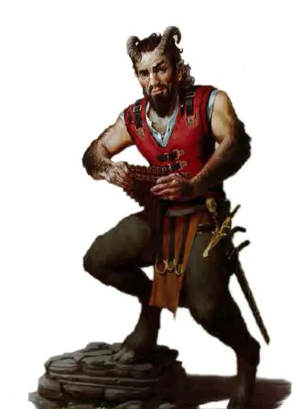

# Sátiro

Os sátiros são fadas barulhentas que brincam em florestas selvagens, impulsionados pela curiosidade e hedonismo em medidas iguais.

Os sátiros lembram humanos atarracados com a parte de baixo de seus corpos peludos e com cascos fendidos de bodes. Chifres brotam de suas cabeças, variando em tamanho desde pequenos tocos até grandes e espiralados chifres de carneiro. Eles geralmente ostentam barbas.

***Farristas Hedonistas***. Os sátiros anseiam pela bebida mais forte, as especiarias mais perfumadas e as danças mais estonteantes. Um sátiro se sente faminto quando ele não pode se divertir e não irá medir esforços para saciar seus desejos. Ele pode sequestrar um excelente menestrel para ouvir suas canções adoráveis, entrar furtivamente em um jardim bem protegido para contemplar um belo rapaz ou moça, ou se infiltrar em um palácio para provar da melhor comida do local. Os sátiros não permitem que nenhuma festividade passe por eles. Eles participam de todos os feriados que ouvem falar. As civilizações do mundo possuem festivais e feriados suficiente para justificar uma celebração ininterrupta.

Inebriados por bebidas e prazer, os sátiros não dão a mínima para as consequências do hedonismo que incita nos outros. Eles deixam tais criaturas mistificadas pelo seu próprio comportamento. Tais farristas podem ter que se desculpar para seus pais, empregados, familiares ou amigos por seu estado desordeiro.

> **Variação: Flauta do Sátiro**
>
> Um sátiro pode carregar uma flauta de pã, a qual ele pode tocar para criar efeitos mágicos. Geralmente, apenas um sátiro em um grupo carregará tal flauta. Se um sátiro tiver a flauta, ele ganha a seguinte opção de ação adicional.
>
> ***Flauta de Pã***. O sátiro toca sua flauta e escolhe um dos seguintes efeitos mágicos: uma melodia encantadora, uma trilha assustadora ou uma canção de ninar. Qualquer criatura a até 18 metros do sátiro que puder ouvir a flauta, deve ser bem sucedida num teste de resistência de Sabedoria CD 13 ou será afetada como descrito abaixo. Outros sátiros e criaturas que não possam ser enfeitiçadas não são afetados. Uma criatura afetada pode repetir o teste de resistência no final de cada um dos turnos dela, terminando o efeito sobre si com um sucesso. Se o teste de resistência de uma criatura for bem sucedido ou se o efeito terminar sobre ela, ela fica imune a essa flauta de pã pelas próximas 24 horas. *Melodia Encantadora*. A criatura fica enfeitiçada pelo sátiro por 1 minuto. Se o sátiro ou qualquer de seus companheiros ferir a criatura, o efeito nela termina imediatamente. *Trilha Assustadora*. A criatura fica amedrontada por 1 minuto. *Canção de Ninar*. A criatura cai no sono e fica inconsciente por 1 minuto. O efeito termina se a criatura sofrer dano ou se alguém usar uma ação para sacudir a criatura até acorda-la.

## Bloco de estatísticas: Sátiro

*Fada Média, caótico e neutro*

**Classe de Armadura** 14 (armadura de couro)  
**Pontos de Vida** 31 (7d8)  
**Deslocamento** 12 m

| FOR | DES | CON | INT | SAB | CAR |
| :---: | :---: | :---: | :---: | :---: | :---: |
| 12 (+1) | 16 (+3) | 11 (+0) | 12 (+1) | 10 (+0) | 14 (+2) |

**Perícias** Atuação +6, Furtividade +5, Percepção +2  
**Sentidos** Percepção passiva 12  
**Idiomas** Comum, Élfico, Silvestre  
**Nível de Desafio** 1/2 (100 XP)

***Resistência à Magia***. O sátiro possui vantagem nos testes de resistência contra magias e outros efeitos mágicos.

### Ações

***Cabeçada***. *Ataque Corpo-a-Corpo com Arma*: +3 para atingir, alcance 1,5 m, um alvo. *Acerto*: 6 (2d4 + 1) de dano de concussão.

***Espada Curta***. *Ataque Corpo-a-Corpo com Arma*: +5 para atingir, alcance 1,5 m, um alvo. *Acerto*: 6 (1d6 + 3) de dano perfurante.

***Arco Curto***. *Ataque à Distância com Arma*: +5 para atingir, distância 24/96 m, um alvo. *Acerto*: 6 (1d6 + 3) de dano perfurante.
