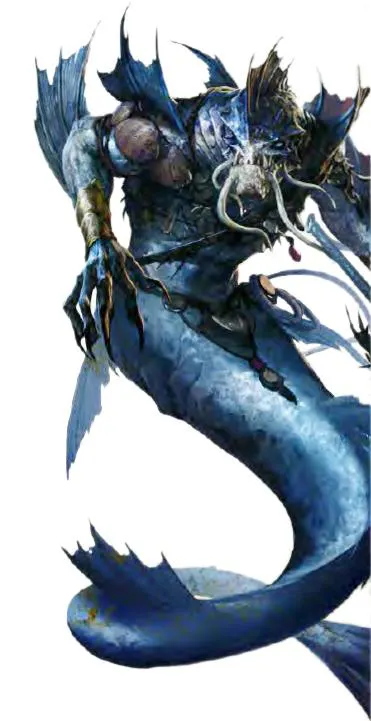

# Sirenídeo

Os sirenídeos assombram as águas costeiras, caçando o povo-peixe, povo do mar e qualquer outra criatura comestível que cruze seu caminho. Esses monstros selvagens capturam e devoram presas desatentas, arrastando corpos afogados de volta para suas grutas submersas para se alimentar.

***Povo do Mar Transformado***. Muito tempo atrás, uma tribo de povo do mar encontrou um ídolo de Demogorgon no fundo do mar. Sem saber do que se tratava, eles levaram o artefato para seu rei. Todos que tocaram no ídolo foram afligidos com loucura, incluindo o rei, que decretou que um ritual de sacrifício deveria ser realizado para abrir um portal para o Abismo. O oceano ficou vermelho com o sangue do massacre do povo do mar, mas o ritual funcionou, e o rei liderou os sobreviventes através do portal submerso para a camada de Demogorgon no Abismo. O povo do mar permaneceu lá por gerações, lutando por suas vidas enquanto o Abismo os distorcia completamente, transformando-os em monstruosidades malignas brutais. Então, o primeiro sirenídeo nasceu.

***Valentões Costeiros***. Sempre que uma oportunidade aparece para ele, o Príncipe dos Demônios envia sirenídeos de volta para o Plano Material para causar estragos nos oceanos. Os sirenídeos são valentões, atacando todas as criaturas menores e mais fracas que eles.

Os sirenídeos vivem em cavernas submersas cheias de tesouros e troféus, tirados de suas vítimas e de navios naufragados. Eles amarram os corpos apodrecidos de seus inimigos mortos e de marinheiros afogados a cordões de algas marinhas para demarcar as fronteiras de seus territórios.

## Bloco de estatísticas: Sirenídeo

*Monstruosidade Grande, caótico e mau*

**Classe de Armadura** 13 (armadura natural)  
**Pontos de Vida** 45 (6d10 + 12)  
**Deslocamento** 3 m, natação 12 m

| FOR | DES | CON | INT | SAB | CAR |
| :---: | :---: | :---: | :---: | :---: | :---: |
| 18 (+4) | 10 (+0) | 15 (+2) | 8 (–1) | 10 (+0) | 9 (–1) |

**Perícias** Percepção +2  
**Sentidos** visão no escuro 18 m, Percepção passiva 12  
**Idiomas** Abissal, Aquan  
**Nível de Desafio** 2 (450 XP)

***Anfíbio***. O sirenídeo pode respirar ar e água.

### Ações

***Ataques Múltiplos***. O sirenídeo realiza dois ataques: um com sua mordida e um com suas garras ou arpão.

***Mordida***. *Ataque Corpo-a-Corpo com Arma*: +6 para atingir, alcance 1,5 m, um alvo. *Acerto*: 8 (1d8 + 4) de dano perfurante.

***Garras***. *Ataque Corpo-a-Corpo com Arma*: +6 para atingir, alcance 1,5 m, um alvo. *Acerto*: 9 (2d4 + 4) de dano cortante.

***Arpão***. *Ataque Corpo-a-Corpo ou à Distância com Arma*: +6 para atingir, alcance 1,5 m ou distância 6/18 m, um alvo. *Acerto*: 11 (2d6 + 4) de dano perfurante. Se o alvo for uma criatura Enorme ou menor, ela deve ser bem sucedida num teste resistido de Força contra o sirenídeo, ou será puxada 6 metros na direção dele.
