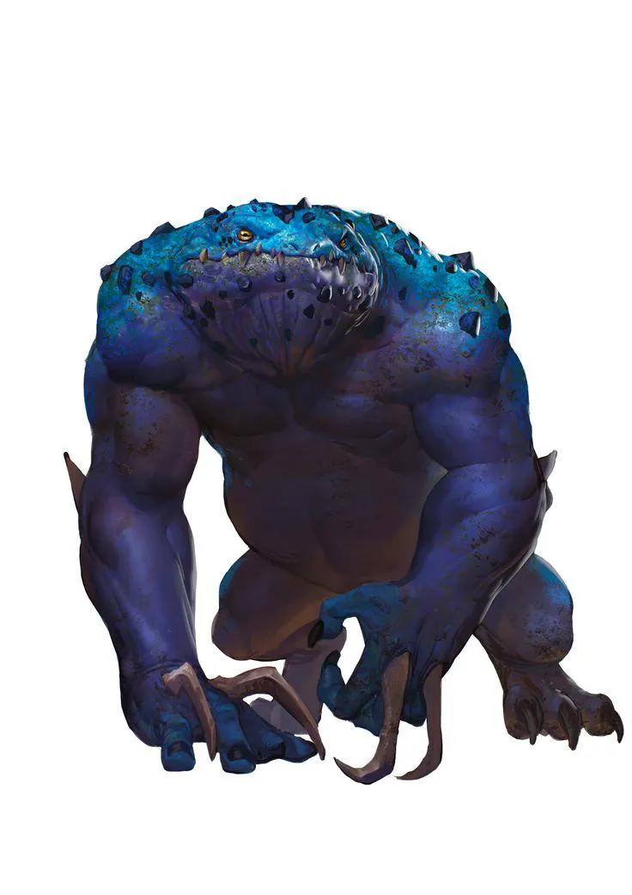
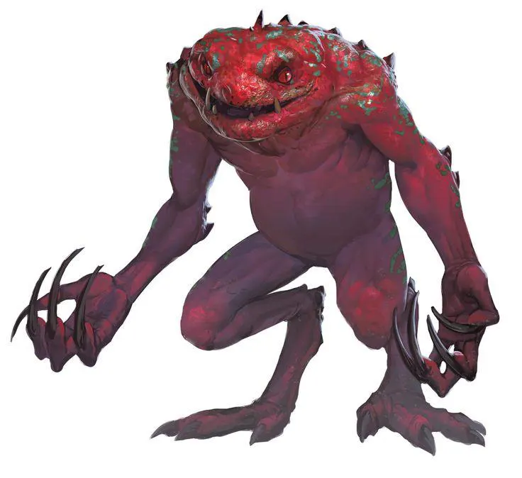
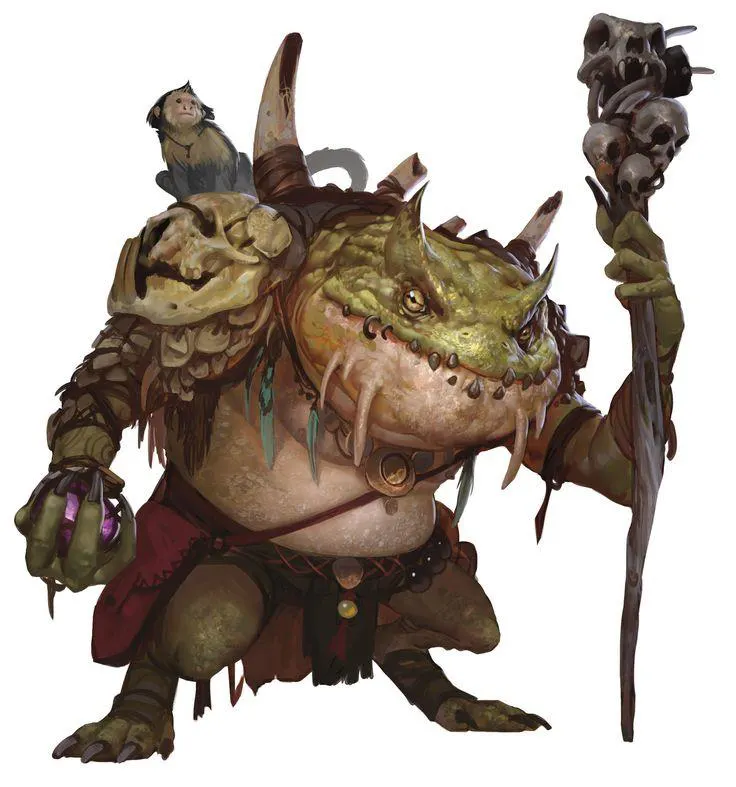
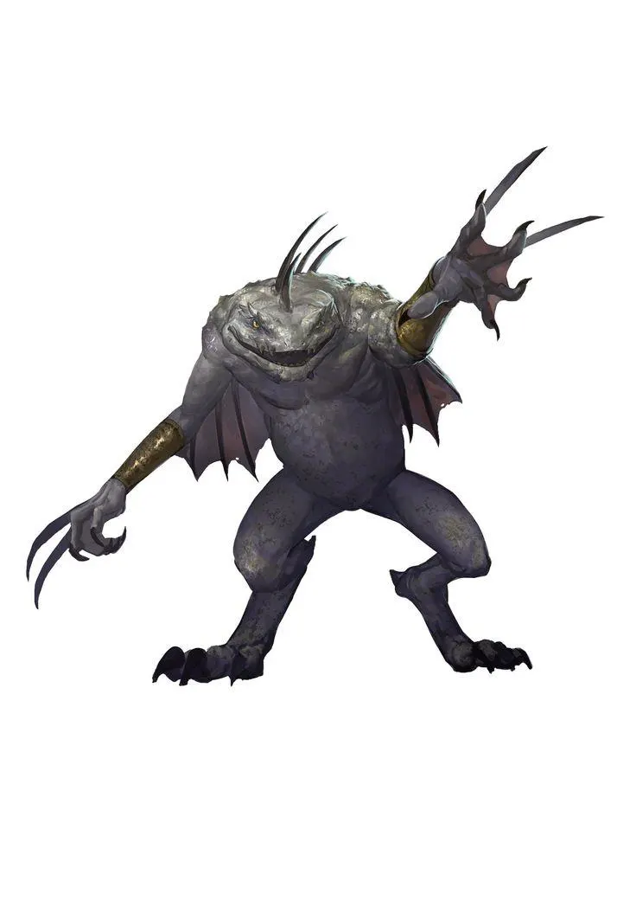
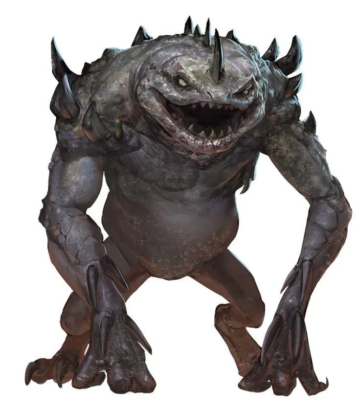

# Slaadi

No Caos Eternamente Mutável do Limbo, pedaços de florestas e campinas, castelos arruinados e ilhas isoladas derivam através de um alvoroço de fogo, água, terra e vento. Os principais habitantes desse plano inóspito são os sapos humanoides, slaadi. Os slaadi são indisciplinados e não possui uma hierarquia formal, apesar de os slaadi mais fracos obedecerem os mais fortes sob ameaça de aniquilação.

***A Pedra da Geração***. Muito tempo atrás, Primus, senhor supremo dos modrons, criou uma gigantesca pedra geometricamente complexa imbuída com o poder da lei. Ele então, deixou-a à deriva no Limbo, acreditando que a pedra poderia trazer ordem ao caos desse plano e impedir o caos de se espalhar para os outros planos. Conforme o poder da pedra crescia, ela tornou possível para criaturas com mentes ordeiras, como os modrons e os githzerai, criarem enclaves no Limbo. Porém, a criação de Primus teve um efeito colateral imprevisto: a energia caótica absorvida pela pedra gerou os horrores que vieram a ser chamados de slaadi. Sábios se referem a maciça criação de Primus como a Pedra da Geração por essa razão.

Os slaadi dizimaram todos os enclaves de modrons no Limbo. Como criaturas de caos absoluto, os slaadi abominam os modrons e os atacam à primeira vista. Porém, Primus manteve sua criação e, ou não a considerou os slaadi como uma ameaça ou optou por ignorá-los.

***Nascimento e Transformação***. Os slaadi possuem um ciclo de reprodução horripilante. Eles se reproduzem tanto ao implantar ovos em hospedeiros humanoides ou ao infecta-los com uma doença transformadora chamada febre do caos. Cada cor de slaad reproduz ou transforma-se de uma forma diferente, com os slaadi vermelhos originando slaadi azuis e verdes, e os slaadi azuis gerando vermelhos e verdes. Cada slaad verde passa por um longo ciclo vital de transformação nos mais poderosos slaadi cinza e da morte. Em cada transformação o slaad mantem suas lembranças.

***Metamorfos***. Alguns slaadi podem se transformar em criaturas humanoides das quais eles são originalmente gerados. Esses slaadi retornam ao Plano Material para semear a discórdia disfarçados de seus antigos eus.

### Slaad Vermelho

Quando um slaad vermelho atinge uma criatura humanoide com sua garra, ele pode invejar um ovo a partir de uma glândula debaixo de suas garras. O ovo faz seu caminho até o hospedeiro e gesta nele, eventualmente formando uma larva slaad. Tal larva, então, devora seu caminho para fora do corpo do hospedeiro, alimentando-se dos restos do hospedeiro e então, buscando qualquer outra carne fresca que possa encontrar. A larva se transforma em um slaad azul totalmente crescido – ou em um slaad verde, se o hospedeiro tinha a capacidade de conjurar magias de 3° nível ou superior – dentro de 2d12 horas.

### Slaad Azul

Os gancho ósseos que brotam das costas das mãos de um slaad azul infligem uma terrível doença transformadora nos humanoides feridos por eles. Essa infecção, chamada febre do caos, transforma suas vítimas em um slaad vermelho totalmente crescido – ou em um slaad verde, se o hospedeiro era um conjurador com a capacidade de conjurar magias de 3° nível ou superior

### Slaad Verde

Slaadi verdes são surpreendentemente inteligentes e possuem capacidade de conjuração inata. Um slaad verde pode mudar de forma para se parecer com um humanoide. Se tiver nascido de um hospedeiro humanoide, o slaad geralmente adotará a forma do seu hospedeiro.

Em algum momento imprevisível de sua existência, um slaad verde desbloqueia os meios de magicamente, instantaneamente e prematuramente se transformar em um slaad cinza. Desbloquear esse conhecimento pode levar anos, ou mesmo décadas.

### Slaad Cinza

Fora do Limbo, os slaadi cinzas agem como extensões vivas da vontade de seus mestres, os slaadi da morte. Um slaad cinza viaja para o Plano Material incumbidos de perdição, frequentemente assumindo formas humanoides. Um slaad cinza aprende como dominar o uso de uma espada grande e imbui ela com sua própria magia inata.

Um slaad cinza que devore um corpo inteiro de um slaad da morte morto, instantaneamente se transforma em um slaad da morte.

### Slaad da Morte

Os slaadi da morte estão impregnados pela energia do Plano da Energia Negativa e exemplificam a corrupção maligna do caos, tendo um prazer sádico em causar dor aos outros. Eles propagam sua raça gerando turbas de slaadi vermelhos e azuis e invadindo outros planos. Os humanoides que sobrevivem a incursão tornam-se incubadoras para novos slaadi.

> **Variação: Gemas de Controle de Slaad**
>
> Conforme um slaad surge da Pedra de Geração, a pedra magicamente implanta um fragmento dela no cérebro do slaad. Esse fragmento toma a forma de uma gema mágica de tamanho e forma aproximados do punho de uma criança humana. A gema é da mesma cor do slaad. Outra criatura pode usar magia para alcançar a gema slaad e usa-la para subjugar o slaad. O slaad deve obedecer a quem quer que possua sua gema. Se a gema de um slaad for destruída, o slaad não poderá mais ser controlado dessa forma. Um slaad nascido de alguma outra forma que não da Pedra de Geração, não possuirá uma gema no seu cérebro, mas ele adquire uma caso entre em contato com a Pedra da Geração. Os slaadi no Limbo são atraídos pela Pedra de Geração, por isso muitos acabam adquirindo uma gema. Um slaad com uma gema de controle em seu cérebro possui o seguinte traço adicional. Gema de Controle. Implantada no cérebro do slaad está uma gema mágica. O slaad deve obedecer quem quer que possua a gema e é imune a ser enfeitiçado enquanto estiver sendo controlado. Certas magias podem ser usadas para adquirir a gema. Se o slaad falhar no teste de resistência contra a magia *aprisionamento*, a magia pode transferir a gema para a mão aberta do conjurador, ao invés de aprisionar o slaad. Uma magia *desejo*, se for conjurada na presença do slaad, também pode ser ordenada para adquirir a gema. Uma magia *restauração maior* conjurada no slaad destrói a gema sem ferir o slaad. Alguém que seja proficiente em Sabedoria (Medicina) pode remover a gema de um slaad incapacitado. Cada tentativa requer 1 minuto de trabalho ininterrupto e um teste de Sabedoria (Medicina) bem sucedido. Cada tentativa fracassada causa 22 (4d10) de dano psíquico ao slaad.

## Bloco de estatísticas: Slaad Vermelho

*Aberração Grande, caótico e neutro*

**Classe de Armadura** 14 (armadura natural)  
**Pontos de Vida** 93 (11d10 + 33)  
**Deslocamento** 9 m

| FOR | DES | CON | INT | SAB | CAR |
| :---: | :---: | :---: | :---: | :---: | :---: |
| 16 (+3) | 12 (+1) | 16 (+3) | 6 (–2) | 6 (–2) | 7 (–2) |

**Perícias** Percepção +1  
**Resistência a Dano** ácido, elétrico, fogo, frio, trovejante  
**Sentidos** visão no escuro 18 m, Percepção passiva 11  
**Idiomas** Slaad, telepatia 18 m  
**Nível de Desafio** 5 (1.800 XP)

***Regeneração***. O slaad recupera 10 pontos de vida no início de cada um dos seus turnos se possuir, pelo menos, 1 ponto de vida.

***Resistência à Magia***. O slaad possui vantagem nos testes de resistência contra magias e outros efeitos mágicos.

### Ações

***Ataques Múltiplos***. O slaad realiza três ataques: um com sua mordida e dois com suas garras.

***Mordida***. *Ataque Corpo-a-Corpo com Arma*: +6 para atingir, alcance 1,5 m, um alvo. *Acerto*: 8 (2d4 + 3) de dano perfurante.

***Garra***. *Ataque Corpo-a-Corpo com Arma*: +6 para atingir, alcance 1,5 m, um alvo. *Acerto*: 7 (1d8 + 3) de dano perfurante. Se o alvo for um humanoide, ele deve ser bem sucedido num teste de resistência de Constituição CD 14 ou será infectado com uma doença – um minúsculo ovo slaad. Um hospedeiro humanoide pode carregar apenas um ovo slaad por vez. Após três meses, o ovo se move para a cavidade torácica, gestando e formando uma larva slaad. Num período de 24 horas antes do nascimento, o hospedeiro começa a se sentir mal, seu deslocamento é reduzido à metade e ele tem desvantagem nas jogadas de ataque, testes de habilidade e testes de resistência. No nascimento, a larva escava seu caminho através dos órgãos vitais e sai do peito do hospedeiro em 1 rodada, matando-o no processo. Se a doença for curada antes da larva emergir, o slaad não-nascido é desintegrado.

## Bloco de estatísticas: Slaad Azul

*Aberração Grande, caótico e neutro*

**Classe de Armadura** 15 (armadura natural)  
**Pontos de Vida** 123 (13d10 + 52)  
**Deslocamento** 9 m

| FOR | DES | CON | INT | SAB | CAR |
| :---: | :---: | :---: | :---: | :---: | :---: |
| 20 (+5) | 15 (+2) | 18 (+4) | 7 (–2) | 7 (–2) | 9 (–2) |

**Perícias** Percepção +1  
**Resistência a Dano** ácido, elétrico, fogo, frio, trovejante  
**Sentidos** visão no escuro 18 m, Percepção passiva 11  
**Idiomas** Slaad, telepatia 18 m  
**Nível de Desafio** 7 (2.900 XP)

***Regeneração***. O slaad recupera 10 pontos de vida no início de cada um dos seus turnos se possuir, pelo menos, 1 ponto de vida.

***Resistência à Magia***. O slaad possui vantagem nos testes de resistência contra magias e outros efeitos mágicos.

### Ações

***Ataques Múltiplos***. O slaad realiza três ataques: um com sua mordida e dois com suas garras.

***Mordida***. *Ataque Corpo-a-Corpo com Arma*: +8 para atingir, alcance 1,5 m, um alvo. *Acerto*: 12 (2d6 + 5) de dano perfurante.

***Garra***. *Ataque Corpo-a-Corpo com Arma*: +8 para atingir, alcance 1,5 m, um alvo. *Acerto*: 12 (2d6 + 5) de dano cortante. Se o alvo for um humanoide, ele deve ser bem sucedido num teste de resistência de Constituição CD 15 ou será infectado pela doença chamada febre do caos. Enquanto estiver infectado, o alvo não pode recuperar pontos de vida e seu máximo de pontos de vida é reduzido em 10 (3d6) a cada 24 horas. Se a doença reduzir o máximo de pontos de vida do alvo a 0, ele instantaneamente é transformado em um slaad vermelho ou, se ele possuía a habilidade de conjurar magias de 3° nível ou superior, em um slaad verde. Apenas uma magia *desejo* pode reverter a transformação.

## Bloco de estatísticas: Slaad Verde

*Aberração Grande (metamorfo), caótico e neutro*

**Classe de Armadura** 16 (armadura natural)  
**Pontos de Vida** 127 (15d10 + 45)  
**Deslocamento** 9 m

| FOR | DES | CON | INT | SAB | CAR |
| :---: | :---: | :---: | :---: | :---: | :---: |
| 18 (+4) | 15 (+2) | 16 (+3) | 11 (+0) | 8 (–1) | 12 (+1) |

**Perícias** Arcanismo +3, Percepção +2  
**Resistência a Dano** ácido, elétrico, fogo, frio, trovejante  
**Sentidos** percepção às cegas 9 m, visão no escuro 18 m, Percepção passiva 12  
**Idiomas** Slaad, telepatia 18 m  
**Nível de Desafio** 8 (3.900 XP)

***Conjuração Inata***. A habilidade de conjuração de um slaad é Carisma (CD de resistência de magia 12). Ele pode conjurar, inatamente, as seguintes magias, sem necessidade de componentes materiais:

À vontade: *detectar magia, detectar pensamentos, mãos mágicas* 2/dia cada: *invisibilidade* (pessoal apenas)*, medo* 1/dia: *bola de fogo*

***Metamorfo***. O slaad pode usar sua ação para se metamorfosear em um humanoide Pequeno ou Médio, ou voltar para sua forma verdadeira. Suas estatísticas, além do seu tamanho, são as mesmas em cada forma. Qualquer equipamento que ele esteja vestindo ou carregando não é transformado. Ele reverte a sua forma verdadeira se morrer.

***Regeneração***. O slaad recupera 10 pontos de vida no início de cada um dos seus turnos se possuir, pelo menos, 1 ponto de vida.

***Resistência à Magia***. O slaad possui vantagem nos testes de resistência contra magias e outros efeitos mágicos.

### Ações

***Ataques Múltiplos***. O slaad realiza três ataques: um com sua mordida e dois com suas garras ou cajado. Alternativamente, ele usa seu Arremessar Chamas duas vezes.

***Mordida (Forma de Slaad Apenas)***. *Ataque Corpo-a-Corpo com* *Arma*: +7 para atingir, alcance 1,5 m, um alvo. *Acerto*: 11 (2d6 + 4) de dano perfurante.

***Garra (Forma de Slaad Apenas)***. *Ataque Corpo-a-Corpo com* *Arma*: +7 para atingir, alcance 1,5 m, um alvo. *Acerto*: 7 (1d6 + 4) de dano cortante.

***Cajado***. *Ataque Corpo-a-Corpo com Arma*: +7 para atingir, alcance 1,5 m, um alvo. *Acerto*: 11 (2d6 + 4) de dano de concussão.

***Arremessas Chamas***. *Ataque à Distância com Magia*: +4 para atingir, distância 45 m, um alvo. *Acerto*: 10 (3d6) de dano de fogo. O fogo incendeia objetos inflamáveis que não estejam sendo vestidos ou carregados.

## Bloco de estatísticas: Slaad Cinza

*Aberração Média (metamorfo), caótico e neutro*

**Classe de Armadura** 18 (armadura natural)  
**Pontos de Vida** 127 (17d8 + 51)  
**Deslocamento** 9 m

| FOR | DES | CON | INT | SAB | CAR |
| :---: | :---: | :---: | :---: | :---: | :---: |
| 17 (+3) | 17 (+3) | 16 (+3) | 13 (+1) | 8 (–1) | 14 (+2) |

**Perícias** Arcanismo +5, Percepção +6  
**Resistência a Dano** ácido, elétrico, fogo, frio, trovejante  
**Sentidos** percepção às cegas 9 m, visão no escuro 18 m, Percepção passiva 16  
**Idiomas** Slaad, telepatia 18 m  
**Nível de Desafio** 9 (5.000 XP)

***Armas Mágicas***. Os ataques com arma do slaad são mágicos.

***Conjuração Inata***. A habilidade de conjuração de um slaad é Carisma (CD de resistência de magia 14). Ele pode conjurar, inatamente, as seguintes magias, sem necessidade de componentes materiais:

À vontade: *detectar magia, detectar pensamentos, imagem maior,* *invisibilidade* (pessoal apenas)*, mãos mágicas* 2/dia cada: *bola de fogo, idiomas, medo, voo* 1/dia: *viagem planar* (pessoal apenas)

***Metamorfo***. O slaad pode usar sua ação para se metamorfosear em um humanoide Pequeno ou Médio, ou voltar para sua forma verdadeira. Suas estatísticas, além do seu tamanho, são as mesmas em cada forma. Qualquer equipamento que ele esteja vestindo ou carregando não é transformado. Ele reverte a sua forma verdadeira se morrer.

***Regeneração***. O slaad recupera 10 pontos de vida no início de cada um dos seus turnos se possuir, pelo menos, 1 ponto de vida.

***Resistência à Magia***. O slaad possui vantagem nos testes de resistência contra magias e outros efeitos mágicos.

### Ações

***Ataques Múltiplos***. O slaad realiza três ataques: um com sua mordida e dois com suas garras ou espada grande.

***Mordida (Forma de Slaad Apenas)***. *Ataque Corpo-a-Corpo com* *Arma*: +7 para atingir, alcance 1,5 m, um alvo. *Acerto*: 6 (1d6 + 3) de dano perfurante.

***Garra (Forma de Slaad Apenas)***. *Ataque Corpo-a-Corpo com* *Arma*: +7 para atingir, alcance 1,5 m, um alvo. *Acerto*: 8 (1d10 + 3) de dano cortante.

***Espada Grande***. *Ataque Corpo-a-Corpo com Arma*: +7 para atingir, alcance 1,5 m, um alvo. *Acerto*: 10 (2d6 + 3) de dano cortante.

## Bloco de estatísticas: Slaad da Morte

*Aberração Média (metamorfo), caótico e mau*

**Classe de Armadura** 18 (armadura natural)  
**Pontos de Vida** 170 (20d8 + 80)  
**Deslocamento** 9 m

| FOR | DES | CON | INT | SAB | CAR |
| :---: | :---: | :---: | :---: | :---: | :---: |
| 20 (+5) | 15 (+2) | 19 (+4) | 15 (+2) | 10 (+0) | 16 (+3) |

**Perícias** Arcanismo +6, Percepção +8  
**Resistência a Dano** ácido, elétrico, fogo, frio, trovejante  
**Sentidos** percepção às cegas 18 m, visão no escuro 18 m, Percepção passiva 18  
**Idiomas** Slaad, telepatia 18 m  
**Nível de Desafio** 10 (5.900 XP)

***Armas Mágicas***. Os ataques com arma do slaad são mágicos.

***Conjuração Inata***. A habilidade de conjuração de um slaad é Carisma (CD de resistência de magia 15, +7 para atingir com ataques com magia). Ele pode conjurar, inatamente, as seguintes magias, sem necessidade de componentes materiais:

À vontade: *detectar magia, detectar pensamentos, imagem maior,* *invisibilidade* (pessoal apenas)*, mãos mágicas* 2/dia cada: *bola de fogo, idiomas, medo, voo* 1/dia cada: *névoa mortal, viagem planar* (pessoal apenas)

***Metamorfo***. O slaad pode usar sua ação para se metamorfosear em um humanoide Pequeno ou Médio, ou voltar para sua forma verdadeira. Suas estatísticas, além do seu tamanho, são as mesmas em cada forma. Qualquer equipamento que ele esteja vestindo ou carregando não é transformado. Ele reverte a sua forma verdadeira se morrer.

***Regeneração***. O slaad recupera 10 pontos de vida no início de cada um dos seus turnos se possuir, pelo menos, 1 ponto de vida.

***Resistência à Magia***. O slaad possui vantagem nos testes de resistência contra magias e outros efeitos mágicos.

### Ações

***Ataques Múltiplos***. O slaad realiza três ataques: um com sua mordida e dois com suas garras ou espada grande.

***Mordida (Forma de Slaad Apenas)***. *Ataque Corpo-a-Corpo com* *Arma*: +9 para atingir, alcance 1,5 m, um alvo. *Acerto*: 9 (1d8 + 5) de dano perfurante mais 7 (2d6) de dano necrótico.

***Garra (Forma de Slaad Apenas)***. *Ataque Corpo-a-Corpo com* *Arma*: +9 para atingir, alcance 1,5 m, um alvo. *Acerto*: 10 (1d10 + 5) de dano cortante mais 7 (2d6) de dano necrótico.

***Espada Grande***. *Ataque Corpo-a-Corpo com Arma*: +9 para atingir, alcance 1,5 m, um alvo. *Acerto*: 12 (2d6 + 5) de dano cortante mais 7 (2d6) de dano necrótico.

## Bloco de estatísticas: Larva Slaad

*Aberração Miúda, caótico e neutro*

**Classe de Armadura** 12  
**Pontos de Vida** 10 (4d4)  
**Deslocamento** 9 m

| FOR | DES | CON | INT | SAB | CAR |
| :---: | :---: | :---: | :---: | :---: | :---: |
| 7 (–2) | 15 (+2) | 10 (+0) | 3 (–4) | 5 (–3) | 3 (–4) |

**Perícias** Furtividade +4  
**Resistência a Dano** ácido, elétrico, fogo, frio, trovejante  
**Sentidos** visão no escuro 18 m, Percepção passiva 7  
**Idiomas** compreende Slaad, mas não pode falar  
**Nível de Desafio** 1/8 (25 XP)

***Resistência à Magia***. O slaad possui vantagem nos testes de resistência contra magias e outros efeitos mágicos.

### Ações

***Mordida***. *Ataque Corpo-a-Corpo com Arma*: +4 para atingir, alcance 1,5 m, um alvo. *Acerto*: 4 (1d4 + 2) de dano perfurante.
