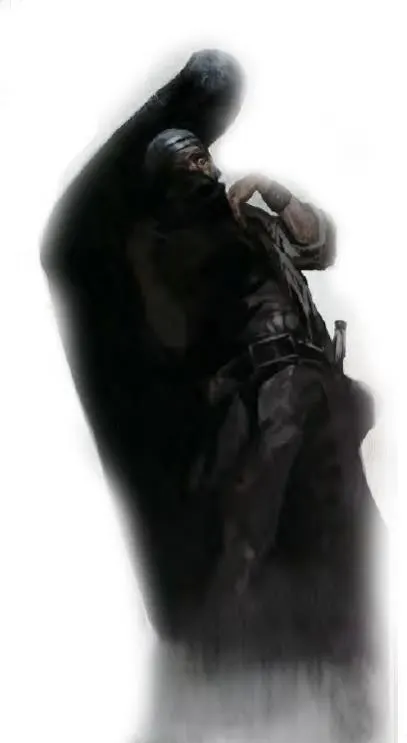

# Sombra

As sombras são mortos-vivos que lembra exageros negros de sombras humanoides.

***Disposição às Trevas***. Da escuridão, a sombra se lança para se alimentar da vitalidade das criaturas vivas. Elas podem consumir qualquer criatura viva, mas elas tem uma propensão especial às criaturas imaculadas pelo mal. Uma criatura que viva uma vida de bondade e caridade consigna seus impulsos mais básicos e tentações mais fortes para a escuridão onde as sombras anseiam. Conforme uma sombra drena a força e forma física de sua vítima, a sombra da vítima se escurece e começa a se mover por sua própria vontade. Na morte, a sombra da criatura se liberta, tornando-se uma nova sombra morta-viva sedenta por mais vidas para consumir.

Se uma criatura de onde uma sombra foi criada, de alguma forma voltar à vida, sua sombra morta-viva sente o retorno. A sombra irá buscar seu “pai” para molesta-lo ou mata-lo. Enquanto a sombra persegue sua contraparte viva, a criatura que originou a sombra não projetará sombra até que o monstro seja destruído.

***Natureza Morta-Viva***. A sombra não precisa respirar, comer, beber ou dormir.

## Bloco de estatísticas: Sombra

*Morto-vivo Médio, caótico e mau*

**Classe de Armadura** 12  
**Pontos de Vida** 16 (3d8 + 3)  
**Deslocamento** 12 m

| FOR | DES | CON | INT | SAB | CAR |
| :---: | :---: | :---: | :---: | :---: | :---: |
| 6 (–2) | 14 (+2) | 13 (+1) | 6 (–2) | 10 (+0) | 8 (–1) |

**Perícias** Furtividade +4 (+6 na penumbra ou escuridão)  
**Vulnerabilidade a Dano** radiante  
**Resistência a Dano** ácido, elétrico, fogo, frio, trovejante; concussão, perfurante e cortante de armas não-mágica  
**Imunidade a Dano** necrótico, veneno  
**Imunidade a Condição** agarrado, caído, envenenado, exausto, impedido, inconsciente, paralisado, petrificado  
**Sentidos** visão no escuro 18 m, Percepção passiva 10  
**Idiomas** –  
**Nível de Desafio** 1/2 (100 XP)

***Amorfo***. A sombra pode se mover através de um espaço de até 2,5 centímetros de espessura sem se espremer.

***Furtividade Sombria***. Enquanto estiver na penumbra ou na escuridão, a sombra pode realizar a ação de Esconder-se com uma ação bônus.

***Fraqueza Solar***. Enquanto estiver sob luz solar, a sombra tem desvantagem nas jogadas de ataque, testes de habilidade e testes de resistência.

### Ações

***Drenar Força***. *Ataque Corpo-a-Corpo com Magia*: +4 para atingir, alcance 1,5 m, uma criatura. *Acerto*: 9 (2d6 + 2) de dano necrótico e o valor de Força da criatura é reduzido em 1d4. O alvo morre se sua Força for reduzida a 0. Do contrário, a redução dura até o alvo terminar um descanso curto ou longo. Se um humanoide não-maligno morrer devido a esse ataque, uma nova sombra se ergue do corpo em 1d4 horas.
