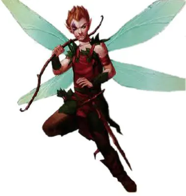

# Sprite

Em bosques secretos e vales protegidos, estão os diminutos sprites com suas asas de libélula batendo. Apesar de todo o seu esplendor feérico, no entanto, falta nos sprites cordialidade e compaixão. Eles são guerreiros agressivos e durões, tomando medidas severas para afastar estranhos de seus lares. Invasores que chegarem muito perto terão seu caráter moral julgado, então serão postos para dormir ou afugentados.

***Protetores da Floresta***. Os sprites constroem pequenas vilas nos galhos de árvores e de entes dispostas, em clareiras verdejantes iluminadas por musgos, flores silvestres e cogumelos. A natureza selvagem prospera e os sprites não permitem invasores. Quando intrusos são avistados, os sprites desviam-nos com barulhos ameaçadores dos arbustos e estalos de galhos distantes. As criaturas tolas o bastante par persistirem na invasão do território dos sprites são atingidas com flechas envenenadas e induzidas a um sono entorpecente. Enquanto eles estiverem adormecidos, os sprites escapam, recuando para áreas ainda mais reclusas da floresta.

***Videntes do Coração***. Os sprites podem sentir se uma criatura é boa ou má pelo som e ternura das batidas do coração. Botando na balança as ações passadas de uma criatura, o sprite pode dizer se as batidas aceleradas do coração são de amor ou se sinalizam tristeza, ou se ele está enegrecido por ódio ou ganância. O poder do sprite de perceber o coração sempre mostra a verdade, pois o coração não pode mentir.

***Fabricantes de Venenos***. Nos domínios florestais, os sprites criam toxinas, unguentos, antídotos e venenos, incluindo o veneno sonífero com o qual cobrem suas flechas. Eles se aventuram fundo nas florestas para coletar flores, musgos e fungos raros, às vezes atravessando territórios perigosos para isso. Se estiverem desesperados, os sprites podem até roubar ingredientes dos jardins de bruxas.

***Bons de Coração***. Por serem juízes do coração e preferirem criaturas boas, os sprites se opõem à vontade de fadas malignas e se comprometem a frustrar arquifadas malignas a qualquer momento. Se eles encontrarem aventureiros em uma busca para livrar sua floresta de uma criatura feérica maligna ou da ameaça de goblinoides, eles irão oferecer seu suporte e até vir em auxílio deles quando os aventureiros menos esperarem.

Diferente dos pixies, os sprites raramente se envolvem em alegria frívola ou diversão. Eles são firmes guerreiros, protetores e juízes e sua inclinação severa faz com que as outras fadas considerem-nos extremamente sisudos e sérios. Porém, as fadas que respeitam o território dos sprites encontram neles aliados fieis em momentos de angústia.

## Bloco de estatísticas: Sprite

*Fada Miúda, neutro e bom*

**Classe de Armadura** 15 (armadura de couro)  
**Pontos de Vida** 2 (1d4)  
**Deslocamento** 3 m, voo 12 m

| FOR | DES | CON | INT | SAB | CAR |
| :---: | :---: | :---: | :---: | :---: | :---: |
| 3 (–4) | 18 (+4) | 10 (+0) | 14 (+2) | 13 (+1) | 11 (+0) |

**Perícias** Furtividade +8, Percepção +3  
**Sentidos** Percepção passiva 13  
**Idiomas** Comum, Élfico, Silvestre  
**Nível de Desafio** 1/4 (50 XP)

### Ações

***Arco Curto***. *Ataque à Distância com Arma*: +6 para atingir, distância 12/48 m, um alvo. *Acerto*: 1 de dano perfurante. Se o alvo for uma criatura, ela deve ser bem sucedida num teste de resistência de Constituição CD 10 ou ficará envenenada por 1 minuto. Se o resultado do teste de resistência for 5 ou inferior, o alvo cairá inconsciente pela duração ou até sofrer dano ou outra criatura usar sua ação para acorda-lo.

***Espada Longa***. *Ataque Corpo-a-Corpo com Arma*: +2 para atingir, alcance 1,5 m, um alvo. *Acerto*: 1 de dano cortante.

***Invisibilidade***. O sprite fica invisível até ele atacar, conjurar uma magia ou sua concentração acabar. Qualquer coisa que o sprite invisível estiver carregando ou vestindo fica invisível contanto que permaneça em contato com ele.

***Visão do Coração***. O sprite toca uma criatura e descobre o estado emocional atual dela. Se o alvo falhar num teste de resistência de Carisma CD 10, o sprite também saberá a tendência da criatura. Celestiais, corruptores e mortos-vivos falham automaticamente nesse teste de resistência.
