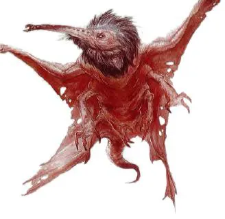

# Stirge

Essa horrenda criatura voadora perece um cruzamento entre um morcego gigante e um mosquito desproporcional. Suas patas terminam em pinças afiadas e seu longo probóscide em forma de agulha chicoteia o ar enquanto ele busca sua próxima refeição.

Os stirges alimentam-se do sangue das criaturas vivas, prendendo-se nelas e drenando-as lentamente. Apesar de representarem pouco perigo em pequenos números, um enxame de stirges pode ser uma ameaça formidável, se prendendo mais rapidamente que suas presas enfraquecidas podem arranca-los.

***Drenar Sangue***. Um stirge ataca ao pousar em uma vítima, encontrar um ponto vulnerável e introduzir seu probóscide na carne enquanto usa suas patas pinçadas para se grudar na vítima. Quando o stirge tiver se satisfeito, ele se desprende e voa para digerir sua refeição.

## Bloco de estatísticas: Stirge

*Besta Miúda, imparcial*

**Classe de Armadura** 14 (armadura natural)  
**Pontos de Vida** 2 (1d)  
**Deslocamento** 3 m, voo 12 m

| FOR | DES | CON | INT | SAB | CAR |
| :---: | :---: | :---: | :---: | :---: | :---: |
| 4 (–3) | 16 (+3) | 11 (+0) | 2 (–4) | 8 (–1) | 6 (–2) |

**Sentidos** visão no escuro 18 m, Percepção passiva 9  
**Idiomas** –  
**Nível de Desafio** 1/8 (25 XP)

### Ações

***Drenar Sangue***. *Ataque Corpo-a-Corpo com Arma*: +5 para atingir, alcance 1,5 m, uma criatura. *Acerto*: 5 (1d4 + 3) de dano perfurante e o stirge se prende ao alvo. Enquanto estiver preso, o stirge não pode atacar. Ao invés disso, no início de cada um dos turnos do stirge, o alvo perde 5 (1d4 + 3) pontos de vida devido à perda de sangue. O stirge pode se desprender gastando 1,5 metro de seu movimento. Ele fará isso após drenar 10 pontos de vida de sangue do alvo ou o alvo morrer. Uma criatura, incluindo o alvo, pode usar uma ação para desprender o stirge.
