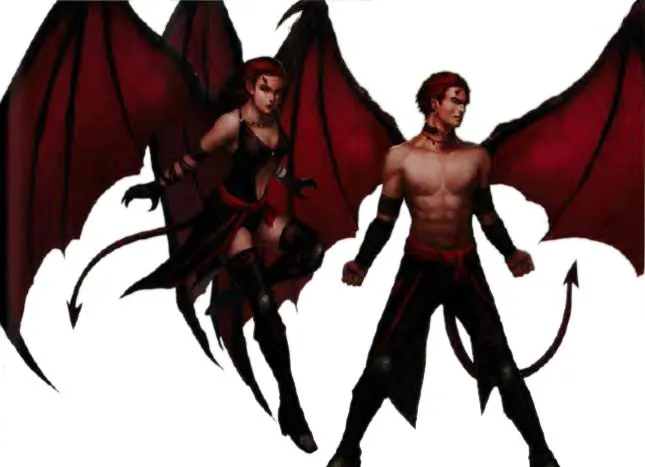

# Súcubo/Íncubo

As súcubos e os íncubos habitam todos os Planos Inferiores e esses corruptores lascivos de asas negras podem ser encontrados a serviço de diabos, demônios, bruxas da noite, rakshasas e yugoloths. Asmodeu, senhor dos Nove Infernos, usa esses corruptores para atentar mortais a realizarem atos malignos. O lorde demônio Graz’zt mantem súcubos e íncubos como conselheiros e consortes.

Apesar das lendas se referirem a eles separadamente, qualquer súcubo pode se tornar um íncubo, e vice-versa. A maioria desses corruptores tem uma preferência por uma forma ou pela outra. Os mortais raramente veem uma súcubo ou um íncubo em sua forma verdadeira, já que esse corruptor, geralmente, começa a sua corrupção velada de formas insidiosas.

***Corruptores Belos***. Uma súcubo ou um íncubo primeiramente aparece em uma forma etérea, passando através de paredes como um fantasma espreitando próximo da cabeceira da cama de um mortal e sussurrando prazeres proibidos. As vítimas adormecidas são tentadas a sucumbirem ao seus desejos obscuros, quebrar tabus e alimentar apetites proibidos. Conforme o corruptor preenche os sonhos da vítima com imagens pervertidas, ela se torna mais suscetível a tentação na sua vida cotidiana.

Inevitavelmente, o corruptor entra no reino mortal em uma forma tentadora para influenciar diretamente as ações de uma criatura. Aparecendo disfarçado como um humanoide que já tenha aparecido anteriormente nos sonhos da vítima, a súcubo ou o íncubo seduz ou faz amizade com a vítima, entregando todos os desejos dela para que a vítima realize atos de maldade por sua própria vontade.

Um mortal lega sua alma para o corruptor não por um penhor formal ou contrato. Ao invés disso, quando uma súcubo ou um íncubo tiver corrompido uma criatura completamente – alguns dizem, fazendo com que a vítima cometa três traições de pensamento, palavra e ação – a alma da vítima pertencerá ao corruptor. Quanto mais virtuosa for a presa do corruptor, mais tempo se leva para corrompe-la, mas a recompensa pela queda é maior. Após corromper uma vítima com sucesso, a súcubo ou o íncubo a mata e a alma maculada desce para os Planos Inferiores.

A súcubo ou íncubo só recorre à enfeitiçar a vítima magicamente quando necessário, geralmente como uma forma de autodefesa. Uma criatura enfeitiçada não é responsável por seus atos, por isso, força-la a agir contra sua vontade não deixa o corruptor mais próximo do seu prêmio definitivo: a alma da vítima.

***Beijo Mortal***. O beijo de uma súcubo ou de um íncubo é uma continuação do desejo do corruptor por uma alma corrompida. Da mesma forma, o receptor do beijo do corruptor não tem nenhuma satisfação nele, experimentando apenas uma dor e vazio profundos transmitidos pelo corruptor. O beijo não é nada menos que um tipo de ataque, normalmente dado como um último adeus antes do corruptor fugir.

***Prole de Corruptores***. As súcubos e os íncubos podem reproduzir-se entre si para gerar mais de sua espécie. Menos frequente, é uma súcubo ou um íncubo se reproduzir com um humanoide. Dessa união profana, uma criança cambion é concebida. Invariavelmente, a prole corruptora é tão perversa quanto seus pais corruptores.

## Bloco de estatísticas: Súcubo/Íncubo

*Corruptor Médio (metamorfo), neutro e mau*

**Classe de Armadura** 15 (armadura natural)  
**Pontos de Vida** 66 (12d8 + 12)  
**Deslocamento** 9 m, voo 18 m

| FOR | DES | CON | INT | SAB | CAR |
| :---: | :---: | :---: | :---: | :---: | :---: |
| 8 (–1) | 17 (+3) | 13 (+1) | 15 (+2) | 12 (+1) | 20 (+5) |

**Perícias** Enganação +9, Furtividade +7, Intuição +5, Percepção +5, Persuasão +9  
**Resistência a Dano** elétrico, fogo, frio, veneno; concussão, cortante e perfurante de ataques não-mágicos  
**Sentidos** visão no escuro 18 m, Percepção passiva 15  
**Idiomas** Abissal, Comum, Infernal, telepatia 18 m  
**Nível de Desafio** 4 (1.100 XP)

***Elo Telepático***. O corruptor ignora a restrição de alcance da sua telepatia quando estiver se comunicando com uma criatura que ele tenha enfeitiçado. Ambos se quer precisam estar no mesmo plano de existência.

***Metamorfo***. O corruptor pode usar sua ação para se metamorfosear em um humanoide Pequeno ou Médio, ou voltar para sua forma verdadeira. Sem asas, o corruptor perde seu deslocamento de voo. Além disso, do seu tamanho e deslocamento, suas estatísticas são as mesmas em cada forma. Qualquer equipamento que ele esteja vestindo ou carregando não é transformado. Ele reverte a sua forma verdadeira se morrer.

### Ações

***Garra (Forma de Corruptor Apenas)***. *Ataque Corpo-a-Corpo com* *Arma*: +5 para atingir, alcance 1,5 m, um alvo. *Acerto*: 6 (1d6 + 3) de dano cortante.

***Enfeitiçar***. Um humanoide que o corruptor possa ver, a até 9 metros dele, deve ser bem sucedido num teste de resistência de Sabedoria CD 15 ou ficará magicamente enfeitiçado por 1 dia. O alvo enfeitiçado obedece os comandos verbais ou telepáticos do corruptor. Se o alvo sofrer qualquer dano ou receber um comando suicida, ele poderá repetir o teste de resistência, terminando o efeito sobre si num sucesso. Se o alvo for bem sucedido contra o efeito, ou se ele terminar o efeito sobre si, ele fica imune ao Enfeitiçar do corruptor pelas próximas 24 horas. O corruptor pode ter apenas um alvo enfeitiçado por vez. Se ele enfeitiçar outro, o efeito no alvo anterior acaba.

***Beijo Drenador***. O corruptor beija uma criatura enfeitiçada por ele ou uma criatura voluntária. O alvo deve realizar um teste de resistência de Constituição CD 15 contra essa mágica, sofrendo 32 (5d10 + 5) de dano psíquico se fracassar na resistência, ou metade desse dano se obtiver sucesso. O máximo de pontos de vida do alvo é reduzido num valor igual ao dano sofrido. Essa redução dura até o alvo terminar um descanso longo. O alvo morre se esse efeito reduzir seu máximo de pontos de vida a 0.

***Forma Etérea***. O corruptor, magicamente, entra no Plano Etéreo a partir do Plano Material, ou vice-versa.
