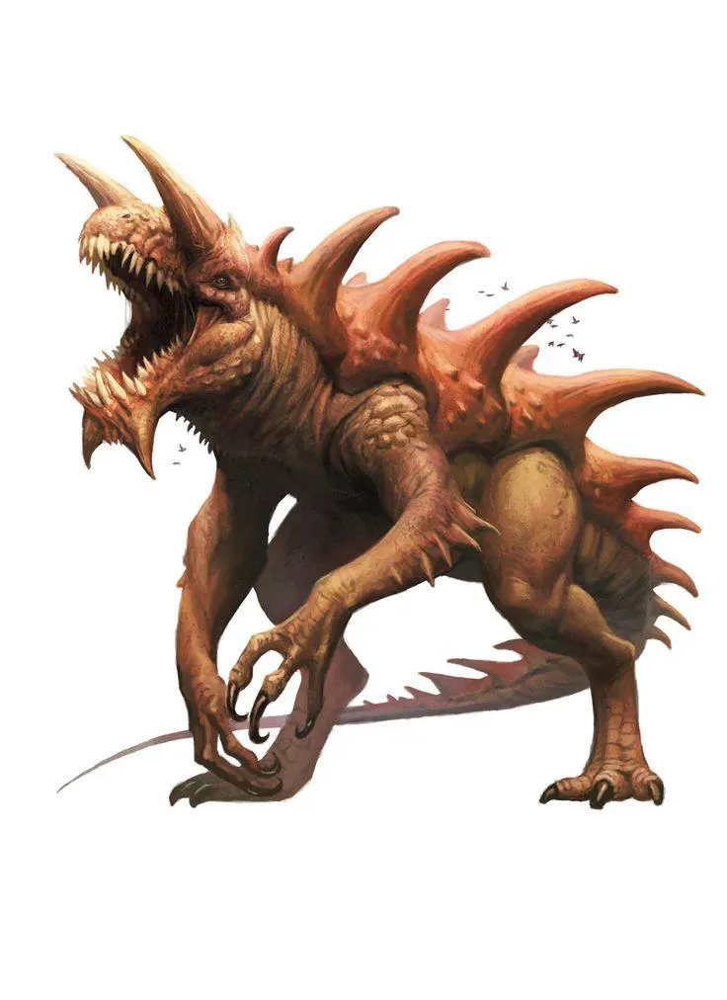

# Tarrasque

O lendário tarrasque é possivelmente o monstro mais assustador do Plano Material. Acredita-se que apenas uma dessas criaturas exista, embora ninguém possa prever onde ele irá atacar.

Como um bípede escamoso, o tarrasque mede quinze metros de altura e vinte e um metros de comprimento, pesando centenas de toneladas. Ele se move como uma ave de rapina, inclinando-se para a frente e usando sua poderosa cauda longa para se equilibrar. Sua bocarra cavernosa abre-se o suficiente para engolir até as maiores

## Bloco de estatísticas: Tarrasque

*Monstruosidade Imensa (titã), imparcial*

**Classe de Armadura** 25 (armadura natural)  
**Pontos de Vida** 676 (33d20 + 330)  
**Deslocamento** 12 m

| FOR | DES | CON | INT | SAB | CAR |
| :---: | :---: | :---: | :---: | :---: | :---: |
| 30 (+10) | 11 (+0) | 30 (+10) | 3 (–4) | 11 (+0) | 11 (+0) |

**Testes de Resistência** Int +5, Sab +9, Car +9  
**Imunidade a Dano** fogo, veneno; concussão, cortante e perfurante de ataques não-mágicos  
**Imunidade a Condição** amedrontado, enfeitiçado, envenenado, paralisado  
**Sentidos** percepção às cegas 36 m, Percepção passiva 10  
**Idiomas** –  
**Nível de Desafio** 30 (155.000 XP)

***Carapaça Reflexiva***. Sempre que o tarrasque for alvo de uma magia mísseis mágicos, uma magia de linha ou uma magia que requeira uma jogada de ataque à distância, role um d6. Entre 1 e 5, o tarrasque não é afetado. Num 6, o tarrasque não é afetado e o efeito é refletido de volta no conjurador como se ele tivesse sido originado do tarrasque, transformando o conjurador no alvo.

***Monstro de Cerco***. O tarrasque causa o dobro do dano a objetos e estruturas.

***Resistência à Magia***. O tarrasque possui vantagem nos testes de resistência contra magias e outros efeitos mágicos.

***Resistência Lendária (3/Dia)***. Se o tarrasque falhar em um teste de resistência, ele pode escolher obter sucesso, no lugar.

### Ações

***Ataques Múltiplos***. O tarrasque pode usar sua Presença Aterradora. Ele pode então, realizar cinco ataques: um com sua mordida, dois com suas garras, um com seus chifres e um com sua cauda. Ele pode usar seu Engolir ao invés de sua mordida.

***Mordida***. *Ataque Corpo-a-Corpo com Arma*: +19 para atingir, alcance 3 m, um alvo. *Acerto*: 36 (4d12 + 10) de dano perfurante. Se o alvo for uma criatura, ela fica agarrada (CD 20 para escapar). Até o agarrão acabar, o alvo fica impedido e o tarrasque não pode morder outro alvo.

***Garras***. *Ataque Corpo-a-Corpo com Arma*: +19 para atingir, alcance 4,5 m, um alvo. *Acerto*: 28 (4d8 + 10) de dano cortante.

criaturas e sua fome é tão grande que ele pode devorar as populações de cidades inteiras.

***Destruição Lendária***. O potencial destrutivo de um tarrasque é tão amplo que algumas culturas incorporaram o monstro em doutrinas religiosas, considerando suas aparições esporádicas na história como justiça ou ira divina. As lendas contam que o tarrasque dorme em seu covil secreto abaixo da terra, permanecendo em um estado inativo por décadas ou séculos. Quando ele acorda em resposta a algum chamado cósmico inescrutável, ele emerge das profundezas para obliterar tudo em seu caminho.

***Chifres***. *Ataque Corpo-a-Corpo com Arma*: +19 para atingir, alcance 3 m, um alvo. *Acerto*: 32 (4d10 + 10) de dano perfurante.

***Cauda***. *Ataque Corpo-a-Corpo com Arma*: +19 para atingir, alcance 6 m, um alvo. *Acerto*: 24 (4d6 + 10) de dano de concussão. Se o alvo for uma criatura, ele deve ser bem sucedido num teste de resistência de Força CD 20 ou será derrubado no chão.

***Presença Aterradora***. Cada criatura, à escolha do tarrasque, que esteja a até 36 metros dele e esteja ciente disso, deve ser bem sucedida num teste de resistência de Sabedoria CD 17 ou ficará amedrontada por 1 minuto. Uma criatura pode repetir o teste de resistência no final de cada um dos turnos dela, com desvantagem se o tarrasque estiver em sua linha de visão, terminando o efeito sobre si, caso obtenha sucesso. Se o teste de resistência de uma criatura for bem sucedido ou caso o efeito termine sobre ela, a criatura ficará imune a Presença Aterradora do tarrasque pelas próximas 24 horas.

***Engolir***. O tarrasque realiza um ataque de mordida contra um alvo Grande ou menor que esteja agarrando. Se o ataque atingir, o alvo sofre o dano da mordida, é engolido e o agarrão termina. Enquanto estiver engolido, o alvo estará cego e impedido, ele terá cobertura total contra ataques e outros efeitos de fora do tarrasque e sofre 56 (16d6) de dano ácido no começo de cada turno do tarrasque. Se o tarrasque sofrer 60 de dano ou mais em um único turno por uma criatura engolida, o tarrasque deve ser bem sucedido num teste de resistência de Constituição CD 20 no final desse turno ou regurgitará todas as criaturas engolidas, que cairão em um espaço a até 3 metros do tarrasque. Se o tarrasque morrer, uma criatura engolida não estará mais impedida por ele e poderá escapar do corpo usando 6 metro de movimento, estando caída ao sair.

### Ações Lendárias

O tarrasque pode realizar 3 ações lendárias, escolhidas dentre as opções abaixo. Apenas uma ação lendária pode ser usada por vez e apenas no final do turno de outra criatura. O tarrasque recupera as ações lendárias gastas no começo do turno dele.

**Ataque**. O tarrasque realiza um ataque de garra ou um ataque de cauda.  
**Movimento**. O tarrasque se move até metade do seu deslocamento.

***Mastigar (Custa 2 Ações).*** O tarrasque realiza um ataque de mordida ou usa seu Engolir.

