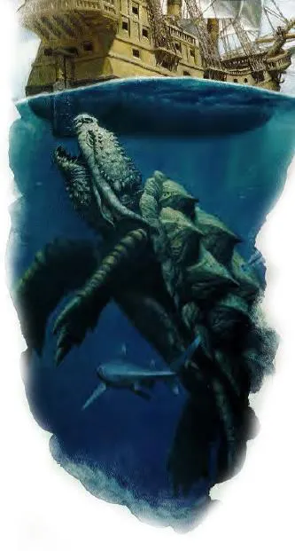

# Tartaruga Dragão

## Bloco de estatísticas: Tartaruga-Dragão

*Dragão Imenso, neutro*

**Classe de Armadura** 20 (armadura natural)  
**Pontos de Vida** 341 (22d20 + 110)  
**Deslocamento** 6 m, natação 12 m

| FOR | DES | CON | INT | SAB | CAR |
| :---: | :---: | :---: | :---: | :---: | :---: |
| 25 (+7) | 10 (+0) | 20 (+5) | 10 (+0) | 12 (+1) | 12 (+1) |

**Testes de Resistência** Des +6, Con +11, Sab +7  
**Resistência a Dano** fogo  
**Sentidos** visão no escuro 36 m, Percepção passiva 11  
**Idiomas** Aquan, Dracônico  
**Nível de Desafio** 17 (18.000 XP)

***Anfíbio***. A tartaruga-dragão pode respirar ar e água.

### Ações

***Ataques Múltiplos***. A tartaruga-dragão realiza três ataques: um com sua mordida e dois com suas garras. Ela pode realizar um ataque de cauda no lugar dos seus dois ataques de garra.

***Mordida***. *Ataque Corpo-a-Corpo com Arma*: +13 para atingir, alcance 4,5 m, um alvo. *Acerto*: 26 (3d12 + 7) de dano perfurante.

***Garra***. *Ataque Corpo-a-Corpo com Arma*: +13 para atingir, alcance 3 m, um alvo. *Acerto*: 16 (2d8 + 7) de dano cortante.

***Cauda***. *Ataque Corpo-a-Corpo com Arma*: +13 para atingir, alcance 4,5 m, um alvo. *Acerto*: 26 (3d12 + 7) de dano de concussão. Se o alvo for uma criatura, ela deve ser bem sucedida num teste de resistência de Força CD 20 ou será empurrada até 3 metros para longe da tartaruga-dragão e cairá no chão.

***Sopro de Vapor (Recarrega 5–6)***. A tartaruga-dragão expele vapor escaldante num cone de 18 metros. Cada criatura na área deve realizar um teste de resistência de Destreza CD 19, sofrendo 52 (15d6) de dano de fogo caso fracassem, ou metade desse dano caso obtenham sucesso. Estar dentro da água não confere resistência contra esse dano.

As tartarugas-dragão estão dentre as criaturas mais assustadoras dos oceanos. Tão grande e voraz quanto as mais antigas espécimes de dragões terrestres, uma tartaruga-dragão ataca com suas mandíbulas mortais, sopro de vapor e cauda esmagadora.

O casco rígido de uma tartaruga-dragão tem a mesma cor verde escuro das águas profundas onde esse monstro vive. Realces prateados revestindo o casco se assemelham a luzes dançando sobre o mar aberto e a superfície da tartaruga-dragão, às vezes, é confundida pelo reflexo do sol ou da lua nas ondas.

***Dragões das Profundezas***. Como dragões verdadeiros, as tartarugas-dragão coletam tesouros, primeiro afundando navios e depois peneirando os destroços atrás de moedas e itens preciosos. Uma tartaruga-dragão engole o tesouro para transporta-lo, depois regurgitando-o quando chega ao seu covil.

As tartarugas-dragão habitam em cavernas escondidas em recifes de coral, sob o fundo do mar ou em trechos de costa acidentada. Se uma caverna escolhida já estiver sendo habitada, uma tartaruga-dragão atacará seus residentes atuais em uma tentativa de tomar a caverna.

**Monstros Mercenários**. Uma tartaruga-dragão é esperta o suficiente para ser subornada e piratas que naveguem mares patrulhados por essas criaturas rapidamente aprendem a oferecer-lhes tesouros em troca de passagem segura. Sahuagin astutos às vezes se aliam a tartarugas-dragão, seduzindo-as com tesouros para usar suas armas de sopro de causticantes em assaltos sahuagin contra navios e colônias costeiras.

***Força Elemental***. As tartarugas-dragão, às vezes encontram caminhos através de brechas planares submersas para o Plano Elemental da Água. Essas espécimes monstruosas podem frequentemente ser encontradas servindo marids, que constroem magníficos tronos de coral nas costas das tartarugas-dragão e cavalgam-nas como montarias.
